# 程序员续命与长寿指南 · Awesome Programmer Longevity

> **从续命到长寿：每一条建议，都有证据分级和真实文献。**
> From Survival to Longevity: every tip comes with an evidence grade and real references.

写代码的人自称"咖啡续命""周末补觉续命"——本指南把这句自嘲当真：**命是可以科学地续的**。这里收集程序员最需要的生活方式证据：久坐、用眼、睡眠、作息、运动、饮食——每一条都标注证据等级、列出可查证的参考文献。

我们不神化任何方法，也不否定传统经验——**证据走到哪一步，我们就说到哪一步。**

## 前言 · 为什么写这份指南

**写这份指南，是因为一个认知差。**

过去几十年，睡眠医学、营养流行病学、神经科学攒下了大量"怎么活得更久更好"的证据——它们躺在 PubMed 里，躺在论文标题里，等着被翻译。而大多数人的健康知识，还停在转发的养生帖和口头叮嘱之间。

**科研进展不必等医生都了解之后再告诉你——你可以直接理解它。** PubMed 是公开的，文献是可查的。这份指南里的每一条都附了 PMID：不信我，可以自己查。

我也不想让领域之间的墙继续立着。睡眠医学的结论、营养学的队列、细胞生物学的机制、中医药的现代研究——这本该是一张拼图，不是几个互不理睬的学科。这份指南做的事，就是把不同领域拉齐到同一张桌面上，按同一套证据分级说话。

最后，**日常经验和中医传统不该被无视——其中有一部分是真的。** 按摩下颌、八段锦、甘麦大枣汤，它们要么已拿到部分科学证据，要么正在被验证。我们不神化，也不否定。

命是可以科学地续的。翻开吧。

——熊博士

**维护人**：熊博士 · 每周三更新（他是谁——见文末[关于熊博士](#关于熊博士)）

## 证据分级说明

| 标记 | 含义 | 支撑证据类型 |
|---|---|---|
| 🟢 | 人群实证 | 大型队列研究 / 随机对照试验（RCT）支持 |
| 🟡 | 机制+动物 | 生物学机制明确，动物或小样本人体证据 |
| 🔴 | 经验待证 | 传统经验或流行说法，尚无直接科学证据 |

> 每条目的"参考文献"均为 PubMed 可查的真实文献（PMID/DOI）。证据等级标错比不标更糟——若您发现等级或引用有误，欢迎提 Issue 或 PR。

## 连载说明

- **首发五篇《续命的一天》**：按一天的时间动线走——早起晒光、白天起身、护住眼睛、下午断咖啡因、深夜止损。五条全部 🟢/🟡，是"投入产出比"最高的一组。
- **每周三更新**（"续命星期三"）：从下方选题池取题，写完即入目录。
- **科学骨架**：选题按 2023 年 *Cell* 十二大衰老标志组织（见[续命十二柱](#-续命十二柱衰老标志全景)）——每条建议都挂得到一根柱子上。
- **公开征题**：想看哪条？开 Issue 点菜。补剂、传统经验、都市传说都收——但等级从严标注。

## 目录

**👇 点击条目卡片标题，展开全文（做法/机制/证据/文献/边界/熊博士按）**

### 🌅 续命的一天（首发五篇，按时间线）

| # | 条目 | 痛点 | 等级 |
|---|---|---|---|
| 005 | 晨光 10 分钟 | 昼夜颠倒 | 🟢 |
| 002 | 30 分钟起身闹钟 | 腰酸、血糖 | 🟢 |
| 003 | 20-20-20 用眼法则 | 眼干眼疲劳 | 🟡 |
| 004 | 咖啡因下午 2 点红线 | 睡眠差 | 🟢 |
| 011 | 熬夜与维生素 C | 熬夜止损 | 🟡 |

### 🛏️ 睡眠与恢复

| # | 条目 | 痛点 | 等级 |
|---|---|---|---|
| 007 | 睡眠债偿还表 | 熬夜后遗症 | 🟢 |
| 010 | 睡前 1 小时屏幕宵禁 | 入睡困难 | 🟢 |

### 🧰 身体维护

| # | 条目 | 痛点 | 等级 |
|---|---|---|---|
| 006 | Zone 2 快走 | 体能下降 | 🟢 |
| 008 | 工位人体工学三件套 | 腕/腰/颈 | 🟢 |
| 001 | 下颌淋巴轻按摩 | 大脑昏沉 | 🟡 |
| 009 | 番茄钟的生理学 | 注意力涣散 | 🟡 |

### 🧘 心与情绪（新栏目，首条排队中）

> 程序员最大的未覆盖痛点：deadline 压力、焦虑、burnout。首条《冥想十分钟》（🟢）已在选题池第 1 位。

### ⏳ 选题池（按预计更新顺序排队，每周三取一条）

| # | 栏目 | 选题 | 一句话预告 | 衰老标志锚 | 预估等级 |
|---|---|---|---|---|---|
| 1 | 🧘 心与情绪 | 冥想十分钟 | JAMA Intern Med meta + 职场正念 RCT 群：压力轴最硬干预 | H1（端粒酶↑） | 🟢 |
| 2 | 🧘 心与情绪 | 意想与免疫：注意力投向患处 | Nature Human Behaviour 2026（PMID 42608466）：主动注意可改变急性皮肤炎症走向——神经-免疫对话的人体证据 | H10 细胞间通讯 | 🟡 |
| 3 | 进阶长寿 | 情绪与基因组稳定 | Epel 2004 里程碑：生活压力→端粒加速缩短 | H1/H2 基因组·端粒 | 🟢 |
| 4 | 进阶长寿 | 记忆与基因组的断裂重连 | 大脑为写新记忆主动折断 DNA 再修复（Cell 2015 → Nature 2024 顶刊链）；AD 脑中这种适应性断裂丢失 | H1 基因组 | 🟡 |
| 5 | 🧠 脑力工程 | 写代码与心流 | 程序员最易入流的职业之一——中断成本与心流保护（证据多在 CS 文献库，用 DOI） | 认知（跨界） | 🟡 |
| 6 | 🧠 脑力工程 | 脑内内存管理 | 认知卸载有系统综述；"练脑"软件基本无效（meta 打脸） | 工作记忆（跨界） | 🟡 |
| 7 | 进阶长寿 | 40Hz 声光节拍 | MIT gamma 刺激：从阿尔茨海默到健康大脑的外推 | 神经节律（跨界） | 🟡 |
| 8 | 传统×科学 | 醋与乙酸 | 喝醋降餐后血糖 vs 肠道发酵产酸：同一分子，两条路径 | H12 菌群 | 🟢 |
| 9 | 传统×科学 | 八段锦与筋 | 拉伸、筋膜、蛋白稳态与"肝主筋"的四层递进 | H4 蛋白稳态 | 🟢🟡🔴 |
| 10 | 🧘 心与情绪 | 甘麦大枣汤与小麦胚芽 | 1800 年前的经方与当代自噬研究在同一颗麦粒上相遇 | H11/H5 | 🟡 |
| 11 | 传统×科学 | NAC 与化痰 | 药典老药，黏液溶解的 Cochrane 证据（秋冬正当时） | H11 炎症 | 🟢 |
| 12 | 进阶长寿 | 麦角硫因与蘑菇 | "长寿维生素"——蘑菇摄入与认知的队列证据 | H7/H11 | 🟡 |
| 13 | 进阶长寿 | 亚精胺与小麦胚芽 | "延寿胺"与自噬激活，人体认知 RCT 已起步 | H5 自噬 | 🟡 |
| 14 | 进阶长寿 | PQQ | 线粒体新生，小样本人体 RCT 群 | H7 线粒体 | 🟡 |
| 15 | 进阶长寿 | GlyNAC | 甘氨酸+NAC 的老年补剂组合，Baylor 系列 RCT | H5/H7 | 🟡 |
| 16 | 传统×科学 | 颂钵 | 声音的松弛反应：初步证据，疗效宣称从严 | 松弛反应 | 🟡偏🔴 |
| 17 | 传统×科学 | 面相与生物年龄 | 北大 ThermoFace（Cell Metab 2024，2811 名汉族人面部热像→"热年龄"，PMID 38959862）+ 韩敬东组 AURORA（Cell Metab 2026，面部图像→多组学，PMID 42019500）——"相面"拿到定量证据 | 表型时钟（跨界） | 🟡 |
| 18 | 传统×科学 | 阳气与线粒体 | 概念映射不是证明——但值得认真对待 | H7 线粒体 | 🔴🟡 |
| 19 | 进阶长寿 | 甲基化时钟 | 你的身体年龄谁说了算——表观遗传时钟科普（与面相时钟对照读） | H3 表观遗传 | 🟢 |

### 🏛️ 续命十二柱（衰老标志全景）

本指南的科学骨架：2023 年 *Cell*《Hallmarks of Aging》提出的十二大衰老标志——每条续命方法，最终都挂得到某一根柱子上。

> López-Otín C, Blasco MA, Partridge L, et al. Hallmarks of aging: An expanding universe. *Cell*. 2023;186(2):243-278. (PMID: 36599349)

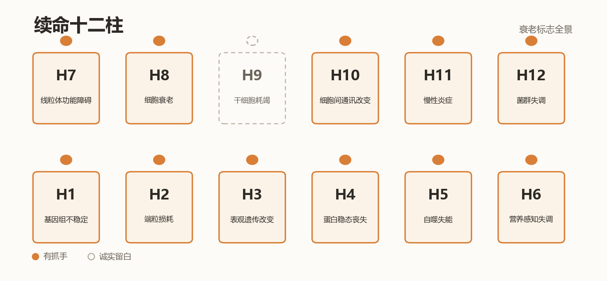

| 柱 | 衰老标志 | 本指南对应 |
|---|---|---|
| H1 | 基因组不稳定 | 排队：情绪与基因组稳定 |
| H2 | 端粒损耗 | 排队：冥想×端粒酶、情绪与基因组稳定 |
| H3 | 表观遗传改变 | 排队：甲基化时钟 |
| H4 | 蛋白稳态丧失 | 排队：八段锦与筋 |
| H5 | 自噬失能 | 排队：亚精胺、GlyNAC |
| H6 | 营养感知失调 | 排队：醋与乙酸 |
| H7 | 线粒体功能障碍 | 已发：006 Zone 2｜排队：阳气线粒体、PQQ、麦角硫因 |
| H8 | 细胞衰老 | 排队：情绪与基因组稳定（慢性压力→p16 衰老细胞） |
| H9 | 干细胞耗竭 | ——暂无生活方式级证据抓手，诚实留白 |
| H10 | 细胞间通讯改变 | 排队：意想与免疫（神经-免疫对话，Nat Hum Behav 2026） |
| H11 | 慢性炎症 | 排队：麦角硫因、NAC、甘麦大枣汤 |
| H12 | 菌群失调 | 排队：醋与乙酸（SCFA 路径） |

> 十二根柱子，十一根有抓手，一根诚实留白——等证据走到那一步，我们再说到那一步。
>
> 📖 延伸阅读：熊博士博客[《抗衰防病五道防线》](https://xiongjianghui.com/zh/blog/five-defense-aging-framework)——五道防线与十二柱，是同一张地图的两种画法。

---

## 🌅 续命的一天 · 正文

<b>腰果 005 · 晨光 10 分钟</b> ｜ 🟢 ｜ 昼夜颠倒

**做法**：起床后 1 小时内，到户外（或窗边）接受自然光 10-30 分钟；阴天也有效，只是需要更久。

**机制**：视网膜内在光敏神经节细胞（ipRGC）对蓝光敏感，晨光抑制褪黑素分泌、锚定视交叉上核（生物钟主钟）——白天更清醒，晚上褪黑素按时升起。室内照明（通常 <500 lux）远弱于户外晨光（数千至十万 lux）。

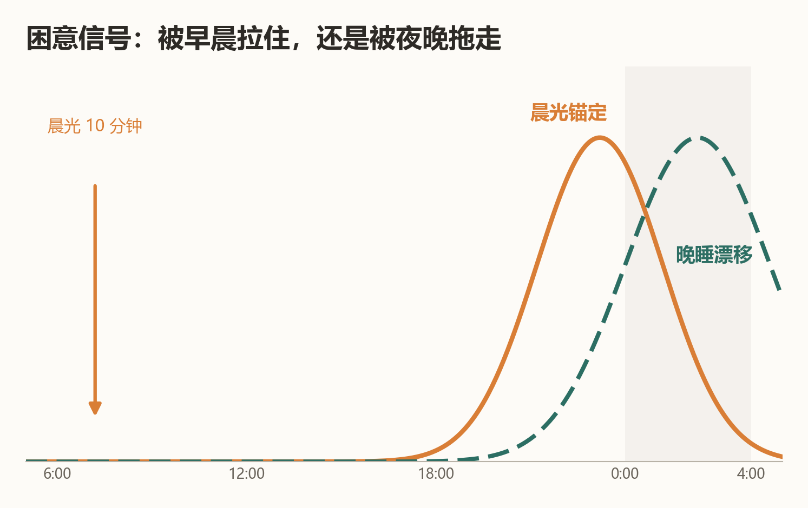

**证据等级**：🟢 人群实证
- 对照研究：户外强光暴露显著提前并巩固昼夜节律；脱离人工光的露营可使褪黑素节律明显回归自然光周期
- 晨光疗法是临床认可的非药物昼夜节律干预（用于延迟睡眠时相障碍）

**程序员场景**：晚睡晚起恶性循环的破局点不是"今晚早睡"，而是"明早晒光"——先锚定早晨，晚上自然早困。

**边界**：bipolar 障碍者光疗需遵医嘱；直视太阳有害，接受环境光即可。

**参考文献**：
1. Wright KP Jr, et al. Entrainment of the human circadian clock to the natural light-dark cycle. *Curr Biol*. 2013;23(16):1554-8. (PMID: 23910656)
2. Zeitzer JM, et al. Sensitivity of the human circadian pacemaker to nocturnal light: melatonin phase resetting response curves. *J Physiol*. 2000;526(Pt 3):695-702. (PMID: 10922269)

> **熊博士按**：反直觉的一条——晚睡晚起的破局点不在晚上，在早晨。想早睡，先早起晒光；顺序搞反了，越努力越失眠。这是"续命的一天"系列的起点。

<b>腰果 002 · 30 分钟起身闹钟</b> ｜ 🟢 ｜ 腰酸、血糖

**做法**：设一个 30 分钟循环的静音闹钟（或用坐垫传感器），响了一次就站起来 2-3 分钟——接杯水、深蹲 5 个、看窗外都行。

**机制**：久坐时骨骼肌的脂蛋白脂肪酶（LPL）活性显著下降，血脂清除变慢（该机制主要来自动物模型）；起身活动可在分钟级恢复肌肉葡萄糖摄取。久坐的伤害是"过程性"的——久坐的总时长与单次持续时长都独立关联健康结局。

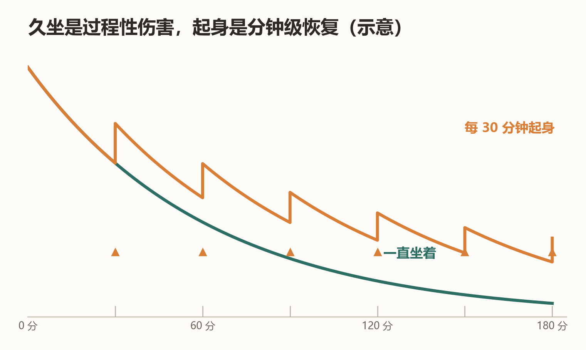

**证据等级**：🟢 人群实证
- 百万人级汇总分析：久坐时间与全因死亡率、心血管疾病正相关，且高体力活动只能部分抵消
- 客观测量研究：打断久坐的频率独立于总久坐时间与代谢指标相关

**程序员场景**：编译/构建/跑测试的间隙是天然起身点——把等待时间变成站立时间。

**边界**：起身动作温和即可，无需剧烈；有体位性低血压者缓慢起身。

**参考文献**：
1. Ekelund U, et al. Does physical activity attenuate, or even eliminate, the detrimental association of sitting time with mortality? *Lancet*. 2016;388(10051):1302-10. (PMID: 27475271)
2. Diaz KM, et al. Patterns of sedentary behavior and mortality in U.S. middle-aged and older adults. *Ann Intern Med*. 2017;167(7):465-475. (PMID: 28892811)

> **熊博士按**：全指南里技术含量最低的一条，也可能是杠杆率最高的一条。我见过太多人买了万元的升降桌，然后把它降到最低、坐着用。

<b>腰果 003 · 20-20-20 用眼法则</b> ｜ 🟡 ｜ 眼干眼疲劳

**做法**：每 20 分钟，看 20 英尺（约 6 米）外的东西 20 秒。

**机制**：持续近距离对焦使睫状肌持续紧张、眨眼频率下降一半以上（TFOS 国际专家组综述：数字环境显著影响眼表）——眼干与视疲劳的主因。远眺让睫状肌放松，主动眨眼恢复泪膜。

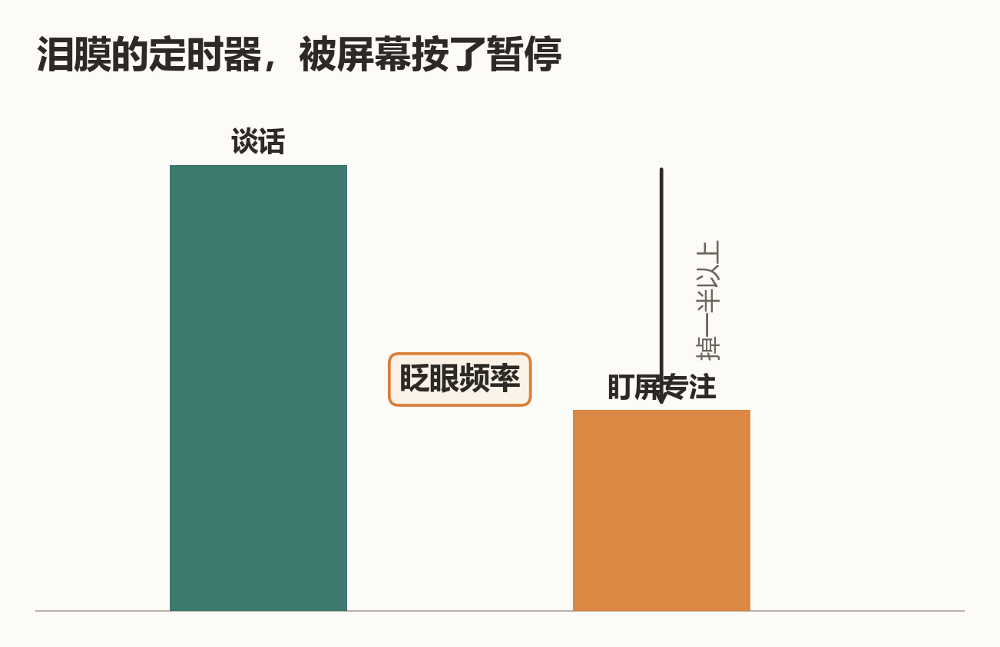

**证据等级**：🟡 广为专业机构推荐（美国眼科学会等），但高质量 RCT 有限｜数字本身（20/20/20）是经验性设定
- 计算机视觉综合征（CVS）与屏幕使用时间的关联证据充分
- "20-20-20"这个具体数字的严格验证有限——机制正确，数字从简

**程序员场景**：与 30 分钟起身闹钟合并执行——起身+远眺+眨眼一套动作。

**边界**：视疲劳持续不缓解、视力骤降、复视——去看眼科，不是屏幕问题那么简单。

**参考文献**：
1. Wolffsohn JS, et al. TFOS Lifestyle: impact of the digital environment on the ocular surface. *Ocul Surf*. 2023;28:213-252. (PMID: 37062428)
2. American Academy of Ophthalmology. Computer vision syndrome / digital eye strain: prevention and treatment. [AAO 官方建议](https://www.aao.org/eye-health/tips-prevention/computer-usage)（机构指南，持续更新）

> **熊博士按**：眨眼是被屏幕劫持的第一个本能——专注时代码看得越入神，眨眼频率掉得越狠，泪膜干了都没感觉。20-20-20 的本质，是给"忘记眨眼"装一个定时器。

<b>腰果 004 · 咖啡因下午 2 点红线</b> ｜ 🟢 ｜ 睡眠差

**做法**：下午 2 点（14:00）后不再摄入咖啡因——咖啡、浓茶、可乐、能量饮料、某些止痛药都算。

**机制**：咖啡因半衰期约 5 小时（个体差异 3-7 小时），下午 2 点的一杯咖啡到晚上 7 点血液里仍剩约一半，慢代谢者（半衰期 7 小时）到深夜仍过半。咖啡因是腺苷受体拮抗剂——它不消除困意，只是屏蔽困意信号，且会破坏后半夜的深睡眠结构（哪怕你"能睡着"）。

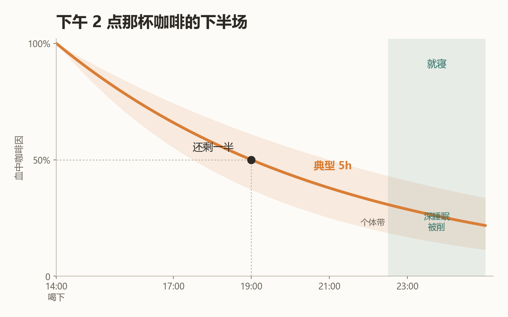

**证据等级**：🟢 人群实证 + 药代动力学
- 随机对照试验：睡前 6 小时的咖啡因仍显著减少客观总睡眠时间——即使本人主观感觉"睡着了也没事"
- 咖啡因对慢波睡眠（深睡眠）结构的削弱与药理学机制有系统综述支持

**程序员场景**：想靠晚咖啡赶 deadline，实际是拿第二天的状态换今晚的清醒——睡眠债是复利。

**边界**：CYP1A2 快代谢型（"咖啡因不敏感"者）也不能豁免对深睡眠结构的影响；孕妇半衰期可延长至 15 小时以上。

**参考文献**：
1. Drake C, et al. Caffeine effects on sleep taken 0, 3, or 6 hours before going to bed. *J Clin Sleep Med*. 2013;9(11):1195-200. (PMID: 24235903)
2. Fredholm BB, et al. Actions of caffeine in the brain with special reference to factors that contribute to its widespread use. *Pharmacol Rev*. 1999;51(1):83-133. (PMID: 10049999)

> **熊博士按**：实验数据在这件事上最不给面子——睡前 6 小时的咖啡照样削减深睡眠，而当事人感觉"我代谢快，没事"。主观感觉不可信，是我把它划成"红线"而不是"建议"的唯一原因。

<b>腰果 011 · 熬夜与维生素 C（止损垫，不是免死金牌）</b> ｜ 🟡 ｜ 熬夜止损

**做法**：熬夜当晚或次日，通过蔬果（橙子、猕猴桃、彩椒）或常规剂量补充剂（100-200mg）补足维生素 C。**不推荐大剂量"对冲式"服用**——见边界。

**机制**：急性睡眠剥夺使皮质醇升高、氧化应激（脂质过氧化）上升。VC 是水相主要抗氧化剂，动物实验显示补 VC 可显著抑制睡眠剥夺引起的血浆皮质醇与脂质过氧化物升高，并减轻记忆损伤。但要分清主次：VC 缓冲的只是氧化应激这一角"附带损伤"——睡眠剥夺的认知损害主体、免疫功能下降、代谢紊乱，VC 一概管不了。**睡眠债没有化学解药。**

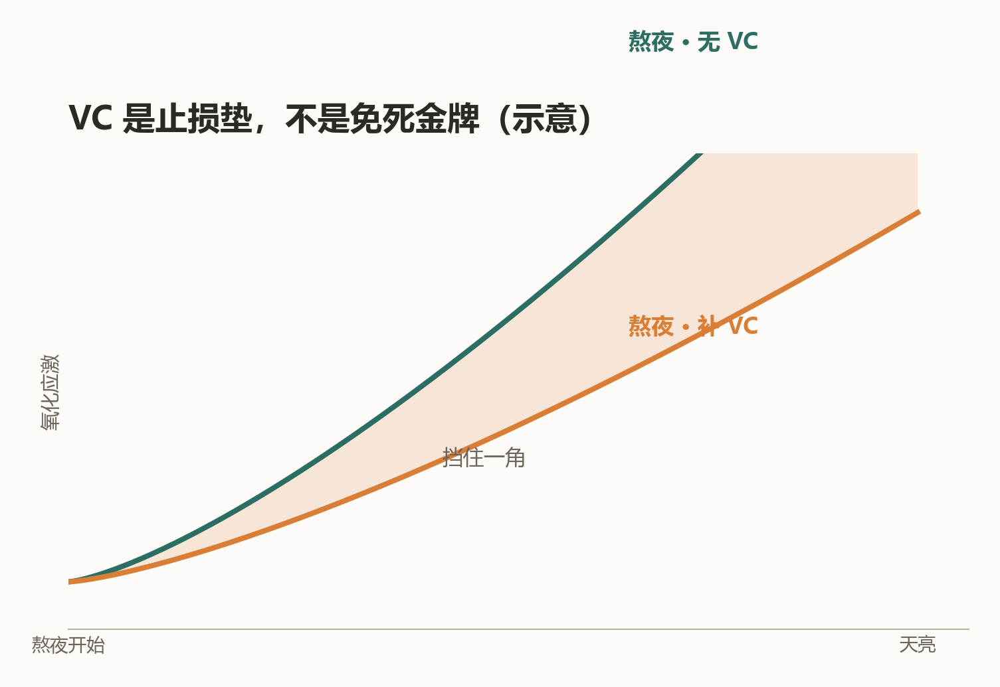

**证据等级**：🟡 机制明确 + 动物实验｜人体直接证据有限
- 大鼠实验：VC 阻止睡眠剥夺诱导的皮质醇与脂质过氧化升高
- 动物行为实验：VC 预处理减轻睡眠剥夺所致记忆损伤
- 人体证据以综述与间接关联为主，缺乏针对"熬夜人群补 VC"的高质量 RCT——如实标注

**程序员场景**：上线夜/发版夜的"止损三件套"之一——VC（抗氧化）+ 当晚提前入睡（见 007 偿还表）+ 次日晨光重锚节律（见 005）。三件套可以少受罪，但不能不还债。

**边界**：单日 >1g 可致胃肠不适，长期大剂量与肾结石风险相关；VC 不是熬夜许可证。夜班刚需者，重点做节律管理（005/010），补剂只是配角。

**参考文献**：
1. Olayaki LA, et al. Vitamin C prevents sleep deprivation-induced elevation in cortisol and lipid peroxidation in the rat plasma. *Niger J Physiol Sci*. 2015;30(1-2):5-9. (PMID: 27507778)
2. Mhaidat NM, et al. Exploring the effect of vitamin C on sleep deprivation induced memory impairment. *Brain Res Bull*. 2015;113:41-7. (PMID: 25724146)
3. Otocka-Kmiecik A, et al. The role of vitamin C in two distinct physiological states: physical activity and sleep. *Nutrients*. 2020;12(12). (PMID: 33371359)

> **熊博士按**：本指南第一个"救火"条目。写它不是为了给熬夜发许可证——VC 能缓冲的只有氧化应激这一角，认知欠账和睡眠债一分都免不了。止损垫不是免死金牌，这是它排在"续命的一天"最后一位的原因：前面四条做到了，才轮得到它出场。

## 🛏️ 睡眠与恢复 · 正文

<b>腰果 007 · 睡眠债偿还表</b> ｜ 🟢 ｜ 熬夜后遗症

**做法**：熬夜后按此偿还：当晚提前 30-60 分钟入睡（不是狂睡到中午）+ 次日 20 分钟以内午睡 + 连续 3 晚正常作息。**不要**周末报复性睡 12 小时。

**机制**：睡眠剥夺的损害是累积且非线性的：连续两周每晚 6 小时，认知缺损最高相当于连续通宵两晚（Van Dongen 2003：equivalent to up to 2 nights of total sleep deprivation）——而本人完全意识不到（主观困倦感平台化，客观能力持续下滑）。补觉能部分偿还，但时间错位的超长补觉会打乱节律，得不偿失。

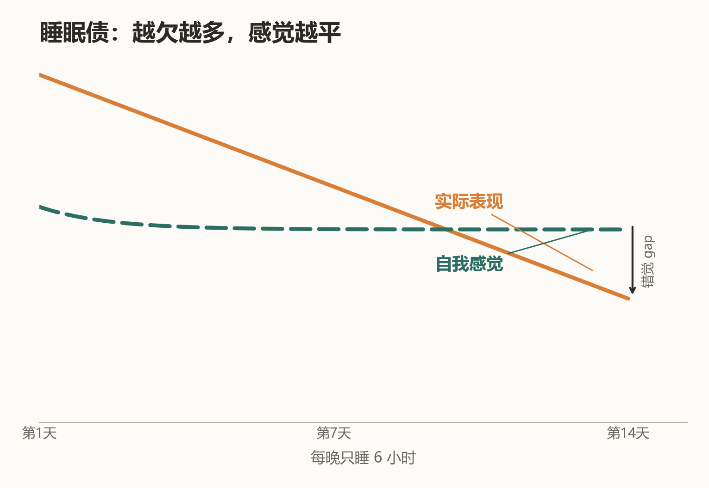（曲线为趋势示意，数据方向：Van Dongen 2003）

**证据等级**：🟢 人群实证
- 美军/宾大睡眠债剂量研究：连续限制睡眠的进行性认知损伤
- 偿还策略（提前入睡+短午睡）来自睡眠医学界的临床共识与节律研究

**程序员场景**：上线夜之后最错误的选择是"周末睡到下午"——那是在睡眠债上再加一笔节律债。

**边界**：慢性失眠（躺下 30 分钟睡不着、每周 3 晚以上、持续 3 个月）是病，去睡眠门诊，不是自律问题。

**参考文献**：
1. Van Dongen HP, et al. The cumulative cost of additional wakefulness. *Sleep*. 2003;26(2):117-26. (PMID: 12683469)
2. Belenky G, et al. Patterns of performance degradation and restoration during sleep restriction and subsequent recovery: a sleep dose-response study. *J Sleep Res*. 2003;12(1):1-12. (PMID: 12603781)

> **熊博士按**：睡眠研究里最阴的发现——睡眠债越欠越多，你的困倦感却会"平台化"，让人真心觉得"我还行"。主观感觉在这件事上是失真的仪表盘，数据不会陪你演。

<b>腰果 010 · 睡前 1 小时屏幕宵禁</b> ｜ 🟢 ｜ 入睡困难

**做法**：睡前 1 小时停用手机/平板（至少切夜间模式+调暗）；用纸质书、播客、拉伸替代。

**机制**：屏幕光（尤其蓝光波段）抑制褪黑素分泌、延迟节律；且屏幕内容（信息流、消息、短视频）带来认知唤醒，双重延迟入睡。

**证据等级**：🟢 人群实证 + 对照实验
- RCT：睡前用发光阅读器 vs 纸质书，前者褪黑素抑制、入睡延迟约 10 分钟、次日困倦感上升——效应存在但量级温和
- 大样本研究（青少年人群，n≈万级）：就寝前屏幕使用与睡眠时长缩短、入睡困难相关——成人的对应证据以对照实验（第 1 篇）为主

**程序员场景**："躺床上刷会儿手机"是晚睡循环的最后一块拼图——宵禁一小时，是性价比最高的睡眠干预。

**边界**：夜班/跨时区工作者需个性化节律策略；重度失眠者屏幕不是唯一原因。

**参考文献**：
1. Chang AM, et al. Evening use of light-emitting eReaders negatively affects sleep, circadian timing, and next-morning alertness. *PNAS*. 2015;112(4):1232-7. (PMID: 25535358)
2. Hysing M, et al. Sleep and use of electronic devices in adolescence: results from a large population-based study. *BMJ Open*. 2015;5:e006748. (PMID: 25643702)

> **熊博士按**：十分钟入睡延迟听起来不痛不痒——直到你意识到它每晚都在，而且"内容唤醒"的账还没算进去。宵禁一小时，买回的是整个入睡窗口。

## 🧰 身体维护 · 正文

<b>腰果 006 · Zone 2 快走</b> ｜ 🟢 ｜ 体能下降

**做法**：每周 3-5 次、每次 30-45 分钟的"还能完整说话但唱不了歌"强度的快走/慢跑/骑车（约最大心率 60-70%）。

**机制**：Zone 2 强度主要靠线粒体氧化代谢供能——是提高线粒体密度和效率的有效刺激区间。线粒体功能衰退是衰老的核心标志之一（hallmarks of aging）；耐力运动的线粒体适应性自 1967 年 Holloszy 的经典工作起被反复验证。

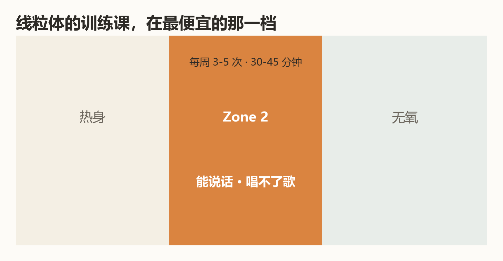

**证据等级**：🟢 人群实证（运动量-死亡率量效关系为流行病学最稳健的发现之一）

**程序员场景**：通勤最后一公里快走、代码评审前绕楼一圈——Zone 2 不需要换衣服不需要健身房，门槛最低。

**边界**：有心血管疾病史者先咨询医生；心率用"说话测试"即可，不必买设备。

**参考文献**：
1. Holloszy JO. Biochemical adaptations in muscle. Effects of exercise on mitochondrial oxygen uptake and respiratory enzyme activity in skeletal muscle. *J Biol Chem*. 1967;242(9):2278-82. (PMID: 4290225)
2. Arem H, et al. Leisure time physical activity and mortality. *JAMA Intern Med*. 2015;175(6):959-67. (PMID: 25844730)

> **熊博士按**：长寿研究绕不开线粒体，Zone 2 是给线粒体上课最便宜的方式——不用办卡、不用装备，"还能说话但唱不了歌"这一句就够了。

<b>腰果 008 · 工位人体工学三件套</b> ｜ 🟢 ｜ 腕/腰/颈

**做法**：
1. **屏幕上缘与视线平齐**、距离一臂（50-70cm）——头前倾 15° 时颈椎负荷约为直立姿态的 2-3 倍（力学模型估算）
2. **肘角 90°-100°**、腕部中立位（键盘垫腕或降低键盘后缘）——正中神经减压
3. **腰椎支撑**：腰后垫枕或用椅背腰托，坐深把臀部坐到椅子最里

**机制**：腰椎间盘压力随坐姿恶化阶梯上升：端坐时已比站立高约四成，身体前倾时进一步接近站立的两倍（Nachemson 经典测量；后续在体复测证实坐姿升压方向一致、量级略低——如实说明）；腕部背伸增加腕管内压力——正中神经受压是腕管综合征的直接机制。

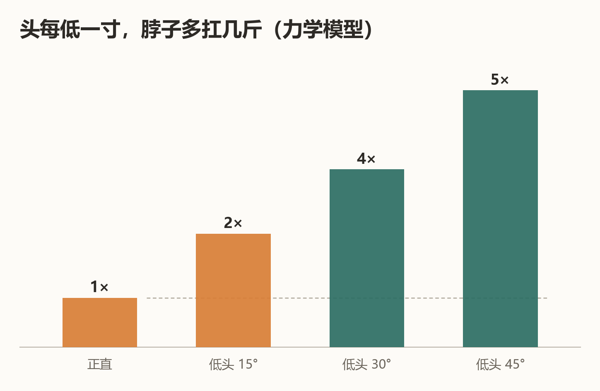

**证据等级**：🟢 生物力学实证｜对"预防腕管综合征"的效果证据中等（工效学干预的 RCT 结论混合——如实说明）

**程序员场景**：笔记本的"屏幕低+键盘高"先天违背人体工学——外接键盘抬屏幕是性价比最高的工位改造。

**边界**：已出现持续手麻（尤其夜间麻醒）、握力下降——就医做神经电生理检查，工位改造救不了已损伤的神经。

**参考文献**：
1. Nachemson AL. Disc pressure measurements. *Spine*. 1981;6(1):93-7. (PMID: 7209680)
2. Hansraj KK. Assessment of stresses in the cervical spine caused by posture and position of the head. *Surg Technol Int*. 2014;25:277-9. (PMID: 25393825)

> **熊博士按**：笔记本是按"偶尔移动使用"设计的，每天八小时用它办公，它就是刑具。外接键盘加支架，一百块钱同时解决颈和腕两个问题——这是我推荐过的性价比最高的改造，没有之一。

<b>腰果 001 · 下颌淋巴轻按摩（Brain Drain）</b> ｜ 🟡 ｜ 大脑昏沉

**做法**：每天 1-2 分钟，用指腹沿下颌骨下缘轻柔按压滑动（从下巴中央到耳垂下），力度以"舒服"为准，不追求痛感。

**机制**：大脑代谢废物（如β-淀粉样蛋白）经类淋巴系统（glymphatic system）清除，经硬脑膜淋巴管引流至颈部淋巴结链（以颈深淋巴结为主）。下颌下淋巴结是头颈部浅表引流网络的一部分；面部与下颌区的轻柔按摩可促进局部淋巴回流——**对大脑废物清除的影响属于间接推演**，直接证据尚在积累，如实标注。

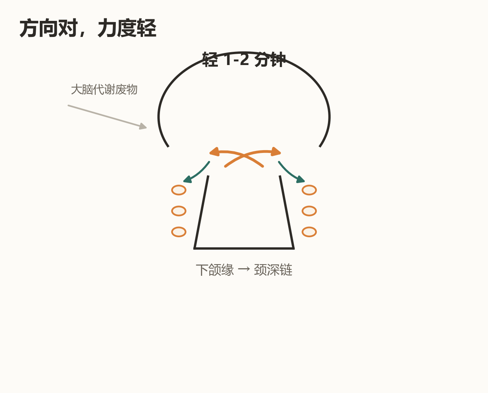

**证据等级**：🟡 机制明确 + 部分动物证据｜"按摩下颌直接加速大脑排毒"是合理推测而非已证结论
- 脑膜淋巴管的存在与功能：2015 年 Nature 两篇里程碑论文确认（此前教科书认为脑没有淋巴管）

**程序员场景**：debug 卡壳时做一轮，替代刷手机；顺带活动眼睛和颈部。

**边界**：颈部有肿块、甲状腺疾病、急性感染发烧者不做；不要用力按压血管搏动处。

**参考文献**：
1. Louveau A, et al. Structural and functional features of central nervous system lymphatic vessels. *Nature*. 2015;523(7560):337-41. (PMID: 26030524)
2. Aspelund A, et al. A dural lymphatic vascular system that drains brain interstitial fluid and macromolecules. *J Exp Med*. 2015;212(7):991-9. (PMID: 26077718)
3. Da Mesquita S, et al. Functional aspects of meningeal lymphatics in ageing and Alzheimer's disease. *Nature*. 2018;560(7717):185-91. (PMID: 30046111)

> **熊博士按**：这条是我标得最犹豫的一条——机制在动物身上是真的，"按摩下颌就能给大脑排毒"目前只能算合理推测。它留在这里有个理由：2015 年之前，教科书还写着"大脑没有淋巴管"。科学会推翻教科书，也包括我这份指南。

<b>腰果 009 · 番茄钟的生理学</b> ｜ 🟡 ｜ 注意力涣散

**做法**：25 分钟专注 + 5 分钟休息为一个周期；这是工程化的近似——不必迷信数字，核心是**有节律的专注-恢复循环**。

**机制**：注意力与觉醒度存在约 90 分钟的超日节律（BRAC，基础休息-活动周期）假说；持续专注伴随前额叶资源消耗，周期性休息可恢复。但"25 分钟"这个数字本身来自 Francesco Cirillo 1980 年代的个人方法，不是生理学推导。

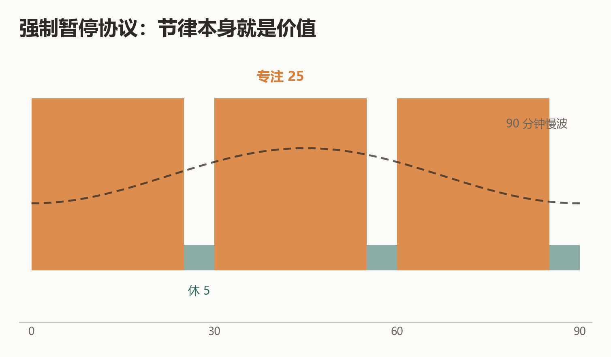

**证据等级**：🟡 专注-恢复循环有生理学支持｜"25 分钟最优"无直接验证——🔴 数字是工程约定
- 微休息（micro-break）研究支持短暂休息对持续注意力有益
- 超日节律在睡眠周期中证据充分，清醒期 90 分钟周期证据较弱

**程序员场景**：把番茄钟当"强制暂停协议"用——25 分钟到点必须抬头眨眼（联动 003）起身（联动 002），价值在节律本身。

**边界**：心流状态被打断有切换成本——深度编码时可放宽到 50+10，不必教条。

**参考文献**：
1. Cirillo F. The Pomodoro Technique.（方法源头，非科学文献）
2. Ariga A, Lleras A. Brief and rare mental "breaks" keep you focused: deactivation and reactivation of task goals forestall vigilance decrement. *Cognition*. 2011;118(3):439-43. (PMID: 21211793)

> **熊博士按**：我喜欢这一条的诚实——"25 分钟"是一个意大利大学生的个人约定，不是生理学。方法可以工程化，但把工程约定当自然规律，是我们要在整本指南里反复拆穿的事。

---

## 续命工具箱

- **30 秒症状自测**：[DeepKang 症状探索器](https://a.deepkang.com/explore)——免费、匿名、无需注册。输入一个症状（如"眼干""腰酸""睡不好"），30 秒看它的共现网络与常见原因方向，生成可以带给医生看的梳理小结。DeepoMe 出品。

> 看完指南想知道"我现在的状态算哪一档"？从探索器开始，比从搜索引擎开始靠谱。

## 贡献指南

欢迎 PR 投稿新条目，格式要求：
1. 按模板：做法 / 机制 / 证据等级 / 参考文献（真实 PMID 或 DOI）/ 边界
2. **文献必须可查证**——伪造引用将被直接关闭
3. 证据等级从严标注：说不清就标低
4. 欢迎对现有条目提出等级异议——证据更新时我们会修订
5. **行文建议**：从表观感受与个人经验入手，再逐步引入机制与文献——控制阅读负担，别让读者第一屏就撞上术语墙
6. **延伸阅读**：参考资料可酌情引用[深度甲基公众号](https://mp.weixin.qq.com/s/yG0bg0ht0oOEBFSQOtPGWA)科普文章与[熊博士博客](https://xiongjianghui.com)长文（仅作为延伸阅读，不替代一手文献；须为已发布文章的真实链接）
7. **配图**：欢迎一图一机制——每张图讲清一个可验证的科学点；**图内文字尽量少**（关键词级，不放成句解释、不放参考文献），出处写在正文参考文献里；优先脚本可复现的图表而非装饰插画

## 关于熊博士

<b>展开：熊博士是谁</b>（姓名 · 机构 · 论文——按需查看）

**熊博士**（熊江辉），[DeepoMe 深度甲基](https://deepome.com)创始人，长寿医学智能方向研究者。做这个指南只有一个规矩：**证据走到哪一步，就说到哪一步**——这条规矩同样约束我们自己。

- ✍️ [熊博士博客 · xiongjianghui.com](https://xiongjianghui.com)——个人官网，方法论与行业观察长文
- 🌐 [DeepoMe 深度甲基](https://deepome.com)——把长寿科学工程化为可交付体系
- 🧬 [DeepKang 健康平台](https://deepkang.com) / [症状探索器](https://a.deepkang.com/explore)
- 💻 [GitHub · DeepoMe](https://github.com/DeepoMe)——论文配套代码与数据工具
- 📄 代表论文：RootMap（[DOI: 10.32388/A1NTLL](https://doi.org/10.32388/A1NTLL)）
- 📢 公众号科普：[衰老检测不该只是一个值——从行动仪表盘到个人长寿操作系统](https://mp.weixin.qq.com/s/yG0bg0ht0oOEBFSQOtPGWA)（更多文章陆续收录）

## 声明

本指南是健康教育内容，不构成医疗建议；有疾病请就医。维护方 [DeepoMe 深度甲基](https://deepome.com)——与长寿医学实践者同行，把科学工程化为实践者可用的智能（[DeepKang](https://deepkang.com)）。

## License

CC BY-NC-SA 4.0（署名-非商业-相同方式共享）
