# 程序员续命与长寿指南 · Awesome Programmer Longevity

> **[English Edition](README_EN.md)** ｜ 简体中文版（完整 33 条）

> **从续命到长寿：每一条建议，都有证据分级和真实文献。**
> From Survival to Longevity: every tip comes with an evidence grade and real references.

写代码的人自称"咖啡续命""周末补觉续命"——本指南把这句自嘲当真：**命是可以科学地续的**。这里收集程序员最需要的生活方式证据：久坐、用眼、睡眠、作息、运动、饮食——每一条都标注证据等级、列出可查证的参考文献。

我们不神化任何方法，也不否定传统经验——**证据走到哪一步，我们就说到哪一步。**

## 前言 · 为什么写这份指南

**写这份指南，是因为一个认知差。**

过去几十年，睡眠医学、营养流行病学、神经科学攒下了大量"怎么活得更久更好"的证据——它们躺在 PubMed 里，躺在论文标题里，等着被翻译。而大多数人的健康知识，还停在转发的养生帖和口头叮嘱之间。

**科研进展不必等医生都了解之后再告诉你——你可以直接理解它。** PubMed 是公开的，文献是可查的。这份指南里的每一条都附了 PMID：不信我，可以自己查。

我也不想让领域之间的墙继续立着。睡眠医学的结论、营养学的队列、细胞生物学的机制、中医药的现代研究——这本该是一张拼图，不是几个互不理睬的学科。这份指南做的事，就是把不同领域拉齐到同一张桌面上，按同一套证据分级说话。

最后，**日常经验和中医传统不该被无视——其中有一部分是真的。** 按摩下颌、八段锦、甘麦大枣汤，它们要么已拿到部分科学证据，要么正在被验证。我们不神化，也不否定。

命是可以科学地续的。翻开吧。

——熊博士

**维护人**：熊博士 · 每周三更新（他是谁——见文末[关于熊博士](#关于熊博士)）

## 证据分级说明

| 标记 | 含义 | 支撑证据类型 |
|---|---|---|
| 🟢 | 人群实证 | 大型队列研究 / 随机对照试验（RCT）支持 |
| 🟡 | 机制+动物 | 生物学机制明确，动物或小样本人体证据 |
| 🔴 | 经验待证 | 传统经验或流行说法，尚无直接科学证据 |

> 每条目的"参考文献"均为 PubMed 可查的真实文献（PMID/DOI）。证据等级标错比不标更糟——若您发现等级或引用有误，欢迎提 Issue 或 PR。

## 连载说明

- **首发五篇《续命的一天》**：按一天的时间动线走——早起晒光、白天起身、护住眼睛、下午断咖啡因、深夜止损。五条全部 🟢/🟡，是"投入产出比"最高的一组。
- **每周三更新**（"续命星期三"）：从下方选题池取题，写完即入目录。
- **科学骨架**：选题按 2023 年 *Cell* 十二大衰老标志组织（见[续命十二柱](#-续命十二柱衰老标志全景)）——每条建议都挂得到一根柱子上。
- **公开征题**：想看哪条？开 Issue 点菜。补剂、传统经验、都市传说都收——但等级从严标注。

## 目录

**👇 点击条目卡片标题，展开全文（做法/机制/证据/文献/边界/熊博士按）**

### 🌅 续命的一天（首发五篇，按时间线）

| # | 条目 | 痛点 | 等级 |
|---|---|---|---|
| 005 | 晨光 10 分钟 | 昼夜颠倒 | 🟢 |
| 002 | 30 分钟起身闹钟 | 腰酸、血糖 | 🟢 |
| 003 | 20-20-20 用眼法则 | 眼干眼疲劳 | 🟡 |
| 004 | 咖啡因下午 2 点红线 | 睡眠差 | 🟢 |
| 011 | 熬夜与维生素 C | 熬夜止损 | 🟡 |

### 🛏️ 睡眠与恢复

| # | 条目 | 痛点 | 等级 |
|---|---|---|---|
| 007 | 睡眠债偿还表 | 熬夜后遗症 | 🟢 |
| 010 | 睡前 1 小时屏幕宵禁 | 入睡困难 | 🟢 |

### 🧰 身体维护

| # | 条目 | 痛点 | 等级 |
|---|---|---|---|
| 006 | Zone 2 快走 | 体能下降 | 🟢 |
| 008 | 工位人体工学三件套 | 腕/腰/颈 | 🟢 |
| 001 | 下颌淋巴轻按摩 | 大脑昏沉 | 🟡 |
| 009 | 番茄钟的生理学 | 注意力涣散 | 🟡 |

### 🧘 心与情绪

| # | 条目 | 痛点 | 等级 |
|---|---|---|---|
| 012 | 冥想十分钟 | 压力、焦虑 | 🟢 |
| 013 | 意想与免疫 | 身心交互 | 🟡 |
| 014 | 甘麦大枣汤与小麦胚芽 | 情绪不稳 | 🟡 |

### 🧠 脑力工程

| # | 条目 | 痛点 | 等级 |
|---|---|---|---|
| 015 | 写代码与心流 | 中断、切换成本 | 🟡 |
| 016 | 脑内内存管理 | 认知超载 | 🟡 |

### 📈 进阶长寿

| # | 条目 | 痛点/主题 | 等级 |
|---|---|---|---|
| 017 | 情绪与基因组稳定 | 慢性压力的分子账单 | 🟢 |
| 018 | 记忆与基因组的断裂重连 | 学新东西时大脑在干嘛 | 🟡 |
| 019 | 40Hz 声光节拍 | 健脑外推 | 🟡 |
| 020 | 麦角硫因与蘑菇 | 长寿维生素 | 🟡 |
| 021 | Omega-3 与干眼 | 护眼补剂 | 🟡 |
| 022 | 坚果一把 | 每日零食 | 🟢 |
| 023 | APOE4 与长链脂肪酸 | 基因×营养 | 🟡 |
| 024 | 亚精胺与小麦胚芽 | 自噬激活 | 🟡 |
| 025 | PQQ | 线粒体新生 | 🟡 |
| 026 | GlyNAC | 老年补剂组合 | 🟡 |
| 027 | 甲基化时钟 | 生物年龄 | 🟢 |

### 🌿 传统×科学

| # | 条目 | 主题 | 等级 |
|---|---|---|---|
| 028 | 醋与乙酸 | 餐后血糖×菌群 | 🟢 |
| 029 | 八段锦与筋 | 拉伸×蛋白稳态 | 🟢🟡🔴 |
| 030 | NAC 与化痰 | 药典老药 | 🟢 |
| 031 | 颂钵 | 声音松弛 | 🟡偏🔴 |
| 032 | 面相与生物年龄 | 表型时钟 | 🟡 |
| 033 | 阳气与线粒体 | 概念映射 | 🔴🟡 |

> **选题池已全部转正**（原 22 条预告 → 正文 012-033）。新选题走 [Issue 征题](https://github.com/DeepoMe/awesome-programmer-longevity/issues)，每周三评审入池。

### 🏛️ 续命十二柱（衰老标志全景）

本指南的科学骨架：2023 年 *Cell*《Hallmarks of Aging》提出的十二大衰老标志——每条续命方法，最终都挂得到某一根柱子上。

> López-Otín C, Blasco MA, Partridge L, et al. Hallmarks of aging: An expanding universe. *Cell*. 2023;186(2):243-278. (PMID: 36599349)

| 柱 | 衰老标志 | 本指南对应 |
|---|---|---|
| H1 | 基因组不稳定 | 017 情绪与基因组稳定、023 APOE4、018 记忆断裂重连 |
| H2 | 端粒损耗 | 012 冥想（端粒酶）、017 |
| H3 | 表观遗传改变 | 027 甲基化时钟、012 冥想（表观调节信号） |
| H4 | 蛋白稳态丧失 | 029 八段锦与筋 |
| H5 | 自噬失能 | 024 亚精胺、026 GlyNAC、014 小麦胚芽 |
| H6 | 营养感知失调 | 022 坚果、028 醋与乙酸 |
| H7 | 线粒体功能障碍 | 已发 006 Zone 2｜025 PQQ、020 麦角硫因、033 阳气线粒体 |
| H8 | 细胞衰老 | 017（慢性压力→p16 衰老细胞） |
| H9 | 干细胞耗竭 | ——暂无生活方式级证据抓手，诚实留白 |
| H10 | 细胞间通讯改变 | 013 意想与免疫（神经-免疫对话） |
| H11 | 慢性炎症 | 020 麦角硫因、030 NAC、014 甘麦大枣汤、012 冥想（炎症基因） |
| H12 | 菌群失调 | 028 醋与乙酸（SCFA 路径） |

> 十二根柱子，十一根有抓手，一根诚实留白——等证据走到那一步，我们再说到那一步。
>
> 📖 延伸阅读：熊博士博客[《抗衰防病五道防线》](https://xiongjianghui.com/zh/blog/five-defense-aging-framework)——五道防线与十二柱，是同一张地图的两种画法。

---

## 🌅 续命的一天 · 正文

<b>腰果 005 · 晨光 10 分钟</b> ｜ 🟢 ｜ 昼夜颠倒

**做法**：起床后 1 小时内，到户外（或窗边）接受自然光 10-30 分钟；阴天也有效，只是需要更久。

**机制**：视网膜内在光敏神经节细胞（ipRGC）对蓝光敏感，晨光抑制褪黑素分泌、锚定视交叉上核（生物钟主钟）——白天更清醒，晚上褪黑素按时升起。室内照明（通常 <500 lux）远弱于户外晨光（数千至十万 lux）。

**证据等级**：🟢 人群实证
- 对照研究：户外强光暴露显著提前并巩固昼夜节律；脱离人工光的露营可使褪黑素节律明显回归自然光周期
- 晨光疗法是临床认可的非药物昼夜节律干预（用于延迟睡眠时相障碍）

**程序员场景**：晚睡晚起恶性循环的破局点不是"今晚早睡"，而是"明早晒光"——先锚定早晨，晚上自然早困。

**边界**：bipolar 障碍者光疗需遵医嘱；直视太阳有害，接受环境光即可。

**参考文献**：
1. Wright KP Jr, et al. Entrainment of the human circadian clock to the natural light-dark cycle. *Curr Biol*. 2013;23(16):1554-8. (PMID: 23910656)
2. Zeitzer JM, et al. Sensitivity of the human circadian pacemaker to nocturnal light: melatonin phase resetting response curves. *J Physiol*. 2000;526(Pt 3):695-702. (PMID: 10922269)

> **熊博士按**：反直觉的一条——晚睡晚起的破局点不在晚上，在早晨。想早睡，先早起晒光；顺序搞反了，越努力越失眠。这是"续命的一天"系列的起点。

<b>腰果 002 · 30 分钟起身闹钟</b> ｜ 🟢 ｜ 腰酸、血糖

**做法**：设一个 30 分钟循环的静音闹钟（或用坐垫传感器），响了一次就站起来 2-3 分钟——接杯水、深蹲 5 个、看窗外都行。

**机制**：久坐时骨骼肌的脂蛋白脂肪酶（LPL）活性显著下降，血脂清除变慢（该机制主要来自动物模型）；起身活动可在分钟级恢复肌肉葡萄糖摄取。久坐的伤害是"过程性"的——久坐的总时长与单次持续时长都独立关联健康结局。

**证据等级**：🟢 人群实证
- 百万人级汇总分析：久坐时间与全因死亡率、心血管疾病正相关，且高体力活动只能部分抵消
- 客观测量研究：打断久坐的频率独立于总久坐时间与代谢指标相关

**程序员场景**：编译/构建/跑测试的间隙是天然起身点——把等待时间变成站立时间。

**边界**：起身动作温和即可，无需剧烈；有体位性低血压者缓慢起身。

**参考文献**：
1. Ekelund U, et al. Does physical activity attenuate, or even eliminate, the detrimental association of sitting time with mortality? *Lancet*. 2016;388(10051):1302-10. (PMID: 27475271)
2. Diaz KM, et al. Patterns of sedentary behavior and mortality in U.S. middle-aged and older adults. *Ann Intern Med*. 2017;167(7):465-475. (PMID: 28892811)

> **熊博士按**：全指南里技术含量最低的一条，也可能是杠杆率最高的一条。我见过太多人买了万元的升降桌，然后把它降到最低、坐着用。

<b>腰果 003 · 20-20-20 用眼法则</b> ｜ 🟡 ｜ 眼干眼疲劳

**做法**：每 20 分钟，看 20 英尺（约 6 米）外的东西 20 秒。

**机制**：持续近距离对焦使睫状肌持续紧张、眨眼频率下降一半以上（TFOS 国际专家组综述：数字环境显著影响眼表）——眼干与视疲劳的主因。远眺让睫状肌放松，主动眨眼恢复泪膜。

**证据等级**：🟡 广为专业机构推荐（美国眼科学会等），但高质量 RCT 有限｜数字本身（20/20/20）是经验性设定
- 计算机视觉综合征（CVS）与屏幕使用时间的关联证据充分
- "20-20-20"这个具体数字的严格验证有限——机制正确，数字从简

**程序员场景**：与 30 分钟起身闹钟合并执行——起身+远眺+眨眼一套动作。

**边界**：视疲劳持续不缓解、视力骤降、复视——去看眼科，不是屏幕问题那么简单。

**参考文献**：
1. Wolffsohn JS, et al. TFOS Lifestyle: impact of the digital environment on the ocular surface. *Ocul Surf*. 2023;28:213-252. (PMID: 37062428)
2. American Academy of Ophthalmology. Computer vision syndrome / digital eye strain: prevention and treatment. [AAO 官方建议](https://www.aao.org/eye-health/tips-prevention/computer-usage)（机构指南，持续更新）

> **熊博士按**：眨眼是被屏幕劫持的第一个本能——专注时代码看得越入神，眨眼频率掉得越狠，泪膜干了都没感觉。20-20-20 的本质，是给"忘记眨眼"装一个定时器。

<b>腰果 004 · 咖啡因下午 2 点红线</b> ｜ 🟢 ｜ 睡眠差

**做法**：下午 2 点（14:00）后不再摄入咖啡因——咖啡、浓茶、可乐、能量饮料、某些止痛药都算。

**机制**：咖啡因半衰期约 5 小时（个体差异 3-7 小时），下午 2 点的一杯咖啡到晚上 7 点血液里仍剩约一半，慢代谢者（半衰期 7 小时）到深夜仍过半。咖啡因是腺苷受体拮抗剂——它不消除困意，只是屏蔽困意信号，且会破坏后半夜的深睡眠结构（哪怕你"能睡着"）。

**证据等级**：🟢 人群实证 + 药代动力学
- 随机对照试验：睡前 6 小时的咖啡因仍显著减少客观总睡眠时间——即使本人主观感觉"睡着了也没事"
- 咖啡因对慢波睡眠（深睡眠）结构的削弱与药理学机制有系统综述支持

**程序员场景**：想靠晚咖啡赶 deadline，实际是拿第二天的状态换今晚的清醒——睡眠债是复利。

**边界**：CYP1A2 快代谢型（"咖啡因不敏感"者）也不能豁免对深睡眠结构的影响；孕妇半衰期可延长至 15 小时以上。

**参考文献**：
1. Drake C, et al. Caffeine effects on sleep taken 0, 3, or 6 hours before going to bed. *J Clin Sleep Med*. 2013;9(11):1195-200. (PMID: 24235903)
2. Fredholm BB, et al. Actions of caffeine in the brain with special reference to factors that contribute to its widespread use. *Pharmacol Rev*. 1999;51(1):83-133. (PMID: 10049999)

> **熊博士按**：实验数据在这件事上最不给面子——睡前 6 小时的咖啡照样削减深睡眠，而当事人感觉"我代谢快，没事"。主观感觉不可信，是我把它划成"红线"而不是"建议"的唯一原因。

<b>腰果 011 · 熬夜与维生素 C（止损垫，不是免死金牌）</b> ｜ 🟡 ｜ 熬夜止损

**做法**：熬夜当晚或次日，通过蔬果（橙子、猕猴桃、彩椒）或常规剂量补充剂（100-200mg）补足维生素 C。**不推荐大剂量"对冲式"服用**——见边界。

**机制**：急性睡眠剥夺使皮质醇升高、氧化应激（脂质过氧化）上升。VC 是水相主要抗氧化剂，动物实验显示补 VC 可显著抑制睡眠剥夺引起的血浆皮质醇与脂质过氧化物升高，并减轻记忆损伤。但要分清主次：VC 缓冲的只是氧化应激这一角"附带损伤"——睡眠剥夺的认知损害主体、免疫功能下降、代谢紊乱，VC 一概管不了。**睡眠债没有化学解药。**

**证据等级**：🟡 机制明确 + 动物实验｜人体直接证据有限
- 大鼠实验：VC 阻止睡眠剥夺诱导的皮质醇与脂质过氧化升高
- 动物行为实验：VC 预处理减轻睡眠剥夺所致记忆损伤
- 人体证据以综述与间接关联为主，缺乏针对"熬夜人群补 VC"的高质量 RCT——如实标注

**程序员场景**：上线夜/发版夜的"止损三件套"之一——VC（抗氧化）+ 当晚提前入睡（见 007 偿还表）+ 次日晨光重锚节律（见 005）。三件套可以少受罪，但不能不还债。

**边界**：单日 >1g 可致胃肠不适，长期大剂量与肾结石风险相关；VC 不是熬夜许可证。夜班刚需者，重点做节律管理（005/010），补剂只是配角。

**参考文献**：
1. Olayaki LA, et al. Vitamin C prevents sleep deprivation-induced elevation in cortisol and lipid peroxidation in the rat plasma. *Niger J Physiol Sci*. 2015;30(1-2):5-9. (PMID: 27507778)
2. Mhaidat NM, et al. Exploring the effect of vitamin C on sleep deprivation induced memory impairment. *Brain Res Bull*. 2015;113:41-7. (PMID: 25724146)
3. Otocka-Kmiecik A, et al. The role of vitamin C in two distinct physiological states: physical activity and sleep. *Nutrients*. 2020;12(12). (PMID: 33371359)

> **熊博士按**：本指南第一个"救火"条目。写它不是为了给熬夜发许可证——VC 能缓冲的只有氧化应激这一角，认知欠账和睡眠债一分都免不了。止损垫不是免死金牌，这是它排在"续命的一天"最后一位的原因：前面四条做到了，才轮得到它出场。

## 🛏️ 睡眠与恢复 · 正文

<b>腰果 007 · 睡眠债偿还表</b> ｜ 🟢 ｜ 熬夜后遗症

**做法**：熬夜后按此偿还：当晚提前 30-60 分钟入睡（不是狂睡到中午）+ 次日 20 分钟以内午睡 + 连续 3 晚正常作息。**不要**周末报复性睡 12 小时。

**机制**：睡眠剥夺的损害是累积且非线性的：连续两周每晚 6 小时，认知缺损最高相当于连续通宵两晚（Van Dongen 2003：equivalent to up to 2 nights of total sleep deprivation）——而本人完全意识不到（主观困倦感平台化，客观能力持续下滑）。补觉能部分偿还，但时间错位的超长补觉会打乱节律，得不偿失。

（曲线为趋势示意，数据方向：Van Dongen 2003）

**证据等级**：🟢 人群实证
- 美军/宾大睡眠债剂量研究：连续限制睡眠的进行性认知损伤
- 偿还策略（提前入睡+短午睡）来自睡眠医学界的临床共识与节律研究

**程序员场景**：上线夜之后最错误的选择是"周末睡到下午"——那是在睡眠债上再加一笔节律债。

**边界**：慢性失眠（躺下 30 分钟睡不着、每周 3 晚以上、持续 3 个月）是病，去睡眠门诊，不是自律问题。

**参考文献**：
1. Van Dongen HP, et al. The cumulative cost of additional wakefulness. *Sleep*. 2003;26(2):117-26. (PMID: 12683469)
2. Belenky G, et al. Patterns of performance degradation and restoration during sleep restriction and subsequent recovery: a sleep dose-response study. *J Sleep Res*. 2003;12(1):1-12. (PMID: 12603781)

> **熊博士按**：睡眠研究里最阴的发现——睡眠债越欠越多，你的困倦感却会"平台化"，让人真心觉得"我还行"。主观感觉在这件事上是失真的仪表盘，数据不会陪你演。

<b>腰果 010 · 睡前 1 小时屏幕宵禁</b> ｜ 🟢 ｜ 入睡困难

**做法**：睡前 1 小时停用手机/平板（至少切夜间模式+调暗）；用纸质书、播客、拉伸替代。

**机制**：屏幕光（尤其蓝光波段）抑制褪黑素分泌、延迟节律；且屏幕内容（信息流、消息、短视频）带来认知唤醒，双重延迟入睡。

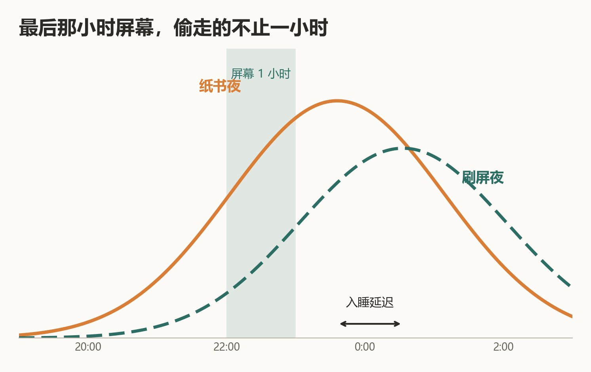

**证据等级**：🟢 人群实证 + 对照实验
- RCT：睡前用发光阅读器 vs 纸质书，前者褪黑素抑制、入睡延迟约 10 分钟、次日困倦感上升——效应存在但量级温和
- 大样本研究（青少年人群，n≈万级）：就寝前屏幕使用与睡眠时长缩短、入睡困难相关——成人的对应证据以对照实验（第 1 篇）为主

**程序员场景**："躺床上刷会儿手机"是晚睡循环的最后一块拼图——宵禁一小时，是性价比最高的睡眠干预。

**边界**：夜班/跨时区工作者需个性化节律策略；重度失眠者屏幕不是唯一原因。

**参考文献**：
1. Chang AM, et al. Evening use of light-emitting eReaders negatively affects sleep, circadian timing, and next-morning alertness. *PNAS*. 2015;112(4):1232-7. (PMID: 25535358)
2. Hysing M, et al. Sleep and use of electronic devices in adolescence: results from a large population-based study. *BMJ Open*. 2015;5:e006748. (PMID: 25643702)

> **熊博士按**：十分钟入睡延迟听起来不痛不痒——直到你意识到它每晚都在，而且"内容唤醒"的账还没算进去。宵禁一小时，买回的是整个入睡窗口。

## 🧰 身体维护 · 正文

<b>腰果 006 · Zone 2 快走</b> ｜ 🟢 ｜ 体能下降

**做法**：每周 3-5 次、每次 30-45 分钟的"还能完整说话但唱不了歌"强度的快走/慢跑/骑车（约最大心率 60-70%）。

**机制**：Zone 2 强度主要靠线粒体氧化代谢供能——是提高线粒体密度和效率的有效刺激区间。线粒体功能衰退是衰老的核心标志之一（hallmarks of aging）；耐力运动的线粒体适应性自 1967 年 Holloszy 的经典工作起被反复验证。

**证据等级**：🟢 人群实证（运动量-死亡率量效关系为流行病学最稳健的发现之一）

**程序员场景**：通勤最后一公里快走、代码评审前绕楼一圈——Zone 2 不需要换衣服不需要健身房，门槛最低。

**边界**：有心血管疾病史者先咨询医生；心率用"说话测试"即可，不必买设备。

**参考文献**：
1. Holloszy JO. Biochemical adaptations in muscle. Effects of exercise on mitochondrial oxygen uptake and respiratory enzyme activity in skeletal muscle. *J Biol Chem*. 1967;242(9):2278-82. (PMID: 4290225)
2. Arem H, et al. Leisure time physical activity and mortality. *JAMA Intern Med*. 2015;175(6):959-67. (PMID: 25844730)

> **熊博士按**：长寿研究绕不开线粒体，Zone 2 是给线粒体上课最便宜的方式——不用办卡、不用装备，"还能说话但唱不了歌"这一句就够了。

<b>腰果 008 · 工位人体工学三件套</b> ｜ 🟢 ｜ 腕/腰/颈

**做法**：
1. **屏幕上缘与视线平齐**、距离一臂（50-70cm）——头前倾 15° 时颈椎负荷约为直立姿态的 2-3 倍（力学模型估算）
2. **肘角 90°-100°**、腕部中立位（键盘垫腕或降低键盘后缘）——正中神经减压
3. **腰椎支撑**：腰后垫枕或用椅背腰托，坐深把臀部坐到椅子最里

**机制**：腰椎间盘压力随坐姿恶化阶梯上升：端坐时已比站立高约四成，身体前倾时进一步接近站立的两倍（Nachemson 经典测量；后续在体复测证实坐姿升压方向一致、量级略低——如实说明）；腕部背伸增加腕管内压力——正中神经受压是腕管综合征的直接机制。

**证据等级**：🟢 生物力学实证｜对"预防腕管综合征"的效果证据中等（工效学干预的 RCT 结论混合——如实说明）

**程序员场景**：笔记本的"屏幕低+键盘高"先天违背人体工学——外接键盘抬屏幕是性价比最高的工位改造。

**边界**：已出现持续手麻（尤其夜间麻醒）、握力下降——就医做神经电生理检查，工位改造救不了已损伤的神经。

**参考文献**：
1. Nachemson AL. Disc pressure measurements. *Spine*. 1981;6(1):93-7. (PMID: 7209680)
2. Hansraj KK. Assessment of stresses in the cervical spine caused by posture and position of the head. *Surg Technol Int*. 2014;25:277-9. (PMID: 25393825)

> **熊博士按**：笔记本是按"偶尔移动使用"设计的，每天八小时用它办公，它就是刑具。外接键盘加支架，一百块钱同时解决颈和腕两个问题——这是我推荐过的性价比最高的改造，没有之一。

<b>腰果 001 · 下颌淋巴轻按摩（Brain Drain）</b> ｜ 🟡 ｜ 大脑昏沉

**做法**：每天 1-2 分钟，用指腹沿下颌骨下缘轻柔按压滑动（从下巴中央到耳垂下），力度以"舒服"为准，不追求痛感。

**机制**：大脑代谢废物（如β-淀粉样蛋白）经类淋巴系统（glymphatic system）清除，经硬脑膜淋巴管引流至颈部淋巴结链（以颈深淋巴结为主）。下颌下淋巴结是头颈部浅表引流网络的一部分；面部与下颌区的轻柔按摩可促进局部淋巴回流——**对大脑废物清除的影响属于间接推演**，直接证据尚在积累，如实标注。

**证据等级**：🟡 机制明确 + 部分动物证据｜"按摩下颌直接加速大脑排毒"是合理推测而非已证结论
- 脑膜淋巴管的存在与功能：2015 年 Nature 两篇里程碑论文确认（此前教科书认为脑没有淋巴管）

**程序员场景**：debug 卡壳时做一轮，替代刷手机；顺带活动眼睛和颈部。

**边界**：颈部有肿块、甲状腺疾病、急性感染发烧者不做；不要用力按压血管搏动处。

**参考文献**：
1. Louveau A, et al. Structural and functional features of central nervous system lymphatic vessels. *Nature*. 2015;523(7560):337-41. (PMID: 26030524)
2. Aspelund A, et al. A dural lymphatic vascular system that drains brain interstitial fluid and macromolecules. *J Exp Med*. 2015;212(7):991-9. (PMID: 26077718)
3. Da Mesquita S, et al. Functional aspects of meningeal lymphatics in ageing and Alzheimer's disease. *Nature*. 2018;560(7717):185-91. (PMID: 30046111)

> **熊博士按**：这条是我标得最犹豫的一条——机制在动物身上是真的，"按摩下颌就能给大脑排毒"目前只能算合理推测。它留在这里有个理由：2015 年之前，教科书还写着"大脑没有淋巴管"。科学会推翻教科书，也包括我这份指南。

<b>腰果 009 · 番茄钟的生理学</b> ｜ 🟡 ｜ 注意力涣散

**做法**：25 分钟专注 + 5 分钟休息为一个周期；这是工程化的近似——不必迷信数字，核心是**有节律的专注-恢复循环**。

**机制**：注意力与觉醒度存在约 90 分钟的超日节律（BRAC，基础休息-活动周期）假说；持续专注伴随前额叶资源消耗，周期性休息可恢复。但"25 分钟"这个数字本身来自 Francesco Cirillo 1980 年代的个人方法，不是生理学推导。

**证据等级**：🟡 专注-恢复循环有生理学支持｜"25 分钟最优"无直接验证——🔴 数字是工程约定
- 微休息（micro-break）研究支持短暂休息对持续注意力有益
- 超日节律在睡眠周期中证据充分，清醒期 90 分钟周期证据较弱

**程序员场景**：把番茄钟当"强制暂停协议"用——25 分钟到点必须抬头眨眼（联动 003）起身（联动 002），价值在节律本身。

**边界**：心流状态被打断有切换成本——深度编码时可放宽到 50+10，不必教条。

**参考文献**：
1. Cirillo F. The Pomodoro Technique.（方法源头，非科学文献）
2. Ariga A, Lleras A. Brief and rare mental "breaks" keep you focused: deactivation and reactivation of task goals forestall vigilance decrement. *Cognition*. 2011;118(3):439-43. (PMID: 21211793)

> **熊博士按**：我喜欢这一条的诚实——"25 分钟"是一个意大利大学生的个人约定，不是生理学。方法可以工程化，但把工程约定当自然规律，是我们要在整本指南里反复拆穿的事。

---

## 🧘 心与情绪 · 正文

<b>腰果 012 · 冥想十分钟</b> ｜ 🟢 ｜ 压力、焦虑

**做法**：每天 10 分钟，坐直，注意力放在呼吸上（吸气数 1，呼气数 2，数到 10 重来）。走神了？正常——**把注意力拉回来这个动作，就是训练本身**。

**机制**：注意力投放是可训练的技能。压力轴：冥想程序对焦虑/压力的改善有 meta 级证据（Goyal 2014）；职场正念 RCT 群（J Occup Health Psychol 2019 meta）。分子层：冥想与端粒酶活性升高相关（meta，Psychoneuroendocrinology 2014）；炎症层有促炎基因表达下调的信号，但临床炎症标志物效应量小（2023 meta："Only Small Effects"）——分层如实。

**证据等级**：🟢 压力/焦虑轴（meta+RCT 群）｜🟡 分子层信号（端粒酶/基因表达，机制级）

**程序员场景**：编译等待、会议间隙、睡前——十分钟不比一集短视频长。

**边界**：不替代精神科治疗；确诊抑郁/焦虑障碍者以专业治疗为主，冥想是辅助。

**参考文献**：
1. Goyal M, et al. Meditation programs for psychological stress and well-being: a systematic review and meta-analysis. *JAMA Intern Med*. 2014;174(3):357-68. (PMID: 24395196)
2. Bartlett L, et al. A systematic review and meta-analysis of workplace mindfulness training randomized controlled trials. *J Occup Health Psychol*. 2019;24(1):108-126. (PMID: 30714811)
3. Schutte NS, Malouff JM. A meta-analytic review of the effects of mindfulness meditation on telomerase activity. *Psychoneuroendocrinology*. 2014;42:45-8. (PMID: 24636500)

> **熊博士按**：这一条是"一招三柱"——压力轴（H11 炎症基因）、端粒酶（H1/H2）、表观遗传调节信号（H3）。十分钟换三根柱子的正向干预，全指南性价比前二。

<b>腰果 013 · 意想与免疫：注意力投向患处</b> ｜ 🟡 ｜ 身心交互

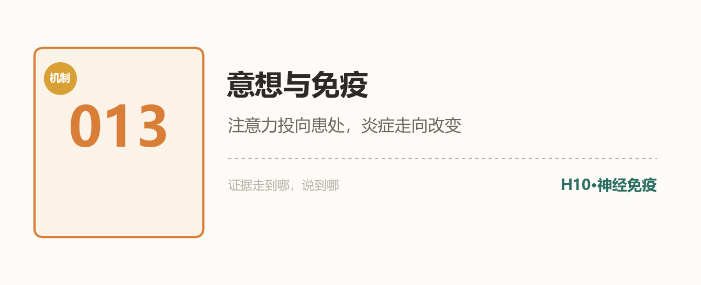

**做法**：身体某处急性不适（蚊虫叮咬、局部刺激）时，把注意力温和地投向那个部位 2-3 分钟——只是观察感受，不用力想象"治愈"。

**机制**：2026 年 *Nature Human Behaviour* 的人体实验：主动的内部注意（意想身体某处）可以改变急性皮肤炎症的发展轨迹，并给出认知-生理通路线索。这是"神经-免疫对话"（十二柱 H10）在人体上的直接证据雏形。

**证据等级**：🟡 单篇初步人体证据，待复制；适应证仅急性皮肤炎症模型

**程序员场景**：被蚊子咬了别急着挠——先试试"看它一眼"。顺便说，冥想（012）里的身体扫描，练的就是这种注意力投放。

**边界**：**不替代任何治疗**；慢性炎症、自身免疫病请遵医嘱。效应量与适用范围待更多研究。

**参考文献**：
1. Mizrachi N, et al. Voluntary attention regulates acute immune responses in humans. *Nat Hum Behav*. 2026. (PMID: 42608466)

> **熊博士按**："意念治病"是养生号重灾区——但 2026 年这篇论文告诉你：注意力与免疫的对话是真的，只是它说的是"改变走向"，不是"治愈"。我们把这条标 🟡 收进来，就是示范怎么区分"有初步证据的神奇"和"纯神奇"。

<b>腰果 014 · 甘麦大枣汤与小麦胚芽</b> ｜ 🟡 ｜ 情绪不稳

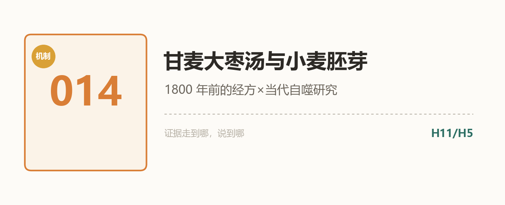

**做法**：本条是科普而非处方——甘麦大枣汤是《金匮要略》（约公元 200 年）经典方，需中医师辨证使用。程序员可及的平民版：把小麦胚芽纳入主食（麦片、胚芽粉）。

**机制**：经方端：甘麦大枣汤主治"脏躁"（情绪不稳、悲伤欲哭），有 meta 分析（2014）与 2025 动物研究（CUMS 抑郁模型）支持。现代端：小麦胚芽是膳食亚精胺的头部来源——亚精胺是自噬激活剂（见 024）。**1800 年前的经方与当代自噬研究，在同一颗麦粒上相遇。**

**证据等级**：🟡 中药 meta（中文 RCT 质量参差，如实说）+ 动物机制；亚精胺人体 RCT 另条目（024）

**程序员场景**：情绪低谷期的饮食仪式感：一碗胚芽燕麦，成本低，叙事好。

**边界**：经方使用请找中医师；甘麦大枣汤不与精神科药物互相替代。

**参考文献**：
1. A meta-analysis of the efficacy and safety of traditional Chinese medicine formula Ganmai Dazao decoction for depression. 2014. (PMID: 24632021)
2. Gan-Mai-Da-Zao decoction ameliorates depressive-like behaviors in CUMS mice. 2025. (PMID: 40580692)

> **熊博士按**：这条的故事密度全指南第一：一张经方，君药是小麦；两千年后，小麦胚芽里的亚精胺成了自噬研究的明星分子。我不说"古人早知道"——我说的是：**好食材经受得住两种完全不同的知识体系反复检验。**

## 🧠 脑力工程 · 正文

<b>腰果 015 · 写代码与心流</b> ｜ 🟡 ｜ 中断、切换成本

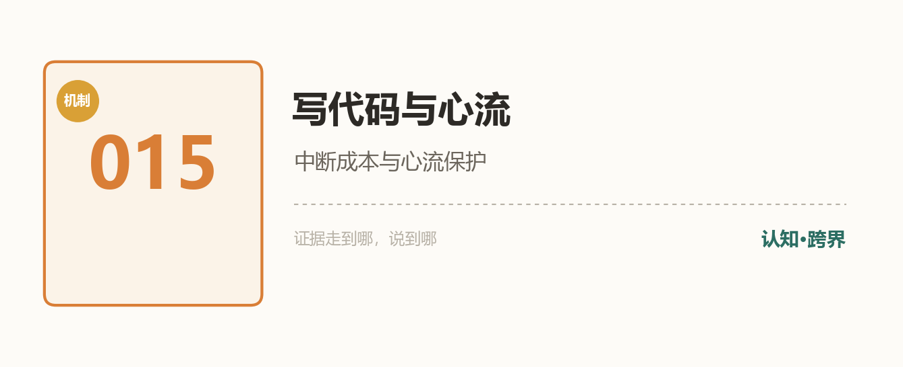

**做法**：两条工程习惯保护心流：①免打扰时段（日历占位+状态标记）；②**恢复注释**——被打断前，用一行注释写下"接下来要做什么"，给未来的自己留断点。

**机制**：程序员是最容易进入心流的职业之一，但中断的代价沉重：对 85 名程序员上万次编程会话的分析（Parnin & Rugaber 2011）显示，开发者以 15-30 分钟短会话为主，且**每次恢复被中断的任务，都要花可观时间重建工作上下文**。恢复注释本质是"断点续传"——把上下文外化，降低重建成本。

**证据等级**：🟡 软件工程实证（CS 文献库）+ 认知科学的微休息证据

**程序员场景**：产品经理走过来之前，Cmd+S 代码，再写下那行注释。心流被打断的切换成本是真实的（与 009 番茄钟的分工：平庸任务用节律，深度任务护心流）。

**边界**：心流不是所有任务的最优态（代码评审、debug 需要发散）；别把"护心流"变成"谁都不能找我"。

**参考文献**：
1. Parnin C, Rugaber S. Resumption strategies for interrupted programming tasks. *Software Quality Journal*. 2011;19(1):5-34. (DOI: 10.1007/s11219-010-9104-9)
2. Ariga A, Lleras A. Brief and rare mental "breaks" keep you focused. *Cognition*. 2011;118(3):439-43. (PMID: 21211793)

> **熊博士按**：中断后"我在干嘛来着"的那十秒钟茫然，就是上下文重建的成本在计费。恢复注释是全指南最便宜的工程习惯——一行注释，买回一次快速续传。

<b>腰果 016 · 脑内内存管理</b> ｜ 🟡 ｜ 认知超载

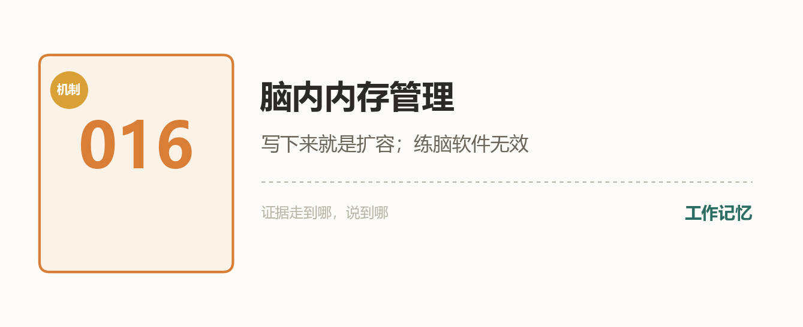

**做法**：把"在脑内持有"改为"在外部持有"：伪代码先行、任务清单、恢复注释（015）、一张草稿纸。写下来不是偷懒，是**扩容**。

**机制**：认知科学称之"认知卸载"（cognitive offloading）：把信息外化到工具，释放工作记忆——该领域已有系统综述（意图卸载，Psychon Bull Rev 2023）。反面证据同样重要：**"练脑"软件基本无效**——工作记忆训练的 meta 分析显示训练收益不迁移到一般认知能力（Perspect Psychol Sci 2016）。

**证据等级**：🟡 卸载有综述支持；训练迁移被 meta 否定

**程序员场景**：你早就在这么干了——注释、TODO、白板。本条只是告诉你：这个直觉有认知科学背书，而且比买脑训练 App 靠谱。

**边界**：卸载≠不动脑——深度理解仍需要工作记忆参与；外化的是"持有"，不是"思考"。

**参考文献**：
1. Boldt A, Gilbert SJ. Outsourcing memory to external tools: A review of 'intention offloading'. *Psychon Bull Rev*. 2023;30(3):920-937. (PMID: 35789477)
2. Melby-Lervåg M, Hulme C. There is no convincing evidence that working memory training is effective. *Perspect Psychol Sci*. 2016;11(2):270-277. (PMID: 27474138)

> **熊博士按**："写下来就是扩容"——工程师对外置存储的理解，比谁都深。倒是那些卖脑训练 App 的，该读读那篇 meta：训练收益不迁移。省下订阅费，买张好草稿纸。

## 📈 进阶长寿 · 正文

<b>腰果 017 · 情绪与基因组稳定</b> ｜ 🟢 ｜ 慢性压力的分子账单

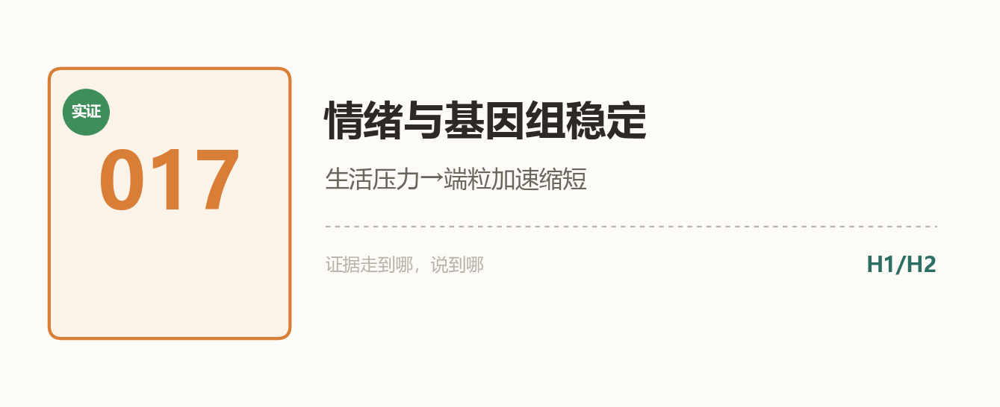

**做法**：把慢性压力当作有分子后果的事来管理：冥想（012）、Zone 2（006）、睡眠（007）、可倾诉的关系。重大压力事件后，给身体安排恢复期。

**机制**：2004 年 PNAS 里程碑（Epel/Blackburn）：**生活压力越大，端粒越短、端粒酶越低**——照护慢性病孩子的高压人群，细胞层面"更老"。后续：抑郁与端粒缩短有 meta 级关联；2025 年 *Nat Aging*：慢性社会压力驱动 p16 介导的衰老细胞积累（小鼠）。

**证据等级**：🟢 端粒关联（多项 meta，人群证据）｜因果方向与干预逆转证据仍在积累

**程序员场景**：连续高压冲刺不是"扛过去就没事"——它在你染色体末端记账。

**边界**：关联≠因果；抑郁症是疾病，治疗优先，端粒不是 KPI。

**参考文献**：
1. Epel ES, et al. Accelerated telomere shortening in response to life stress. *PNAS*. 2004;101(49):17312-5. (PMID: 15574496)
2. Schutte NS, et al. Depression and telomere length: a meta-analysis. *J Affect Disord*. 2016;191:247-52. (PMID: 26688493)
3. Chronic social stress induces p16-mediated senescent cell accumulation in mice. *Nat Aging*. 2025. (PMID: 39528642)

> **熊博士按**：情绪是有分子后果的——这不是鸡汤，是 Epel 2004 以后端粒研究的主流结论之一。管理情绪不是矫情，是基因组维护工作的一部分。

<b>腰果 018 · 记忆与基因组的断裂重连</b> ｜ 🟡 ｜ 学新东西时大脑在干嘛

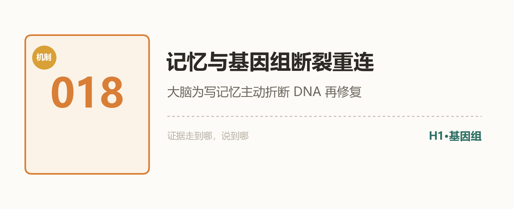

**做法**：学新框架/新语言的那几天，保证睡眠（修复机制多在睡眠中运转）与恢复期；把学习强度控制在"有点难但不至于宕机"。

**机制**：顶刊证据链——*Cell* 2015：神经元激活时拓扑异构酶 IIβ 主动剪断 DNA 启动即刻早基因表达；*Nature* 2023：NPAS4-NuA4 复合体把突触活动与 DNA 修复耦合；*Nature* 2024：记忆组装经 DNA 感知 TLR9 通路；2024：**阿尔茨海默脑中这种"适应性断裂"丢失**——折断后接不回，才是病。

**证据等级**：🟡 机制+动物，顶刊级；人体直接证据在积累

**程序员场景**：啃新东西时大脑在物理层面"重构代码"——给它留出编译时间。

**边界**：适应性断裂≠"多学多断多好"；机制理解中，勿过度演绎。

**参考文献**：
1. Madabhushi R, et al. Activity-induced DNA breaks govern the expression of neuronal early-response genes. *Cell*. 2015;161(7):1592-605. (PMID: 26052046)
2. Kim J, et al. A NPAS4-NuA4 complex couples synaptic activity to DNA repair. *Nature*. 2023;614(7949):754-762. (PMID: 36792830)
3. Pollina EA, et al. Formation of memory assemblies through the DNA-sensing TLR9 pathway. *Nature*. 2024. (PMID: 38538785)

> **熊博士按**：大脑为写一条新记忆，主动折断自己的 DNA 再接回去——而阿尔茨海默的悲剧是接不回去。这是全指南我最想把动画做出来的一条。

<b>腰果 019 · 40Hz 声光节拍</b> ｜ 🟡 ｜ 健脑外推

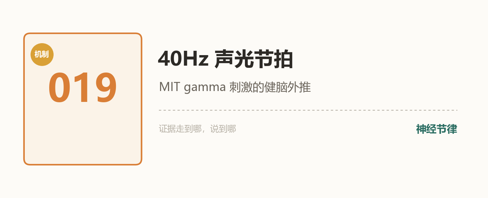

**做法**：本条暂不推荐任何设备——**先让子弹飞**。了解这条线即可；伽马节律的日常自然来源（运动、社交、新异刺激）比设备便宜。

**机制**：MIT 团队的 gamma 感觉刺激（40Hz 光+声）：*Cell* 2019 多感官 gamma 刺激改善 AD 模型小鼠病理与认知；轻症 AD 患者的人体试验（2022）与开放标签延伸（2025）显示可行性与部分信号；2024 年 *J Intern Med* 综述梳理了"从神经退行到健康大脑"的外推路径。

**证据等级**：🟡 AD 人群早期证据；健康年轻人"健脑"属外推，无 RCT

**程序员场景**：对"40Hz 助眠灯/专注音"类产品保持清醒——卖得最热的场景恰恰证据最薄。

**边界**：勿为健康健脑购买高价设备；癫痫/光敏者禁忌闪烁光刺激。

**参考文献**：
1. Adaikkan C, et al. Multi-sensory gamma stimulation ameliorates Alzheimer's-associated pathology and improves cognition. *Cell*. 2019;177(2):256-271. (PMID: 30879788)
2. Chan D, et al. Gamma frequency sensory stimulation in mild probable Alzheimer's dementia patients. *PLoS One*. 2022;17(1):e0261279. (PMID: 36454969)
3. Audiovisual gamma stimulation for the treatment of neurodegeneration. *J Intern Med*. 2024. (PMID: 38115692)

> **熊博士按**：40Hz 是"未来感最强"的一条——出自 MIT，故事性感。但健康人健脑目前是外推，等人体证据，别为预告片买票。

<b>腰果 020 · 麦角硫因与蘑菇</b> ｜ 🟡 ｜ 长寿维生素

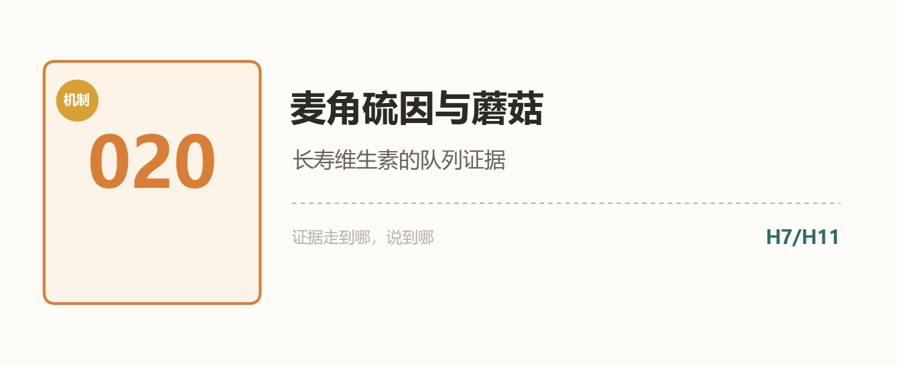

**做法**：蘑菇入菜——香菇、平菇、杏鲍菇、口蘑，每周 2-3 次，换着来。食补优先，暂不推荐补剂。

**机制**：麦角硫因被称"长寿维生素"：人体有专属转运体（说明它在被认真对待），蘑菇是头号膳食来源。人群证据：日本队列——血清麦角硫因越高，痴呆风险越低（2025）；低血浆麦角硫因预测老年人认知与功能下降（2022）；新加坡队列——蘑菇摄入与轻度认知障碍风险降低相关（2019）。

**证据等级**：🟡 观察性队列（相关性），食补风险为零——性价比叙事成立

**程序员场景**：外卖点蘑菇类的菜，是最不费劲的"长寿投资"。

**边界**：观察性证据≠因果；勿囤高价麦角硫因补剂（人体干预证据未定）。

**参考文献**：
1. Serum ergothioneine and risk of dementia in a general older Japanese population. 2025. (PMID: 40908798)
2. Low plasma ergothioneine predicts cognitive and functional decline in an elderly cohort. 2022. (PMID: 36139790)
3. The association between mushroom consumption and mild cognitive impairment. 2019. (PMID: 30775990)

> **熊博士按**：相关性不是因果——但当暴露物是"炒个蘑菇"这种零风险行为时，观察性证据也够下单了。这叫贝叶斯式点菜。

<b>腰果 021 · Omega-3 与干眼</b> ｜ 🟡 ｜ 护眼补剂

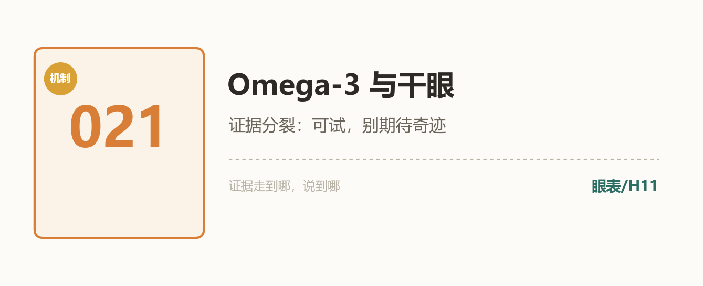

**做法**：干眼困扰者：深海鱼每周 2 次（食补优先）；补剂可试 3 个月，无效就停——别加码。

**机制**：Omega-3（EPA/DHA）抗炎通路对干眼病理合理；meta 存在（2023, J Clin Med）但**结论分裂**——阳性小 RCT 与大 RCT 阴性并存；针对计算机视觉综合征的干预综述（*Ophthalmology* 2022）证据同样有限。先做零成本项（003 眨眼+20-20-20），再谈鱼油。

**证据等级**：🟡 证据分裂，如实标注——"可试，别期待奇迹"

**程序员场景**：眼药水→鱼油→眨眼提醒，顺序应该反过来。

**边界**：高剂量鱼油与抗凝药相互作用；手术前告知医生。

**参考文献**：
1. Efficacy of omega-3 intake in managing dry eye disease: a systematic review and meta-analysis. *J Clin Med*. 2023. (PMID: 38002640)
2. Interventions for the management of computer vision syndrome: a systematic review. *Ophthalmology*. 2022. (PMID: 35597519)

> **熊博士按**：这是全指南"证据最分裂"的一条，我故意留着它——分裂的证据怎么诚实地呈现，本身就是这套分级体系的卖点。

<b>腰果 022 · 坚果一把</b> ｜ 🟢 ｜ 每日零食

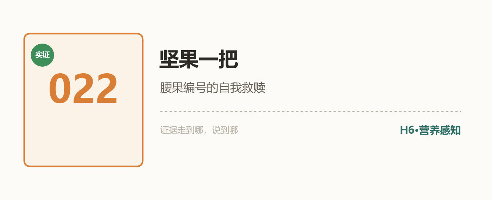

**做法**：每天一小把（约 28g），混合坚果，**无糖无盐**非油炸。腰果在列。

**机制**：坚果摄入频率与全因死亡率负相关：前瞻队列+meta（*Food Funct* 2017）——坚果摄入者的心血管与全因死亡风险更低。机制拼图：不饱和脂肪酸、膳食纤维、麦角硫因（核桃/某些菌坚果）多通路。

**证据等级**：🟢 队列+meta（观察性，但方向一致性与剂量反应关系扎实）

**程序员场景**：把工位抽屉里的辣条换成混合坚果——同名 IP 的自我救赎。

**边界**：坚果热量高，一把为准；过敏者严格回避。

**参考文献**：
1. Nut consumption in relation to all-cause and cause-specific mortality: a meta-analysis of prospective studies. *Food Funct*. 2017;8(11):3893-3905. (PMID: 28875220)

> **熊博士按**：指南的条目编号叫了这么久"腰果"，今天腰果终于凭本事入列——每天一把，混着吃，无盐。IP 的自我救赎，证据等级 🟢。

<b>腰果 023 · APOE4 与长链脂肪酸</b> ｜ 🟡 ｜ 基因×营养

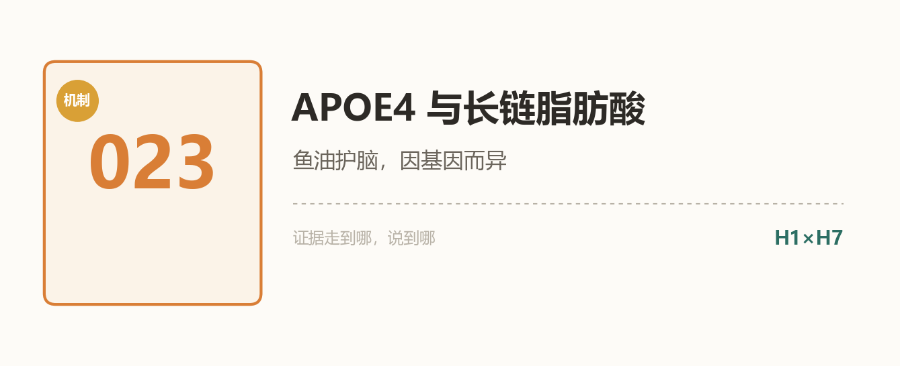

**做法**：无需基因检测焦虑——APOE4 携带者（约 15-25% 人群）更该认真执行本指南的 H7 条目（Zone 2、睡眠），膳食 DHA（深海鱼）规律摄入；检测与解读请找专业机构。

**机制**：APOE4 是阿尔茨海默最常见的遗传风险因子（*Science* 1993 经典）；它同时拖累长链脂肪酸：**PET 研究直接显示 APOE4 携带者脑 DHA 摄取更低**（2017）；2026 年高剂量 DHA 补充的脑靶点研究在推进。同一个"鱼油护脑"，基因型不同，效率不同——精准营养的预告片。

**证据等级**：🟡 机制清晰（PET 直接证据）+人群关联；干预获益的基因分层证据在积累

**程序员场景**：不用急着测基因——把"鱼油是否有用因人而异"这个概念装进脑子，就已经跑赢补剂营销话术。

**边界**：基因≠命运（外显率不高、可干预因素多）；APOE 检测有心理与保险 implications，咨询后再做。

**参考文献**：
1. Corder EH, et al. Gene dose of apolipoprotein E type 4 allele and the risk of Alzheimer's disease in late onset families. *Science*. 1993;261(5123):921-3. (PMID: 8346443)
2. Yassine HN, et al. DHA brain uptake and APOE4 status: a PET study with [1-(11)C]-DHA. *Alzheimers Res Ther*. 2017;9(1):51. (PMID: 28335828)
3. CNS target engagement of high-dose DHA supplementation in older adults at risk for dementia. *EBioMedicine*. 2026. (PMID: 42315445)

> **熊博士按**：营养补剂的下一代叙事不是"吃不吃"，是"谁吃有用"。APOE4×DHA 是这条赛道最早成形的例子——记下这个框架，能免疫大部分补剂广告。

<b>腰果 024 · 亚精胺与小麦胚芽</b> ｜ 🟡 ｜ 自噬激活

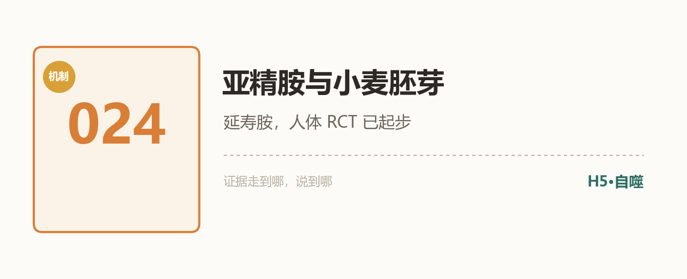

**做法**：食补优先：小麦胚芽（胚芽麦片/粉）、纳豆、陈年奶酪、蘑菇。补剂证据起步中，不神化。

**机制**：亚精胺是自噬（十二柱 H5）的天然激活剂；动物延寿证据充分（酵母-果蝇-小鼠）。人体：小麦胚芽提取物的认知 RCT（2022）有信号；**2024 年 40mg/天补充的 RCT 显示循环多胺变化最小**——阴性/弱结果如实收编。

**证据等级**：🟡 机制+动物强，人体认知 RCT 起步、结果混合

**程序员场景**：早餐加两勺小麦胚芽粉——与 014 甘麦大枣汤同源，一颗麦粒两种叙事。

**边界**：补剂剂量与长期安全性未定；孕哺期咨询医生。

**参考文献**：
1. Wirth J, et al. Effects of spermidine supplementation on cognition and biomarkers in older adults at risk for dementia. *J Cogn Enhanc*. 2022. (PMID: 35616942)
2. Supplementation of spermidine at 40 mg/day has minimal effects on circulating polyamines. 2024. (PMID: 39405978)

> **熊博士按**："延寿胺"的人体证据还在爬坡——阳性的认知信号与阴性的血指标并存。食补路径（胚芽/纳豆）零风险先走，补剂等更大的 RCT。

<b>腰果 025 · PQQ</b> ｜ 🟡 ｜ 线粒体新生

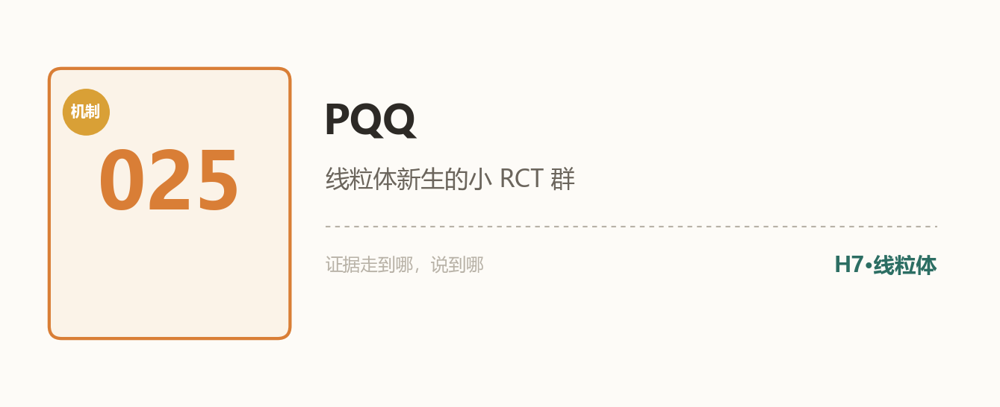

**做法**：本条重点是"知道"而非"服用"：PQQ 广泛存在于食物（纳豆、绿茶、青椒，含量微）。补剂证据小样本，观察即可。

**机制**：吡咯喹啉醌（PQQ）在线粒体新生（biogenesis，H7）方向有动物与细胞证据；人体小 RCT：健康成人认知（2022）、年轻与老年脑功能（2023）、6 周补充的线粒体功能指标（2024）——样本都小。

**证据等级**：🟡 小样本人体 RCT 群；效应量与长期安全性待验证

**程序员场景**：看到"PQQ 太岁精华"类产品——太岁无 PubMed 文献，PQQ 证据小样本，两者都不足以下单。

**边界**：孕妇儿童数据缺乏；别与"太岁"传说捆绑消费。

**参考文献**：
1. Effect of dietary pyrroloquinoline quinone disodium salt on cognitive function in healthy adults. 2022. (PMID: 34415830)
2. Pyrroloquinoline quinone disodium salt improves brain function in both younger and older adults. 2023. (PMID: 36807425)
3. Six-week PQQ supplementation and mitochondrial function. 2024. (PMID: 38908296)

> **熊博士按**：PQQ 的故事性感（线粒体新生），人体数据还在幼儿园阶段。民间的"太岁"传说连文献都没有——传说归传说，钱包归钱包。

<b>腰果 026 · GlyNAC</b> ｜ 🟡 ｜ 老年补剂组合

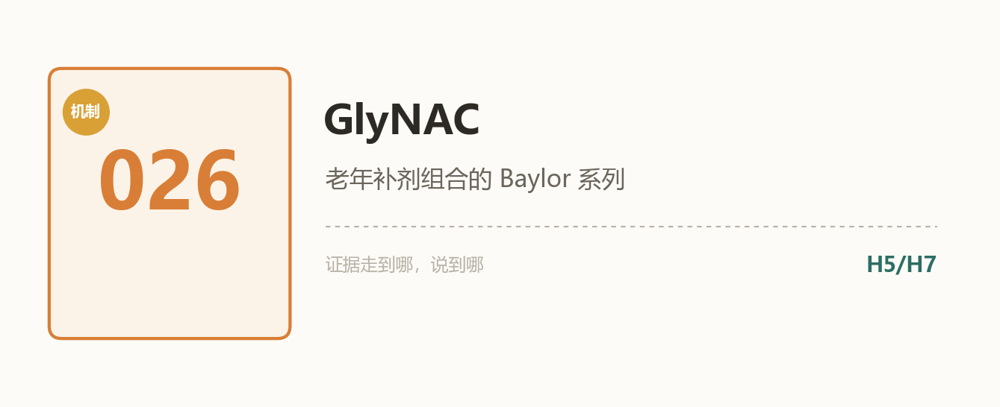

**做法**：这条主要写给**你的父母**：老年人群的甘氨酸+NAC 组合有系列 RCT 支持方向；年轻人不急。

**机制**：GlyNAC（甘氨酸+N-乙酰半胱氨酸）为细胞补充谷胱甘肽前体：Baylor 团队系列 RCT（2020-2022）在老年人中改善谷胱甘肽、氧化应激、线粒体功能、身体功能与认知多个指标；2026 年新团队跟进研究出现。

**证据等级**：🟡 单中心系列 RCT（Baylor），样本小、需独立复制

**程序员场景**：给爸妈的补剂清单里，GlyNAC 的证据等级排在大多数"抗衰网红"前面——但记得先问医生。

**边界**：老年人群证据；与药物相互作用（NAC 影响某些药物）需药师审核。

**参考文献**：
1. Sekhar RV, et al. GlyNAC supplementation in older adults. 2020-2022 系列. (PMID: 33007928 / 33783984 / 35975308)

> **熊博士按**：老龄化叙事里最踏实的一条——不为码农自己，为爸妈。Baylor 的系列 RCT 方向一致，等独立复制，但"先问医生再试"的门槛不高。

<b>腰果 027 · 甲基化时钟</b> ｜ 🟢 ｜ 生物年龄

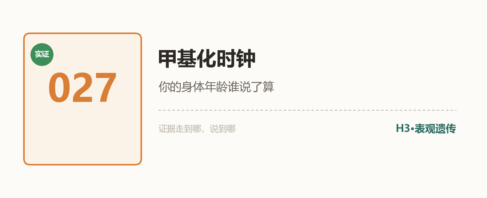

**做法**：本条是概念科普：了解"表观遗传时钟"是什么、能回答什么、不能回答什么。检测属商业行为，本文不构成推荐。

**机制**：DNA 甲基化模式随年龄系统性漂移——Horvath 2013（*Genome Biol*）用全基因组甲基化构建"时钟"，误差显著小于历法年龄；此后时钟家族迭代（不同组织、不同速度）。它是 H3（表观遗传改变）柱的核心测量工具，也是"器官年龄不同步"研究的底座。

**证据等级**：🟢 时钟的测量学证据（数千篇文献）；"干预逆转时钟=逆转衰老"仍是开放问题——如实区分

**程序员场景**：看到"测出生物年龄比实际小 8 岁"的营销——先问：哪个时钟？训练人群还是泛人群？干预前后变化还是单点读数？

**边界**：时钟≠命运；不同时钟给出的读数可能不一致；单次检测的决策价值有限。

**参考文献**：
1. Horvath S. DNA methylation age of human tissues and cell types. *Genome Biol*. 2013;14(10):R115. (PMID: 24138928)
2. López-Otín C, et al. Hallmarks of aging: an expanding universe. *Cell*. 2023. (PMID: 36599349)

> **熊博士按**：与 032（面相时钟）对照读——一个从唾液读，一个从照片读，都指向同一件事：年龄不是一个数。至于哪个更能指导干预，是整个行业正在解的题。

## 🌿 传统×科学 · 正文

<b>腰果 028 · 醋与乙酸</b> ｜ 🟢 ｜ 餐后血糖×菌群

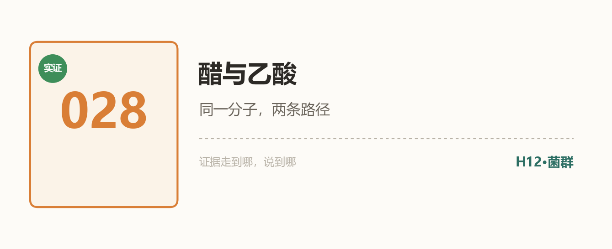

**做法**：凉拌、蘸食加醋（1-2 汤匙）；同时把益生元（燕麦、豆类、蔬果）吃够——养好产短链脂肪酸的菌群。两条路径分开理解。

**机制**：**外源路径**：随餐醋酸延缓胃排空、改善餐后血糖与胰岛素反应——系统综述与多个小 RCT（2017 综述：醋可削弱餐后血糖/胰岛素峰）。**内源路径**：膳食纤维经肠道菌群发酵生成短链脂肪酸（含乙酸）——SCFA 是 H12 菌群轴的健康介质（*Cell Host Microbe* 2016 经典综述）。同一分子（乙酸），两条路径，**别混为一谈**：喝醋的受益证据在血糖曲线，不在"补 SCFA"。

**证据等级**：🟢 餐后血糖端（SR+RCT 群）/菌群端机制充分

**程序员场景**：外卖重碳水的那餐，加碟醋——成本最低的餐后血糖管理。

**边界**：胃食管反流/溃疡者慎；醋不是"排毒神药"，它只对餐后曲线做了点实事。

**参考文献**：
1. Petersson J, et al. Vinegar consumption can attenuate postprandial glucose and insulin responses; a systematic review and meta-analysis. 2017. (PMID: 28292654)
2. Koh A, et al. From dietary fiber to host physiology: short-chain fatty acids as key bacterial metabolites. *Cell Host Microbe*. 2016;20(6):765-74. (PMID: 27259147)

> **熊博士按**：这条示范了"扯得妙"与"扯得错"的分界：益生元发酵的乙酸与食醋的醋酸是同一分子——但两条证据链各自独立，交汇处留给读者自己惊叹。

<b>腰果 029 · 八段锦与筋</b> ｜ 🟢🟡🔴 ｜ 拉伸×蛋白稳态

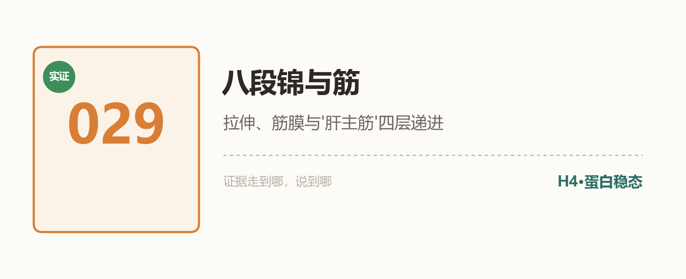

**做法**：跟练视频每天 15-20 分钟（B 站官方跟练即可）。核心要义：**拉、伸、旋拧**——练的是筋与筋膜链。

**机制**：四层递进（证据强度递减，示范本指南方法论）：①**动作层 🟢**：八段锦 RCT 296 篇命中——2025 年 24 周 RCT 改善老年人肌少症；②**组织层 🟡**：2025 年筋膜重定义综述——力学传导枢纽+干细胞储备；③**分子层 🟡**：筋的细胞外基质是全身最大胶原蛋白库之一，蛋白稳态（H4）是 2023 十二柱之一——**这是"筋=蛋白结构"的科学锚点**；④**概念层 🔴**："肝主筋"在英文文献库检索零命中——概念映射是空白区，如实留白。

**证据等级**：分层标注如上——每一层证据走到哪，说到哪

**程序员场景**：工位久坐的逆向操作；睡前 15 分钟替代刷手机。

**边界**：慢病者循序渐进；膝关节不适者调整幅度。

**参考文献**：
1. Efficacy of Baduanjin exercise for sarcopenia in older adults: a 24-week randomized controlled trial. 2025. (PMID: 41371252)
2. Redefining fascia: a mechanobiological hub and stem cell reservoir in regeneration. 2025. (PMID: 41155456)
3. López-Otín C, et al. Hallmarks of aging: an expanding universe. *Cell*. 2023. (PMID: 36599349)

> **熊博士按**：这条是全指南方法论的自证：四层证据，逐层递减，最后一层诚实留白。传统功法值不值得练？动作层 🟢 已经足够回答"值得"。

<b>腰果 030 · NAC 与化痰</b> ｜ 🟢 ｜ 药典老药

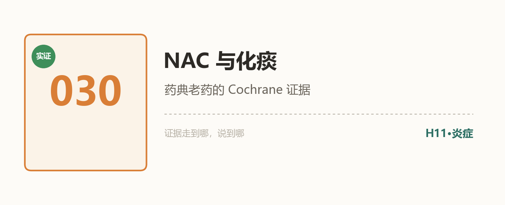

**做法**：这是**药品**条目：痰液黏稠难咯时，N-乙酰半胱氨酸（NAC）是药典收录的黏液溶解剂——**按说明书/遵医嘱使用**，不做日常保健品。

**机制**：NAC 的二硫键断裂作用直接降低痰液黏度——Cochrane 系统综述（2019，慢阻肺急性加重预防）与 2000 年经典 meta 支持其黏液溶解与急性加重减少作用。它同时也是谷胱甘肽前体（与 026 GlyNAC 共享半个分子）。

**证据等级**：🟢 化痰/慢阻肺急性加重（Cochrane+meta）｜抗衰外延（GlyNAC）另条目

**程序员场景**：秋冬感冒后痰黏难咯的夜里，药盒里值得有的老药（遵医嘱）。

**边界**：药品属性：哮喘者慎用（可能诱发支气管痉挛）；不作为日常补充剂长期自行服用。

**参考文献**：
1. Poole P, et al. Continuous or intermittent NAC for COPD. *Cochrane*. 2019. (PMID: 31107966)
2. Stey C, et al. NAC in chronic bronchitis: a quantitative systematic review. 2000. (PMID: 10968500)

> **熊博士按**：老药、便宜、证据清楚——NAC 是"传统×科学"栏目里最不玄的一条。化痰是它的本职，抗衰是它的兼职（见 GlyNAC），别搞反了。

<b>腰果 031 · 颂钵</b> ｜ 🟡偏🔴 ｜ 声音松弛

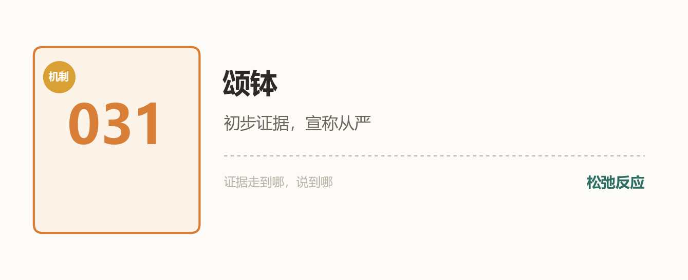

**做法**：作为睡前仪式的**声音放松**（颂钵音疗/白噪音/低频音乐），不作为治疗手段。

**机制**：系统综述（2020, *Complement Ther Med*；2025 更新）显示颂钵相关干预与急性放松反应、紧张感下降相关；RCT（2023）证实藏钵声音诱导急性放松。**但**：研究样本小、对照组弱、适应证多为"主观感受"层面——疗效宣称从严。

**证据等级**：🟡偏🔴 松弛反应有初步证据；"疗愈"宣称不成立

**程序员场景**：屏幕宵禁（010）后的 15 分钟声音仪式——它能帮你从信息流切换到睡前态，仅此而已，已足够。

**边界**：不替代失眠规范治疗；声音敏感/耳鸣者自选音量。

**参考文献**：
1. The human health effects of singing bowls: a systematic review. *Complement Ther Med*. 2020. (PMID: 32507429)
2. Acute relaxation response induced by Tibetan singing bowl sounds: a randomized controlled trial. 2023. (PMID: 36826208)

> **熊博士按**：松弛反应是真的，神话不是。把颂钵当"声音形态的屏幕宵禁"用，物尽其用；当"频率疗愈"买，智商税。

<b>腰果 032 · 面相与生物年龄</b> ｜ 🟡 ｜ 表型时钟

**做法**：概念科普+晨间照镜子的仪式感。商业"AI 面相测衰老"产品谨慎看待（模型不透明、误差未知）。

**机制**：中国团队把"看面相"做成了定量科学：北大 ThermoFace（*Cell Metab* 2024）——2811 名 20-90 岁汉族人面部红外热像训练"热年龄"模型（误差约 5 年）并预测代谢疾病；韩敬东组 AURORA（*Cell Metab* 2026）——面部图像或常规体检数据跨模态生成多组学，建模衰老与代谢健康。

**证据等级**：🟡 大样本模型证据（群体层面成立）；个体误差约 5 年、非因果

**程序员场景**：每天早上镜子里的气色，是免费的多模态传感器的低配版——认真看一眼。

**边界**：误差显著；相学话术（"夫妻宫""财帛宫"）与这些研究无关，勿混用。

**参考文献**：
1. Yu Z, et al. Thermal facial image analyses reveal quantitative hallmarks of aging and metabolic diseases. *Cell Metab*. 2024;36(7):1482-1493. (PMID: 38959862)
2. Chen J, et al. A generative AI framework unifies human multi-omics to model aging. *Cell Metab*. 2026;38(6):1229-1244. (PMID: 42019500)

> **熊博士按**：奶奶说的"印堂发黑要休息"，机器学习版是"面部热分布偏移提示代谢年龄偏高"。隔着一百年的两套语言，说的是同一张脸。

<b>腰果 033 · 阳气与线粒体</b> ｜ 🔴🟡 ｜ 概念映射

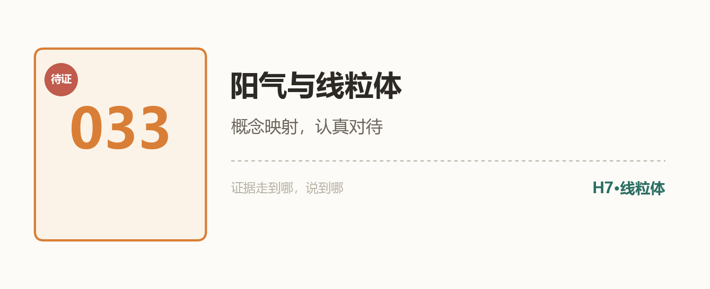

**做法**：怕冷、乏力、精力下降的"阳虚感"人群：可执行的落点是本指南已有条目——Zone 2（006，线粒体训练）、睡眠（007/010）、冬季温热食养（姜、羊肉，传统经验）。中医辨证请就医。

**机制**：这是全指南最"深水"的一条，严格标注：**概念映射，不是证明**。支持材料：中文团队学术假说《线粒体作为人体阳气之本》（2022）——直接提出线粒体能量代谢是"阳"的现代对应物；2024 年《从古代智慧到现代科学：肠道菌群照亮药性理论》——温热药性×能量代谢×菌群的研究方向。⚠️ 这些是假说探索文献，不是验证结论。

**证据等级**：🔴 概念映射（假说级）｜🟡 温阳方向的代谢研究在积累

**程序员场景**：把"补阳气"翻译成"练线粒体"（Zone 2）+规律睡眠——传统直觉的现代执行路径。

**边界**：阳虚是中医辨证概念，需要专业判断；本条不构成任何"温阳药食"自用建议。

**参考文献**：
1. Mitochondria as the essence of Yang Qi in the human body. 2022. (PMID: 36939762)
2. From ancient wisdom to modern science: gut microbiota sheds light on property theory of Chinese medicine. 2024. (PMID: 38937158)

> **熊博士按**：收官条目留给最深的水区：阳气与线粒体——映射得再美，也只是假说。这条的等级标志 🔴🟡 摆在那里，就是整个指南的态度：**证据走到哪一步，我们就说到哪一步。**

---

## 续命工具箱

- **30 秒症状自测**：[DeepKang 症状探索器](https://a.deepkang.com/explore)——免费、匿名、无需注册。输入一个症状（如"眼干""腰酸""睡不好"），30 秒看它的共现网络与常见原因方向，生成可以带给医生看的梳理小结。DeepoMe 出品。

> 看完指南想知道"我现在的状态算哪一档"？从探索器开始，比从搜索引擎开始靠谱。

## 关注与更新

**GitHub 是本指南的家**——star/watch 获取每次更新，Issue 征题与纠错。

📕 **完整电子书**：本仓库根目录 `ebook_v1.pdf`（36 页 A4 紧凑版，33 条全图文）——watch 本仓库即可下载。

📱 **手机网页版**：本仓库根目录 `ebook.html`——左右点击翻页、字号可调（A+/A-）、夜间模式、目录跳转；GitHub Pages 开启后可直接在线阅读。

**每周三**，新条目在公众号首发、GitHub 同步归档——扫码上车：

## 贡献指南

欢迎 PR 投稿新条目，格式要求：
1. 按模板：做法 / 机制 / 证据等级 / 参考文献（真实 PMID 或 DOI）/ 边界
2. **文献必须可查证**——伪造引用将被直接关闭
3. 证据等级从严标注：说不清就标低
4. 欢迎对现有条目提出等级异议——证据更新时我们会修订
5. **行文建议**：从表观感受与个人经验入手，再逐步引入机制与文献——控制阅读负担，别让读者第一屏就撞上术语墙
6. **延伸阅读**：参考资料可酌情引用[深度甲基公众号](https://mp.weixin.qq.com/s/yG0bg0ht0oOEBFSQOtPGWA)科普文章与[熊博士博客](https://xiongjianghui.com)长文（仅作为延伸阅读，不替代一手文献；须为已发布文章的真实链接）
7. **配图**：欢迎一图一机制——每张图讲清一个可验证的科学点；**图内文字尽量少**（关键词级，不放成句解释、不放参考文献），出处写在正文参考文献里；优先脚本可复现的图表而非装饰插画

## 关于熊博士

<b>展开：熊博士是谁</b>（姓名 · 机构 · 论文——按需查看）

**熊博士**（熊江辉），[DeepoMe 深度甲基](https://deepome.com)创始人，长寿医学智能方向研究者。做这个指南只有一个规矩：**证据走到哪一步，就说到哪一步**——这条规矩同样约束我们自己。

- ✍️ [熊博士博客 · xiongjianghui.com](https://xiongjianghui.com)——个人官网，方法论与行业观察长文
- 🌐 [DeepoMe 深度甲基](https://deepome.com)——把长寿科学工程化为可交付体系
- 🧬 [DeepKang 健康平台](https://deepkang.com) / [症状探索器](https://a.deepkang.com/explore)
- 💻 [GitHub · DeepoMe](https://github.com/DeepoMe)——论文配套代码与数据工具
- 📄 代表论文：RootMap（[DOI: 10.32388/A1NTLL](https://doi.org/10.32388/A1NTLL)）
- 📢 公众号科普：[衰老检测不该只是一个值——从行动仪表盘到个人长寿操作系统](https://mp.weixin.qq.com/s/yG0bg0ht0oOEBFSQOtPGWA)（更多文章陆续收录）

## 声明

本指南是健康教育内容，不构成医疗建议；有疾病请就医。维护方 [DeepoMe 深度甲基](https://deepome.com)——与长寿医学实践者同行，把科学工程化为实践者可用的智能（[DeepKang](https://deepkang.com)）。

## License

CC BY-NC-SA 4.0（署名-非商业-相同方式共享）
