# 程序员长寿指南 · Awesome Programmer Longevity

> **从续命到长寿：聚合优质科研进展，每一条都有证据分级和真实文献。**
> A curated, evidence-graded collection of longevity science for programmers. Extend your runtime.
>
> **[English](README.md)** ｜ 简体中文

程序员常说“咖啡续命”“周末补觉续命”。这份指南把这句自嘲当真：**命是可以科学地续的。** 每一条建议都标了证据强度、写了能不能做，参考文献都可以在 PubMed 上查到。

我们不神化任何方法，也不否定传统经验：**证据走到哪一步，我们就说到哪一步。**

### 🔭 连载看点：先看别处读不到的

| 期 | 章 | 看点 |
|---|---|---|
| 第 1 期 | ⭐ **大脑的隐秘运维** | 按脸和脖子能帮大脑排水（*Nature* 2025，小鼠实验）；学新东西时，大脑会剪断自己的 DNA；注意力能调节炎症 |
| 第 1 期 | ⭐ **阳气与线粒体** | “阳气 = 线粒体？”顺着这条映射，开出一张传统食谱里没有的新温阳食单 |
| 第 2 期 | ⭐ **年龄不是一个数** · **古方新解** | 一张脸也许能读出生物年龄；八段锦、甘麦大枣汤、醋、颂钵，用同一把尺子打分 |
| 第 3 期 | **续命十块大石头** | 对寿命影响最大的十件事 |
| 第 4 期 | **续命的一天** · **修复与维护** | 工位上就能做的习惯；熬夜之后怎么还债；工位怎么调 |
| 第 5 期 | **专注力工程** | 心流、脑内内存、番茄钟、冥想 |
| 第 6 期 | **餐桌与补剂** · **别花冤枉钱** | 坚果、鱼油、亚精胺；哪些补剂别买 |
| 第 7 期 | **续命十二柱** | 衰老的十二种机制，全书收官 |

> 证据等级都标得很保守：震撼不等于确定。每一节都写明了“为什么还不是 A”。

## 前言 · 为什么写这份指南

**写这份指南，是因为一个认知差。**

过去几十年，睡眠医学、营养流行病学、神经科学攒下了大量“怎么活得更久更好”的证据。它们躺在 PubMed 里、躺在论文标题里，等着被翻译。而大多数人的健康知识，还停在转发的养生帖和口头叮嘱之间。

**科研进展不必等医生都了解之后再告诉你，你可以直接理解它。** PubMed 是公开的，文献是可查的。这份指南每一条都附了 PMID：不信我，可以自己查。

我也不想让领域之间的墙继续立着。睡眠医学的结论、营养学的队列、细胞生物学的机制、中医药的现代研究，本该拼成一张图，而不是几个互不理睬的学科。这份指南做的事，就是把不同领域拉到同一张桌面上，按同一套证据分级说话。

最后，**日常经验和中医传统不该被无视，其中有一部分是真的。** 按摩面颈、八段锦、甘麦大枣汤，有的已经拿到部分科学证据，有的正在被验证。我们不神化，也不否定。

命是可以科学地续的。翻开吧。

——熊博士

**维护人**：熊博士（他是谁，见文末「关于熊博士」）

<details>
<summary><b>📋 阅读指南 · 本指南独有 · 利益冲突 · 连载说明</b>（点击展开）</summary>

## 怎么读这份指南

全书由一个个**独立的小节**组成，每节讲一件事，几分钟读完，可以从任何一节开始。小节按主题组成章。

| 你有多少时间 | 从哪里开始 |
|---|---|
| 2 分钟 | 上面的「连载看点」，挑一个最想知道的 |
| 5 分钟 | 「续命十块大石头」：对寿命影响最大的十件事 |
| 一个周末 | 按目录挑你的痛点：睡眠、颈腰、眼睛、焦虑、脑力 |
| 想看清全貌 | 「续命十二柱」：衰老的十二种机制，每一节都对应得上 |

看不懂的词，查附录「术语表」；喜欢用代码理解世界的，看「编程比喻对照表」。

## 🔭 本指南独有：在别的长寿书里看不到的

市面上的长寿、健康、营养书，大多讲同一套：运动、睡眠、饮食、补剂。这些我们也讲（见「续命十块大石头」），但下面四件事，你在别处很难找到：

1. **东西方同桌**：传统经验和分子机制，用同一把尺子打分。不神化，也不一笑了之，而是把传统经验翻译成可以检验的科学问题。代表：⭐「阳气与线粒体」（附新温阳食单和可证伪的预测）、⭐「面颈部淋巴按摩」、⭐「古方新解」一章。
2. **一手前沿**：2023–2026 年 *Nature*、*Cell*、*Nat Hum Behav*、*Cell Metab* 的最新发现，第一时间翻成人话。代表：⭐「大脑的隐秘运维」「年龄不是一个数」两章。
3. **程序员的语言**：生物钟是 NTP 校时，睡眠是垃圾回收，慢性炎症是内存泄漏。
4. **诚实到底**：双尺子分级、每节写明“为什么不是 A”、十二柱里一根诚实留白、「别花冤枉钱」一章、利益冲突声明。

> 标 ⭐ 的小节是本指南的独家内容。

## 证据分级说明（v2：两把尺子）

每条建议标两个东西：**证据有多硬**，和**你该怎么对待它**。

**尺子一：证据强度**

| 等级 | 含义 | 典型证据 |
|---|---|---|
| **A** | 人群硬证据 | 随机对照试验（RCT）或大型队列/荟萃分析，结局是死亡、疾病这类“硬终点” |
| **B** | 人群证据 | 有人体研究支持，但结局是替代指标（血糖、褪黑素节律、症状评分），或者只是关联 |
| **C** | 机制 + 初步 | 机制研究、动物实验、小样本或单项人体研究 |
| **D** | 经验待证 | 传统经验或流行说法，暂时没有直接的科学证据 |

**尺子二：行动建议**

| 标记 | 含义 |
|---|---|
| ✅ 去做 | 证据够，成本和风险都低 |
| 🧪 可以试 | 证据有限，但便宜、安全；试一阵，自己观察 |
| 📖 了解即可 | 知识型条目，或者不建议自己操作 |
| 💸 别花钱 | 要花钱买的产品，证据还撑不起价格 |

> 证据强度评的是**这条建议本身**，不是相关机制有多热门。比如“甲基化时钟”作为测量工具很成熟，但“去测一次”对你的决策帮助有限，所以是 📖。
>
> 等级标错比不标更糟。发现等级或引用有误，欢迎提 Issue 或 PR。

## 利益冲突声明

本指南由熊博士维护。他是 [DeepoMe 深度甲基](https://deepome.com) 的创始人，公司业务包括 DNA 甲基化检测和 [DeepKang](https://deepkang.com) 健康平台。与公司业务直接相关的条目（「甲基化时钟」「一张脸能读出你的生物年龄」两节，以及附录「续命工具箱」）都已标注；这些条目一律只做概念科普，不推荐任何检测产品，包括我们自己的。

“证据走到哪一步，就说到哪一步”，这条规矩同样约束我们自己。

## 连载说明

- **连载**：先上别处读不到的独家内容，再上基础习惯，最后用十二柱全景收官。还没上线的章，目录里标着“连载中”。
- **持续更新**：新小节写完就进目录，按主题归入已有的章，或者新开一章。
- **科学骨架**：所有小节按 2023 年 *Cell* 提出的十二大衰老标志组织（见「续命十二柱」）。
- **公开征题**：想看哪条？开 Issue 点菜。补剂、传统经验、都市传说都收，但等级从严标注。

</details>

<details>
<summary><b>📖 完整目录 · 十一章</b>（点击展开；正文按章连载中，从下方第一章开始）</summary>

## 目录

连载中，按章陆续上线。小节不编号，可以从任何一节开始读。

#

</details>

---

## 第一章 · 大脑的隐秘运维

| 小节 | 痛点 | 证据 ｜ 行动 |
|---|---|---|
| 面颈部淋巴按摩（Brain Drain） ⭐ | 大脑昏沉 | C（小鼠直接证据）｜ 🧪 可以试 |
| 学新东西时，大脑会剪断自己的 DNA ⭐ | 学新东西时脑子烧了 | C（动物机制，顶刊证据链）｜ 📖 了解即可 |
| 注意力能调节炎症 ⭐ | 身心交互 | C（单篇人体，3 个预注册实验）｜ 🧪 可以试 |
| 40Hz 声光节拍 | 想“健脑” | C（阿尔茨海默病早期人体试验）｜ 📖 了解即可（设备 💸） |

### 第二章 · 阳气与线粒体

| 小节 | 痛点 | 证据 ｜ 行动 |
|---|---|---|
| 阳气与线粒体：一张新的温阳食单 ⭐ | 怕冷、乏力、下午没电 | 映射 D ｜ 食单 B–C ｜ 📖 + 🧪 |
| Zone 2 快走 | 体能下降、下午没电 | B ｜ ✅ 去做 |
| 麦角硫因与蘑菇 | 长寿维生素 | C ｜ 🧪 可以试（食补；补剂 💸） |

### 第三章 · 年龄不是一个数

| 小节 | 痛点 | 证据 ｜ 行动 |
|---|---|---|
| 一张脸能读出你的生物年龄 ⭐ | 我老得快不快 | C（大样本模型）｜ 📖 了解即可 ｜ ⚠️ 利益相关 |
| 甲基化时钟 | 生物年龄 | B（测量学）｜ 📖 了解即可 ｜ ⚠️ 利益相关 |
| 情绪与基因组稳定 | 慢性压力的分子账单 | B（关联）｜ 📖 了解即可 |

### 第四章 · 古方新解

| 小节 | 痛点 | 证据 ｜ 行动 |
|---|---|---|
| 甘麦大枣汤与小麦胚芽 ⭐ | 情绪不稳 | C ｜ 📖 了解即可 |
| 八段锦与筋 ⭐ | 拉伸×蛋白稳态 | B（平衡/肌少症）+ D（筋膜机制映射）｜ 🧪 可以试 |
| 醋与乙酸 | 餐后血糖×菌群 | B（餐后血糖）｜ 🧪 可以试 |
| NAC 与化痰 | 药典老药 | B（化痰，与长寿无关）｜ 📖 了解即可（药品） |
| 颂钵 | 声音松弛 | D ｜ 🧪 可以试（放松仪式） |

### 第五章 · 续命十块大石头

对寿命影响最大的十件事：不吸烟、每天动起来、每周两次力量训练、睡够 7 小时左右、少喝酒、知道自己的血压、看懂体检里的血脂和血糖、以植物为主的地中海式饮食、管住腰围、有人可以说话。

### 第六章 · 续命的一天

| 小节 | 痛点 | 证据 ｜ 行动 |
|---|---|---|
| 晨光 10 分钟 | 昼夜颠倒 | B ｜ ✅ 去做 |
| 30 分钟起身闹钟 | 腰酸、血糖 | B ｜ ✅ 去做 |
| 20-20-20 用眼法则 | 眼干眼疲劳 | C ｜ 🧪 可以试 |
| 咖啡因下午 2 点红线 | 睡眠差 | B ｜ ✅ 去做 |

### 第七章 · 修复与维护

| 小节 | 痛点 | 证据 ｜ 行动 |
|---|---|---|
| 睡眠债偿还表 | 熬夜后遗症 | B ｜ ✅ 去做 |
| 睡前 1 小时屏幕宵禁 | 入睡困难 | B ｜ ✅ 去做 |
| 熬夜与维生素 C（止损垫，不是免死金牌） | 熬夜止损 | C ｜ 🧪 可以试 |
| 工位人体工学三件套 | 腕/腰/颈 | B ｜ ✅ 去做 |

### 第八章 · 专注力工程

| 小节 | 痛点 | 证据 ｜ 行动 |
|---|---|---|
| 写代码与心流 | 中断、切换成本 | C ｜ 🧪 可以试 |
| 脑内内存管理 | 认知超载 | C ｜ 🧪 可以试 |
| 番茄钟的生理学 | 注意力涣散 | C ｜ 🧪 可以试 |
| 冥想十分钟 | 压力、焦虑 | B ｜ ✅ 去做 |

### 第九章 · 餐桌与补剂

| 小节 | 痛点 | 证据 ｜ 行动 |
|---|---|---|
| 坚果一把 | 每日零食 | B ｜ ✅ 去做 |
| Omega-3 与干眼 | 护眼补剂 | B（大型 RCT 阴性）｜ 食补 🧪；补剂 💸 |
| APOE4 与长链脂肪酸 | 基因×营养 | C ｜ 📖 了解即可（吃鱼可以；补剂 💸） |
| 亚精胺与小麦胚芽 | 自噬激活 | C ｜ 🧪 食补可以试；补剂 💸 |
| GlyNAC | 老年补剂组合 | C ｜ 📖 了解即可（写给父母） |

### 第十章 · 别花冤枉钱

辟谣章：要花钱买的产品，证据撑不起价格。NMN/NR、大剂量抗氧化剂、大剂量维生素 C、防蓝光眼镜、护眼鱼油与护脑 DHA、亚精胺补剂、40Hz 设备、脑训练 App、“频率疗愈”、反复测生物年龄。

### 第十一章 · 续命十二柱

全书收官：衰老的十二种机制，以及全书每一节对应哪根柱子。

附录：术语表 · 编程比喻对照表 · 配图规范 · 续命工具箱 · 关注与更新 · 贡献指南 · 关于熊博士 · 声明 · License

---

## 第一章 · 大脑的隐秘运维

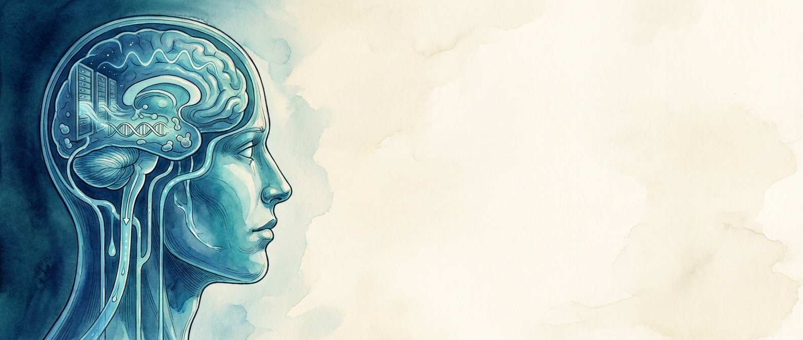

> 你的大脑在后台默默做着三件你不知道的事：排水、剪断 DNA、调节免疫。这一章的主要证据来自 2015–2026 年 *Nature*、*Cell* 等期刊。

### 面颈部淋巴按摩（Brain Drain） ⭐

> **证据 C（小鼠直接证据）｜ 🧪 可以试** ｜ 痛点：大脑昏沉 ｜ 十二柱：H10 细胞间通讯（脑-淋巴对话）

**一句话**：大脑的“污水”有一条出口经过你的脸和脖子。2025 年 *Nature* 发现，隔着皮肤轻压这条通道，小鼠的脑脊液外排量翻了一倍。

**你可能也这样**：连续 debug 四个小时，脑子像一锅粥，喝咖啡也不管用。

**做法**：每天 1–2 次，每次 1–2 分钟，方向始终**向下、朝脖子**：
1. 从眼周、鼻翼两侧，向下轻抹到下颌；
2. 沿下颌骨下缘，从下巴中央滑到耳垂下方；
3. 从耳下沿颈侧，向下轻抹到锁骨上方。

力度像涂面霜：皮肤微微移动就够了，不追求酸痛。

**为什么**：

打个比方：大脑没有垃圾车直达，它把代谢废物溶在**脑脊液**里，靠一套管道排出去，就像机房的排水系统。

这套排水系统很晚才被看清。2015 年，科学家才确认脑膜上有淋巴管，在那之前，教科书写的是“大脑没有淋巴管”。2025 年，韩国团队在 *Nature* 上把整条路线画全了：脑脊液从颅底出发，经过**眼眶周围、鼻腔、上颚**的淋巴管，汇入**颈部浅表淋巴管**，最后流进下颌下的淋巴结。这段颈部淋巴管就在皮肤下面，外面裹着一层会收缩的平滑肌。

关键实验：老年小鼠的这条通道变差了。研究者用一个**控制力度的装置隔着皮肤轻压**颈部浅表淋巴管，脑脊液外排量翻倍，老年小鼠的引流障碍也被纠正。

“按脸按脖子，帮大脑排水”，第一次有了直接的动物实验证据。上面的按摩路线，就是沿着这张路线图走的。

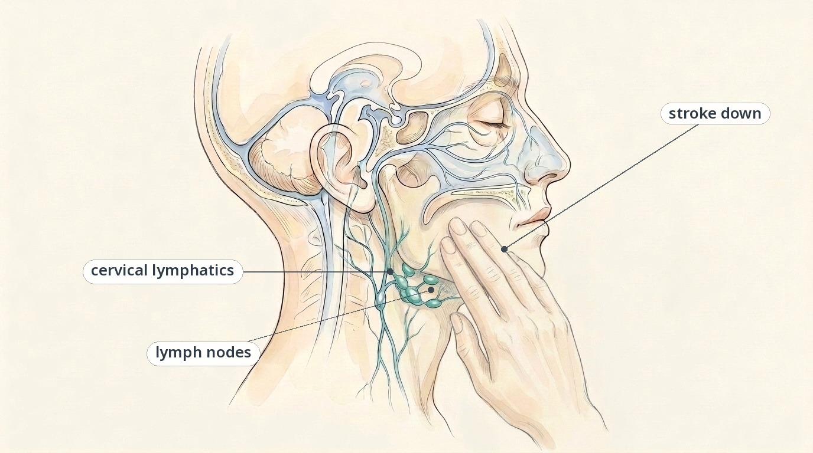

<sub>▲ 方向对，力度轻：脑脊液经颈部浅表淋巴管流向下颌下淋巴结</sub>

<details><summary>🔬 深一层：老化的排水管和一氧化氮</summary>

脑内的代谢废物（包括β-淀粉样蛋白）经类淋巴系统进入脑脊液，主要在睡眠时清除得最快（Xie 2013）。脑脊液经脑膜淋巴管出颅后，一部分经鼻咽、上颚等颅外淋巴管汇入颈部浅表淋巴管，再到下颌下淋巴结。老年小鼠鼻黏膜和上颚的淋巴管变少；颈部浅表淋巴管的 eNOS 蛋白减少，一氧化氮信号受损。外部机械刺激是通过**压迫**浅表淋巴管来增加外排，基本不干扰淋巴管本身的自发收缩（Jin 2025）。

</details>

**证据有多硬（C）**：
- 2015 年两篇里程碑论文确认了脑膜淋巴管的存在和引流功能（Louveau 2015；Aspelund 2015）。
- 2018 年：脑膜淋巴管功能随年龄下降，与阿尔茨海默病相关的病理有关（Da Mesquita 2018）。
- 2025 年：绘出了从脑脊液到颈部浅表淋巴管、再到下颌下淋巴结的路线；隔着皮肤的受控机械刺激让小鼠脑脊液外排翻倍（Jin 2025）。
- **为什么还是 C**：证据来自小鼠，用的是控制力度的装置，不是人的手。人手按摩能不能达到同样效果、能不能让人头脑更清楚，还没有人体试验。

**程序员场景**：debug 卡壳时做一轮，替代刷手机；睡前做一轮，配合睡眠这个大脑排废的高峰期（见「睡眠债偿还表」）。

**边界**：颈部有肿块、甲状腺疾病、急性感染发烧时不做；不要按压颈动脉搏动处；轻柔即可，不用力。

> **笔者按**：这是我标等级时最犹豫的一条。2025 年这篇 *Nature* 让我松了口气：路线图画出来了，动物身上也压出了效果。但从“小鼠 + 装置”到“人 + 手”，中间还隔着一个人体试验。等它出来，这条可能会是本指南第一个从推测升级的条目。

<details><summary>📚 参考文献（5 篇，已核对 PubMed）</summary>

1. Jin H, et al. Increased CSF drainage by non-invasive manipulation of cervical lymphatics. *Nature*. 2025;643(8072):755-767. (PMID: 40468071)
2. Louveau A, et al. Structural and functional features of central nervous system lymphatic vessels. *Nature*. 2015;523(7560):337-41. (PMID: 26030524)
3. Aspelund A, et al. A dural lymphatic vascular system that drains brain interstitial fluid and macromolecules. *J Exp Med*. 2015;212(7):991-9. (PMID: 26077718)
4. Da Mesquita S, et al. Functional aspects of meningeal lymphatics in ageing and Alzheimer's disease. *Nature*. 2018;560(7717):185-191. (PMID: 30046111)
5. Xie L, et al. Sleep drives metabolite clearance from the adult brain. *Science*. 2013;342(6156):373-7. (PMID: 24136970)

</details>


### 学新东西时，大脑会剪断自己的 DNA ⭐

> **证据 C（动物机制，顶刊证据链）｜ 📖 了解即可** ｜ 痛点：学新框架、新语言时的“脑子烧了” ｜ 十二柱：H1 基因组不稳定

**一句话**：为了写下一条新记忆，神经元会主动把自己的 DNA 剪断，再修好接回去。记忆的代价，是一次受控的“基因组损伤”。

**你可能也这样**：连续三天啃一个新框架，脑子像过载的服务器，晚上睡一觉，第二天突然就通了。

**为什么**：

打个比方：这像在生产环境里做**热更新**。为了尽快上线新配置，系统先把一段代码拆开，改完再装回去。拆装本身有风险，所以必须配一套可靠的回滚和修复机制。

大脑真的在这样做。三篇顶刊连成一条证据链：
- **剪开，为了快速开机**：神经元被激活时，一种叫拓扑异构酶 IIβ 的酶会主动剪断特定基因附近的 DNA，让一批“即刻早基因”迅速打开（*Cell* 2015）。
- **剪开之后，有专门的修复队**：突触活动会召集一个蛋白复合体（NPAS4–NuA4），把神经活动和 DNA 修复绑在一起（*Nature* 2023）。
- **断裂，成了记忆的一部分**：小鼠学习后数小时，海马里一小簇神经元出现持续的 DNA 双链断裂，接着启动一条“感知 DNA”的炎症通路（TLR9）来修复。把这条通路关掉，小鼠的记忆就变差了。正是经历过“断裂—修复”的这批神经元，被招进了记忆回路（*Nature* 2024）。

反过来，作者也提醒：如果修复环节出问题，这个基本的记忆机制就会变成通往基因组不稳定和认知衰退的入口。

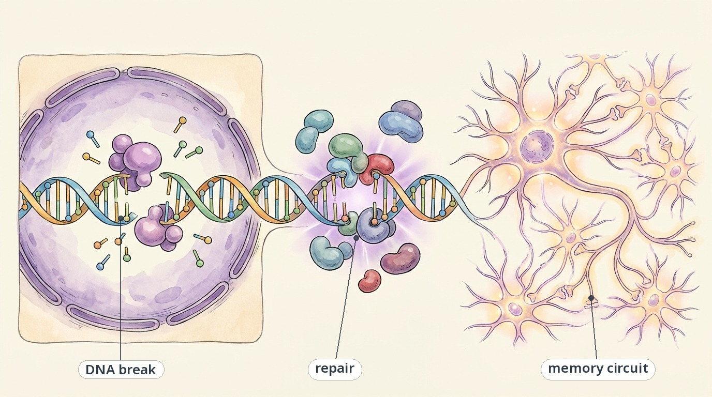

<sub>▲ 一条记忆的诞生：剪开 DNA → 修复 → 接入记忆回路</sub>

**做法**：这是一条认识大脑的条目，不需要你“做”什么。可以落地的是：
- 学新东西的那几天，保证睡眠（「睡够 7 小时左右」），给大脑留出恢复时间；
- 强度控制在“有点难但不至于宕机”，别连续通宵硬啃。

**证据有多硬（C）**：机制证据来自顶刊、证据链完整，但主要是小鼠和细胞实验；人脑是否同样如此，以及能否靠生活方式影响这个过程，还没有直接证据。

**程序员场景**：啃新东西时，大脑在物理层面“重构代码”，给它留出编译时间。

**边界**：“适应性断裂”不等于“学得越多断得越多越好”；这是机制科普，别过度演绎成“学习伤脑”。

> **笔者按**：大脑为了写一条新记忆，主动折断自己的 DNA 再接回去。这是全指南我最想做成动画的一条：它让你重新看待每一次“学会了”。

<details><summary>📚 参考文献（3 篇，已核对 PubMed）</summary>

1. Madabhushi R, et al. Activity-Induced DNA Breaks Govern the Expression of Neuronal Early-Response Genes. *Cell*. 2015;161(7):1592-605. (PMID: 26052046)
2. Pollina EA, et al. A NPAS4-NuA4 complex couples synaptic activity to DNA repair. *Nature*. 2023;614(7949):732-741. (PMID: 36792830)
3. Jovasevic V, et al. Formation of memory assemblies through the DNA-sensing TLR9 pathway. *Nature*. 2024;628(8006):145-153. (PMID: 38538785)

</details>


### 注意力能调节炎症 ⭐

> **证据 C（单篇人体研究，三个预注册实验）｜ 🧪 可以试** ｜ 痛点：身心交互 ｜ 十二柱：H10 细胞间通讯（神经—免疫对话）

**一句话**：把注意力温和地放在身体的感受上，皮肤的急性炎症反应会小约三分之一。这是 2026 年第一次在人体上测出来的。

**你可能也这样**：被蚊子叮了一口，越不管它越痒？还是越盯着它越痒？我们通常以为“别去想”最好。

**为什么**：

打个比方：大脑不只是“读取”身体的传感器数据，它还能**反向下发配置**。

2026 年 *Nature Human Behaviour* 的研究用可控的急性皮肤炎症做模型，做了三个预先注册的实验：同一个人，一次把注意力投向身体感受，一次被别的事分心。结果：
- 注意力投向身体时，炎症反应只有分心时的**约三分之二**（论文表述为约 1.5 倍的差异）；
- 这个效应很稳定：两个独立人群中，约 **90%** 的参与者都出现了；
- 机制上有两条路：一条是注意力改变了大脑对同一份感觉输入的“放大倍数”；另一条是自上而下地调动了副交感神经（迷走神经）。

有意思的是，分散注意力能减轻**疼痛的感受**，但这项研究显示，在炎症这件事上，**把注意力投向身体**反而让免疫反应更受控。

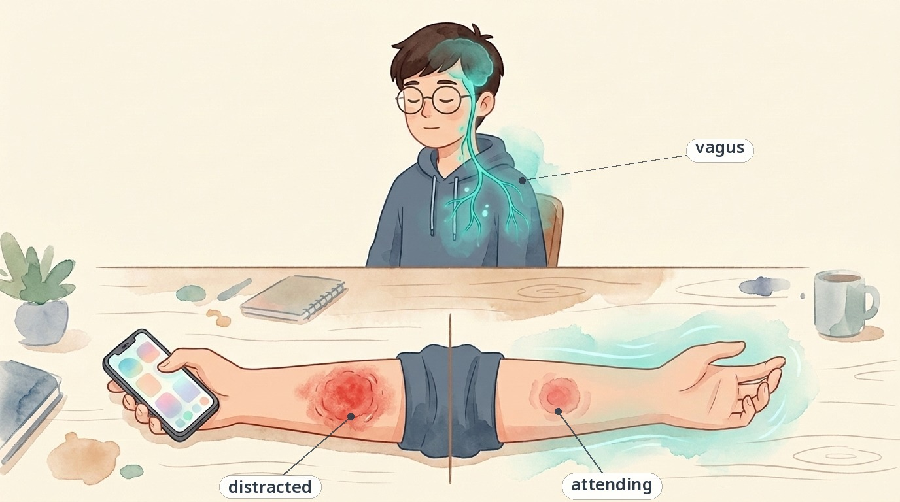

<sub>▲ 分心与注意身体：同样的皮肤炎症，反应大小不同</sub>

**做法**：身体某处出现急性不适（蚊虫叮咬、局部刺激）时，把注意力温和地投向那个部位 2–3 分钟：只是观察感受（热、痒、跳动），不用力想象“治愈”，也不去抓。

**证据有多硬（C）**：单篇论文，但内部包含三个预注册实验和两个独立人群，效应一致。仍需其他团队重复；目前只在急性皮肤炎症模型上验证过。

**程序员场景**：被打断时的烦躁、久坐的腰酸：先花 2 分钟“观察”它，再决定怎么处理（参考 冥想）。

**边界**：**不替代任何治疗**；慢性炎症、自身免疫病请遵医嘱。效应大小和适用范围，还需要更多研究。

> **笔者按**：“意念治病”是养生号的重灾区。但这篇论文告诉你：注意力和免疫之间的对话是真的，只是它说的是“调节走向”，不是“治愈”。把这条收进来，就是示范怎么区分“有初步证据的神奇”和“纯神奇”。

<details><summary>📚 参考文献（1 篇，已核对 PubMed）</summary>

1. Mizrachi N, et al. Voluntary attention regulates acute immune responses in humans. *Nat Hum Behav*. 2026. (PMID: 42608466)

</details>


### 40Hz 声光节拍

> **证据 C（阿尔茨海默病早期人体试验；健康人属外推）｜ 📖 了解即可（设备 💸）** ｜ 痛点：想“健脑” ｜ 十二柱：H10 细胞间通讯

**一句话**：每秒闪 40 次的灯光加 40Hz 的声音，能让小鼠大脑“冲洗”掉更多淀粉样蛋白；人体试验刚起步，健康人用来“健脑”还没有证据。

**你可能也这样**：在短视频里刷到“40Hz 专注音”“40Hz 助眠灯”，评论区说能提神、防老年痴呆，一台几百到几千元。

**为什么**：

打个比方：大脑里的神经元像一个合唱团。清醒专注时，有一种每秒约 40 次的整齐节拍，叫**伽马节律**。阿尔茨海默病患者的大脑，这个节拍会乱掉。

MIT 蔡立慧团队的想法很直接：从外面给一个 40Hz 的节拍，让大脑重新“跟拍”。
- **小鼠**：每天看 40Hz 闪光、听 40Hz 声音，阿尔茨海默模型小鼠的病理改善、认知变好（*Cell* 2019）。
- **为什么有用**：2024 年 *Nature* 给出一个答案：40Hz 刺激能**促进类淋巴系统清运淀粉样蛋白**，也就是帮大脑“排水”。这和「面颈部淋巴按摩」一节讲的是同一套排水系统，一个从里面推，一个从外面压。
- **人**：轻度阿尔茨海默病患者的小样本试验（随机对照的 15 人）显示，每天 1 小时、连续 3 个月是安全可行的，大脑能跟上节拍（*PLoS One* 2022）；延伸研究中 5 名患者用了 2 年，没有不良事件，其中 3 人认知下降比对照人群慢（2025）。

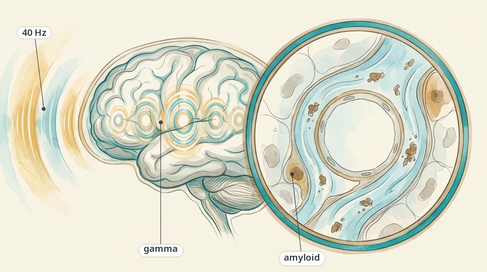

<sub>▲ 大脑的合唱团：40Hz 节拍与类淋巴清运</sub>

**做法**：
- 这一节只需要“知道”，**暂不推荐任何设备**；
- 健康人想让大脑保持节律，运动、社交、学新东西都是免费的来源；
- 家里有轻度认知障碍或阿尔茨海默病的长辈，可以关注正规临床试验，在医生指导下参与。

**证据有多硬（C）**：机制和动物证据来自顶刊，但**并不一致**：纽约大学 Buzsáki 团队在两种阿尔茨海默模型小鼠上重复 40Hz 闪光实验，用电极直接记录，没看到海马等深部脑区的伽马节律被“带起来”，淀粉样蛋白也没有减少（Soula 2023）。人体证据只有阿尔茨海默病患者的小样本和开放标签研究，还没有大型随机对照试验。**健康年轻人用来“健脑”“助眠”“提升专注”，没有任何试验证据**，属于外推。

**程序员场景**：对“40Hz 专注音”保持清醒：卖得最火的场景，恰恰是证据最薄的场景。

**边界**：癫痫或光敏感的人，禁用闪烁光刺激；不要为了健康人“健脑”购买高价设备。

> **笔者按**：40Hz 是全书未来感最强的一节：出自 MIT，故事性感，2024 年还找到了“冲洗大脑”的机制。但另一个顶尖实验室没能在小鼠身上重复出来，健康人健脑更是外推。等人体证据出来，别为预告片买票。

<details><summary>📚 参考文献（6 篇，已核对 PubMed）</summary>

1. Martorell AJ, et al. Multi-sensory Gamma Stimulation Ameliorates Alzheimer's-Associated Pathology and Improves Cognition. *Cell*. 2019;177(2):256-271.e22. (PMID: 30879788)
2. Murdock MH, et al. Multisensory gamma stimulation promotes glymphatic clearance of amyloid. *Nature*. 2024;627(8002):149-156. (PMID: 38418876)
3. Chan D, et al. Gamma frequency sensory stimulation in mild probable Alzheimer's dementia patients: Results of feasibility and pilot studies. *PLoS One*. 2022;17(12):e0278412. (PMID: 36454969)
4. Chan D, et al. Gamma sensory stimulation in mild Alzheimer's dementia: An open-label extension study. *Alzheimers Dement*. 2025;21(10):e70792. (PMID: 41137616)
5. Blanco-Duque C, et al. Audiovisual gamma stimulation for the treatment of neurodegeneration. *J Intern Med*. 2024;295(2):146-170. (PMID: 38115692)
6. Soula M, et al. Forty-hertz light stimulation does not entrain native gamma oscillations in Alzheimer's disease model mice. *Nat Neurosci*. 2023;26(4):570-578. (PMID: 36879142)

</details>


---

## 第二章 · 阳气与线粒体

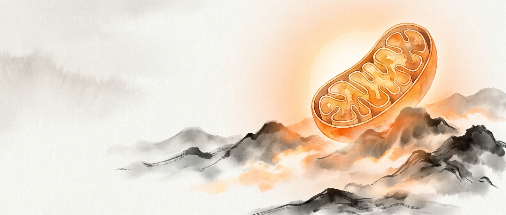

> 中医说的“阳气”，和细胞里的发电厂有什么关系？一个大胆的映射，一张新的温阳食单，以及练、修、喂线粒体的三种方法。

### 阳气与线粒体：一张新的温阳食单 ⭐

> **证据：映射本身 D ｜ 食单逐项 B–C ｜ 📖 了解 + 🧪 食补可以试** ｜ 痛点：怕冷、乏力、下午没电 ｜ 十二柱：H7 线粒体

**一句话**：中医说的“阳气”，很像细胞里线粒体干的活。顺着这条映射，可以给“温阳”开出一张传统食谱里没有的新食单。

**你可能也这样**：手脚冰凉、怕冷、下午三点就没电。长辈说你“阳虚”，让你喝姜茶、冬天吃羊肉。

**为什么**：

中医讲“阳气”，主要说三件事：**温煦**（让身体暖）、**推动**（让身体有劲）、**固护**（抵御和修复）。巧的是，细胞里的线粒体也干三件事：**产热、产能、自我质量控制**。2022 年，一个中国团队在学术期刊上正式提出假说：线粒体是人体“阳气之本”（Luo 2022）。

| 阳气的功能 | 线粒体对应 | 程序员的说法 |
|---|---|---|
| 温煦：手脚暖 | 产热：棕色脂肪里的线粒体能“解偶联”，把能量直接变成热 | 电源发热 |
| 推动：有劲 | 产能：合成 ATP，细胞的通用“电力” | 供电 |
| 固护：能恢复 | 质量控制：坏线粒体被回收（线粒体自噬），新线粒体长出来 | 坏块回收 + 扩容 |

这张表的价值，不在于证明中医对，而在于它能**生成新问题**：如果“温阳”就是在帮线粒体干这三件事，那么，有哪些食物传统上不叫温阳，却在干同样的活？

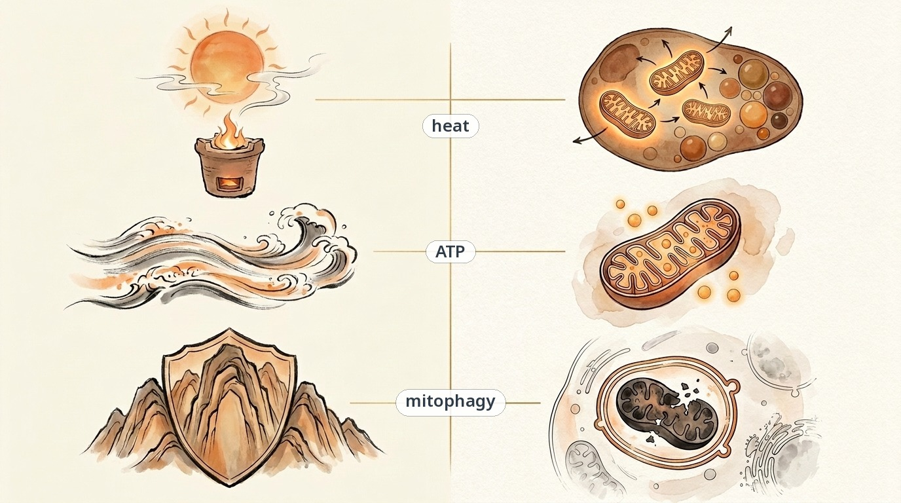

<sub>▲ 阳气三件事 × 线粒体三件事（映射假说）</sub>

**第一步：传统温阳食材，现代怎么看**

| 食材 | 传统说法 | 现代可能的对应 | 证据 |
|---|---|---|---|
| 生姜 | 温中散寒 | 小型人体试验：早餐配姜饮，餐后产热增加（Mansour 2012，10 人） | C |
| 辣椒 | 性热 | 辣椒素及不辣的“辣椒素酯”通过 TRPV1 受体激活棕色脂肪产热，有人体研究支持（Saito 2020 综述） | B |
| 肉桂 | 补火助阳 | 肉桂醛能直接让脂肪细胞产热（Jiang 2017，细胞与小鼠） | C |
| 羊肉 | 温补 | 富含左旋肉碱，它是把脂肪酸运进线粒体的“搬运工”；但肠道菌群会把肉碱转成 TMAO，与动脉粥样硬化相关（Koeth 2013） | C ⚠️ |
| 核桃 | 补肾温肺 | 富含鞣花单宁，可经肠道菌群转化为尿石素 A，一种线粒体自噬激活剂（见下表） | B–C |

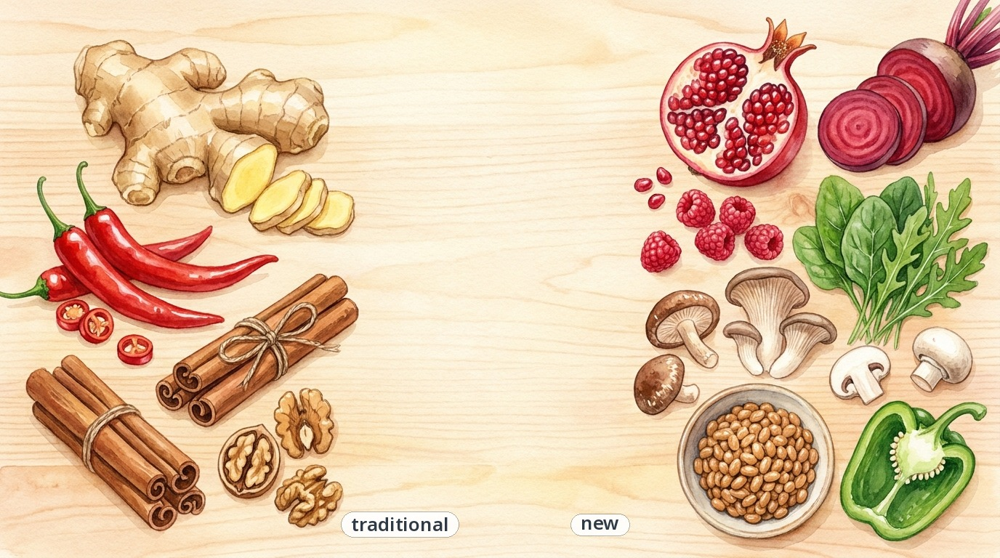

<sub>▲ 新温阳食单：左为传统温阳食材，右为按线粒体逻辑新推的食材</sub>

**第二步：按线粒体逻辑新推的“温阳”食材**

> 下面这些食物，传统食疗里不归为温阳，但按线粒体的逻辑，它们干的是同一类活。这是本指南提出的**映射假说**，每一项单独评级。

| 新食材 | 帮线粒体干哪件事 | 证据 |
|---|---|---|
| **石榴、树莓、核桃**（→ 尿石素 A） | 固护：激活线粒体自噬，回收坏线粒体。人体 RCT 中，补充尿石素 A 改善了中年人的肌力和运动表现，以及老年人的部分肌肉耐力指标（老年人试验的主要终点步行距离未改善）（Andreux 2019；Singh 2022；Liu 2022） | B（补剂试验）；食物转化效率因人而异，取决于肠道菌群 |
| **甜菜根、菠菜、芝麻菜**（膳食硝酸盐） | 推动：人体研究中，膳食硝酸盐让线粒体产能更“省油”（Larsen 2011） | B |
| **蘑菇**（麦角硫因） | 固护：线粒体抗氧化，见「麦角硫因与蘑菇」| C |
| **小麦胚芽、纳豆**（亚精胺） | 固护：自噬，见「亚精胺与小麦胚芽」| C |

**本条的可检验预测**（欢迎研究者认领）：
1. 如果映射成立，自觉“阳虚”的人，棕色脂肪活性、静息代谢率或肌肉线粒体功能应当偏低；
2. 传统温阳食材和上面的“新温阳食材”，都应能测到产热或线粒体指标的变化。

这两条都能用现成方法检验：PET-CT 看棕色脂肪、间接测热法测代谢率、磁共振波谱测肌肉线粒体功能。**一个映射能不能留下来，要看它能不能被证伪。**

**做法**：怕冷、乏力的人：
1. **先放大石头**：「Zone 2 快走」（练线粒体最可靠的方法）、力量训练（「每周两次力量训练」）、睡眠。
2. **餐桌上**：做菜放姜，能吃辣就加点辣椒；每天一把核桃；每周几次石榴或树莓、甜菜根或深绿叶菜、蘑菇。
3. 羊肉冬天可以吃，但红肉总量要控制。
4. 附子、鹿茸等温阳中药不要自己吃，需要中医辨证。

**证据有多硬**：映射本身是 **D**（假说级）。食单里的每一项按各自的证据单独评级（B–C）。整体是“方向值得研究，个人可以从餐桌上低成本尝试”。

**程序员场景**：把“补阳气”翻译成三行代码：练线粒体（Zone 2）、修线粒体（睡眠）、喂线粒体（新温阳食单）。

**边界**：“阳虚”是中医辨证概念，需要专业判断。**甲状腺功能减退、贫血也会让人怕冷乏力，先去医院排除。** 胃不好的人少吃辣；尿石素 A、硝酸盐等补剂不属于本条推荐，本条只讲食物。

> **笔者按**：我把全书最深的水区放在了最前面。“阳气 = 线粒体”映射得再美，也只是假说；但好的假说能开出新的食单、提出能被证伪的预测，这比争论“中医科不科学”有用得多。这条的等级摆在那里，就是整个指南的态度：**证据走到哪一步，我们就说到哪一步。**

<details><summary>📚 参考文献（11 篇，已核对 PubMed）</summary>

1. Luo B, et al. Mitochondria as the Essence of Yang Qi in the Human Body. *Phenomics*. 2022. (PMID: 36939762)
2. Yang J, et al. From ancient wisdom to modern science: Gut microbiota sheds light on property theory of traditional Chinese medicine. *J Integr Med*. 2024. (PMID: 38937158)
3. Mansour MS, et al. Ginger consumption enhances the thermic effect of food and promotes feelings of satiety without affecting metabolic and hormonal parameters in overweight men: a pilot study. *Metabolism*. 2012;61(10):1347-52. (PMID: 22538118)
4. Saito M, et al. Brown Adipose Tissue, Diet-Induced Thermogenesis, and Thermogenic Food Ingredients: From Mice to Men. *Front Endocrinol (Lausanne)*. 2020;11:222. (PMID: 32373072)
5. Jiang J, et al. Cinnamaldehyde induces fat cell-autonomous thermogenesis and metabolic reprogramming. *Metabolism*. 2017;77:58-64. (PMID: 29046261)
6. Koeth RA, et al. Intestinal microbiota metabolism of L-carnitine, a nutrient in red meat, promotes atherosclerosis. *Nat Med*. 2013;19(5):576-85. (PMID: 23563705)
7. Ryu D, et al. Urolithin A induces mitophagy and prolongs lifespan in C. elegans and increases muscle function in rodents. *Nat Med*. 2016;22(8):879-88. (PMID: 27400265)
8. Andreux PA, et al. The mitophagy activator urolithin A is safe and induces a molecular signature of improved mitochondrial and cellular health in humans. *Nat Metab*. 2019;1(6):595-603. (PMID: 32694802)
9. Singh A, et al. Urolithin A improves muscle strength, exercise performance, and biomarkers of mitochondrial health in a randomized trial in middle-aged adults. *Cell Rep Med*. 2022;3(5):100633. (PMID: 35584623)
10. Liu S, et al. Effect of Urolithin A Supplementation on Muscle Endurance and Mitochondrial Health in Older Adults: A Randomized Clinical Trial. *JAMA Netw Open*. 2022;5(1):e2144279. (PMID: 35050355)
11. Larsen FJ, et al. Dietary inorganic nitrate improves mitochondrial efficiency in humans. *Cell Metab*. 2011;13(2):149-59. (PMID: 21284982)

</details>


### Zone 2 快走

> **证据 B（运动量与死亡率：大型队列）｜ ✅ 去做** ｜ 痛点：体能下降、下午没电 ｜ 十二柱：H7 线粒体

**一句话**：“还能完整说话、但唱不了歌”的强度，每周 3–5 次，是给线粒体上课最便宜的方式。

**你可能也这样**：爬三层楼就喘，下午三点电量见底，办了健身卡却一年去了三次。

**为什么**：

打个比方：线粒体是细胞的**电源模块**。你不用它，它就降频、缩容；你持续给它中等负载，它就扩容：数量变多、效率变高。

**Zone 2** 指的是一个中等强度区间：心率约为最大心率的 60%–70%，主要靠线粒体“烧脂肪”供能，不会喘到说不出话。这个区间对线粒体的刺激足够大，身体又恢复得过来，每周可以做很多次。

早在 1967 年，Holloszy 就在动物肌肉里发现：耐力训练让肌肉的线粒体呼吸酶活性大幅升高。半个多世纪以来，这个结论被反复验证。而线粒体功能衰退，正是衰老的十二大标志之一（见「续命十二柱」）。

这也是「阳气与线粒体」一节说的“练线粒体”：想让身体暖起来、有劲，最可靠的方法不是吃什么，而是动起来。

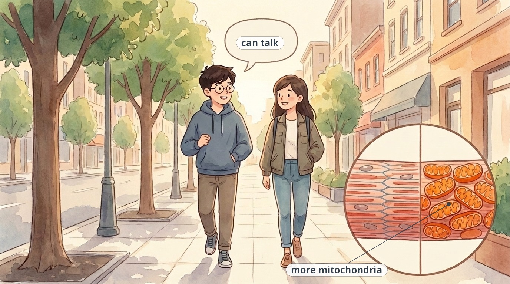

<sub>▲ 线粒体的训练课：能说话、唱不了歌</sub>

**做法**：每周 3–5 次，每次 30–45 分钟，快走、慢跑、骑车都行。强度用**说话测试**：能说完整的句子，但唱不了歌。不用买心率表。

**证据有多硬（B）**：
- 汇总 66 万人、追踪 14 年的分析：休闲时间的中高强度运动量和死亡风险呈剂量关系。达到指南推荐量（每周 150 分钟中等强度）的人，死亡风险比不运动的人低约 3 成；做到推荐量的 3–5 倍，低约 4 成；再多也没有看到害处（Arem 2015）。
- **为什么不是 A**：这是队列研究，不是随机试验；而且研究的是总运动量，不是“Zone 2”这个具体强度区间。Zone 2 是运动生理学上训练线粒体的合理区间，但它比其他强度更好的直接证据有限。

**程序员场景**：通勤的最后一公里快走；代码评审前绕楼一圈；周末骑车代替打车。不用换衣服，不用去健身房。

**边界**：有心血管病史的人先咨询医生；刚开始从每次 15–20 分钟起步。

> **笔者按**：长寿研究绕不开线粒体，Zone 2 是给线粒体上课最便宜的方式：不用办卡，不用装备，“能说话但唱不了歌”这一句就够了。

<details><summary>📚 参考文献（2 篇，已核对 PubMed）</summary>

1. Holloszy JO. Biochemical adaptations in muscle. Effects of exercise on mitochondrial oxygen uptake and respiratory enzyme activity in skeletal muscle. *J Biol Chem*. 1967;242(9):2278-82. (PMID: 4290225)
2. Arem H, et al. Leisure time physical activity and mortality: a detailed pooled analysis of the dose-response relationship. *JAMA Intern Med*. 2015;175(6):959-67. (PMID: 25844730)

</details>


### 麦角硫因与蘑菇

> **证据 C（观察性队列）｜ 🧪 食补可以试；补剂 💸** ｜ 痛点：长寿维生素 ｜ 十二柱：H7 线粒体 · H11 炎症

**一句话**：蘑菇里的麦角硫因，人体专门造了一个“搬运工”来吸收它；血液里含量高的老人，痴呆风险更低。炒个蘑菇，是最便宜的长寿下注。

**你可能也这样**：点外卖时总在纠结吃什么“健康”。

**为什么**：

打个比方：如果系统专门为某个依赖包写了一个安装器，说明这个包大概率很重要。

**麦角硫因**是一种抗氧化物，人体自己不能合成，只能从食物里来，**蘑菇是最主要的来源**。人体细胞上有一个专门运输它的转运蛋白，会把它主动“搬”进细胞、在一些组织里积累起来。所以有学者把它叫作“长寿维生素”。

人群里的线索越来越多：
- **日本久山町研究**：1344 名 65 岁以上、起初没有痴呆的老人，追踪中位 11.2 年。血清麦角硫因越高，全因痴呆和阿尔茨海默病的风险越低；校正了心血管、生活方式和蔬菜摄入等因素后依然成立（2025）。
- **记忆门诊的老人**：血浆麦角硫因低，预示之后的认知和功能下降更快（2022）。
- **新加坡社区研究**：常吃蘑菇的老人，轻度认知障碍的比例更低（2019，横断面研究）。

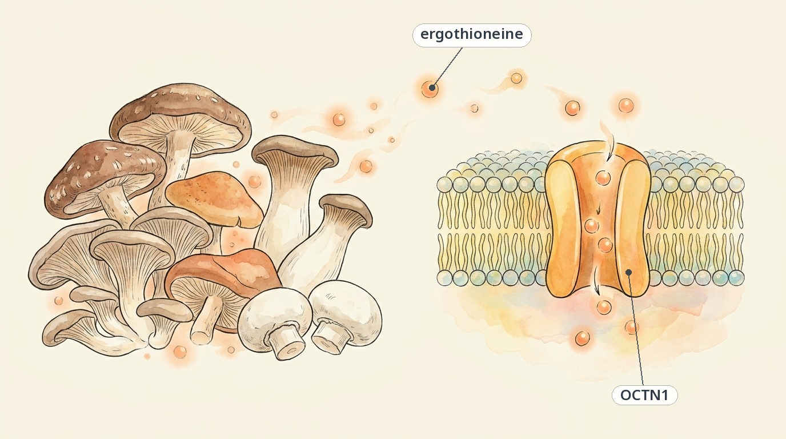

<sub>▲ 专属搬运工：蘑菇里的麦角硫因经专用转运体进入细胞</sub>

**做法**：蘑菇入菜：香菇、平菇、杏鲍菇、口蘑，每周 2–3 次，换着吃。**食补优先，暂不推荐补剂。**

**证据有多硬（C）**：全部是观察性研究，说明“相关”，不能证明“吃蘑菇 → 防痴呆”。还没有补充麦角硫因能预防认知下降的大型人体试验。

**程序员场景**：外卖点一道蘑菇类的菜，是最不费劲的“长寿投资”。

**边界**：观察性证据不等于因果；不要囤高价麦角硫因补剂；野生菌务必确认可食用。

> **笔者按**：相关性不是因果。但当要做的事只是“炒个蘑菇”这种几乎零风险的小事时，观察性证据也够下单了。这叫贝叶斯式点菜。

<details><summary>📚 参考文献（3 篇，已核对 PubMed）</summary>

1. Meng X, et al. Serum ergothioneine and risk of dementia in a general older Japanese population: the Hisayama Study. *Psychiatry Clin Neurosci*. 2025;79(12):808-816. (PMID: 40908798)
2. Wu LY, et al. Low Plasma Ergothioneine Predicts Cognitive and Functional Decline in an Elderly Cohort Attending Memory Clinics. *Antioxidants (Basel)*. 2022;11(9). (PMID: 36139790)
3. Feng L, et al. The Association between Mushroom Consumption and Mild Cognitive Impairment: A Community-Based Cross-Sectional Study in Singapore. *J Alzheimers Dis*. 2019;68(1):197-203. (PMID: 30775990)

</details>


---

## 第三章 · 年龄不是一个数

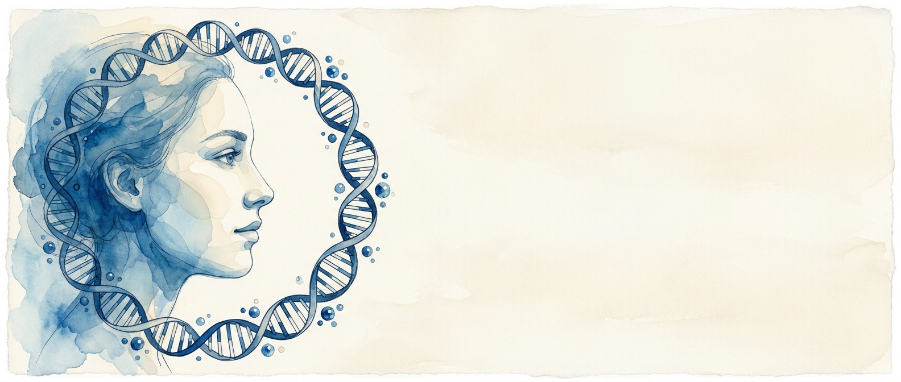

> 从一张脸、一管血、一段压力史里，都能读出你“真正”的年龄。

### 一张脸能读出你的生物年龄 ⭐

> **证据 C（大样本模型，群体层面成立）｜ 📖 了解即可 ｜ ⚠️ 利益相关** ｜ 痛点：我到底老得快不快 ｜ 十二柱：—（表型时钟，与「甲基化时钟」对照）

**一句话**：奶奶看一眼你的脸色，就知道你最近累没累；中国团队用面部红外热像，把“看面相”做成了能预测代谢病的 AI 时钟，而且这个“脸部年龄”能被运动改变。

**你可能也这样**：同学聚会，有人看着比实际年轻十岁，有人老十岁。“看起来多大”到底有没有意义？

**为什么**：

打个比方：脸是一块**免费的监控面板**，只是以前没人会读。

- **热像时钟（ThermoFace，*Cell Metab* 2024）**：研究团队拍了 2811 名 20–90 岁汉族人的面部红外热像，训练出“热年龄”模型，平均误差约 5 年，在独立人群中验证为 5.18 年。“脸部热年龄”和实际年龄的差值，跟代谢指标、睡眠时长明显相关，血液里 DNA 修复、脂肪分解等通路也跟着变；同一套方法还能较准确地预测脂肪肝等代谢病。最关键的一句：**这个差值可以被运动改变。**
- **多模态时钟（AURORA，*Cell Metab* 2026）**：韩敬东团队把转录组、代谢组、菌群、三维和热成像面部图像、常规化验等七类数据，汇集到 42.5 万人、58 万份样本上，训练出生成式 AI 平台。只输入一张脸或一份常规体检，就能补全出一份包括基因表达、代谢、菌群在内的“多组学”画像，估算衰老和疾病风险。

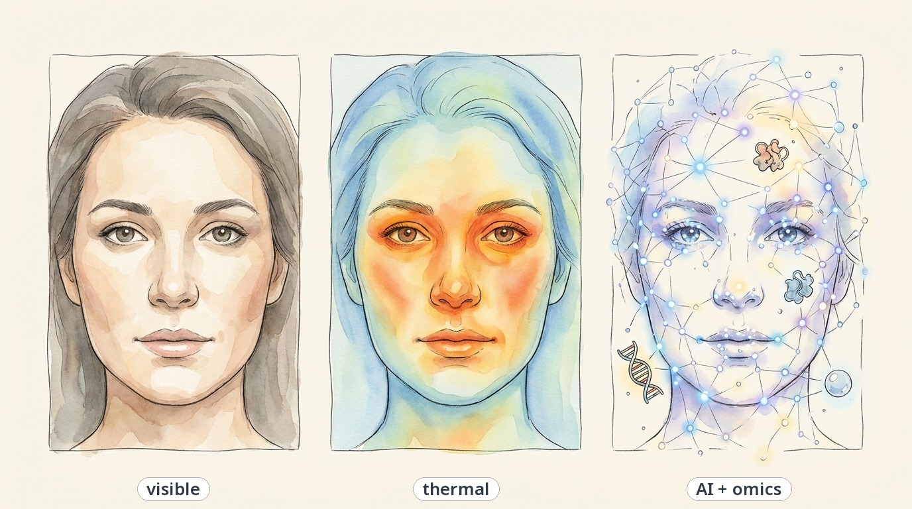

<sub>▲ 同一张脸的三种读法：肉眼看气色、红外看热分布、AI 补全多组学</sub>

**做法**：
- 了解“看脸估年龄”这类时钟能回答什么、不能回答什么；
- 能落地的是那句关键结论：**热年龄可以被运动改变**，所以回到「每天动起来」「Zone 2 快走」；
- 商业“AI 面相测衰老”产品谨慎看待：模型不透明，误差未知。

**证据有多硬（C）**：
- 样本量大、有独立验证，在群体层面成立。
- **为什么不是 B**：个体误差约 5 年；看到的是关联，不是因果；“运动能改变热年龄”目前主要来自这一个团队的数据，还需要别的团队重复；模型在汉族人群里训练，用到其他人群要重新验证。

**程序员场景**：每天早上镜子里的气色，是免费多模态传感器的低配版，认真看一眼。

**边界**：误差显著；相学话术（“夫妻宫”“财帛宫”）和这些研究无关，不要混用。维护方从事衰老检测相关业务，见[利益冲突声明](#利益冲突声明)。

> **笔者按**：奶奶说的“脸色不好，歇歇吧”，机器学习版是“面部热分布偏移，提示代谢年龄偏高”。隔着一百年的两套语言，说的是同一张脸。和「甲基化时钟」对照着读：一个从血液或唾液读，一个从脸上读，都指向同一件事：年龄不是一个数。

<details><summary>📚 参考文献（2 篇，已核对 PubMed）</summary>

1. Yu Z, et al. Thermal facial image analyses reveal quantitative hallmarks of aging and metabolic diseases. *Cell Metab*. 2024;36(7):1482-1493. (PMID: 38959862)
2. Chen J, et al. A generative AI framework unifies human multi-omics to model aging. *Cell Metab*. 2026;38(6):1229-1244. (PMID: 42019500)

</details>


### 甲基化时钟

> **证据 B（测量学）｜ 📖 了解即可 ｜ ⚠️ 利益相关** ｜ 痛点：我的身体到底几岁 ｜ 十二柱：H3 表观遗传

**一句话**：DNA 上的化学“书签”会随年龄越积越乱，读它就能估出生物年龄；但测一次能指导你做什么，还没有定论。

**你可能也这样**：刷到广告“测出生物年龄比实际小 8 岁”，有点心动；转念一想：这个数字是怎么算出来的？测完我又该干嘛？

**做法**：
- 先把概念装进脑子：生物年龄可以测，不同的“时钟”读数会不一样。
- 看到商业检测，问四个问题：用的是哪个时钟？训练它的人群和你像不像？同一份样本重复测，误差有多大？有没有干预前后的对比，还是只有一个单点读数？
- 真正能落地的行动，不在检测本身，在「每天动起来」「睡够 7 小时左右」这些大石头上。

**为什么**：

打个比方：DNA 是一套代码，**甲基化**是贴在代码上的注释和开关，决定哪些函数被调用、哪些被注释掉。年轻时这些开关排得整整齐齐；随着年龄增长，有的地方开关越加越多，有的地方掉了，像一个维护多年的老项目，注释越来越乱。

2013 年，Horvath 从几千份样本里挑出几百个“最随年龄变化”的位点，用它们拟合出一个模型，误差只有几岁，几乎能在所有组织里用。这就是第一代**甲基化时钟**。之后的时钟越做越细：有的预测死亡风险，有的测“衰老速度”。

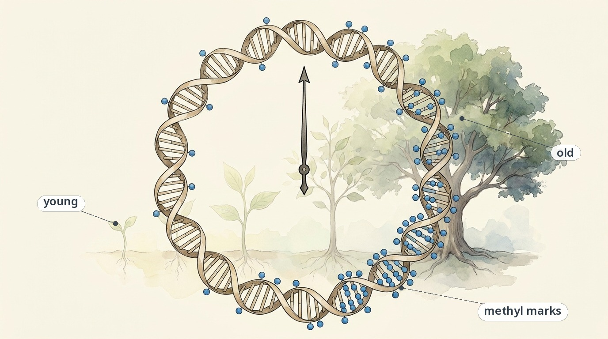

<sub>▲ 甲基化时钟：DNA 上的甲基标记随年龄改变，读它就能估出年龄</sub>

<details><summary>🔬 深一层：时钟读的到底是什么</summary>

甲基化指 DNA 的胞嘧啶（C）上加了一个甲基（–CH₃），多发生在 CpG 位点。它不改变 DNA 序列，却会影响基因能不能被读出来，属于“表观遗传”。2023 年版的衰老十二种标志里，表观遗传改变是其中一柱（见「续命十二柱」）。时钟本身是统计模型：它发现这些位点的变化和年龄高度相关，但这不等于这些位点就是衰老的原因。

</details>

**证据有多硬（B）**：
- 作为**测量工具**，证据扎实：时钟能在群体里稳定地估算年龄（Horvath 2013）；新一代时钟读数偏“老”的人，后续疾病和死亡风险更高（GrimAge，Lu 2019）。
- 作为**行动指南**，证据不够：“某个干预让时钟变年轻 = 让人更长寿”，还没有被证明。
- **为什么只给“了解即可”**：个人单次读数有误差。同一份样本测两次，有的经典时钟读数能差到 9 岁；改进算法后，多数重复能落在 1.5 岁以内（Higgins-Chen 2022）。不同时钟也会给出不同的数字。拿单次读数做决策，价值有限。

**程序员场景**：把它当监控里的一个指标，不是 SLA。指标偏了值得留意，但不要为了把指标调好看去改系统。

**边界**：时钟不是命运；一次检测不说明问题；不同公司、不同时钟的结果不能直接比较。维护方从事衰老检测相关业务，见[利益冲突声明](#利益冲突声明)。

> **笔者按**：这是我自己的行当，所以更要说清楚：时钟能告诉你“偏没偏”，还不能告诉你“怎么改”。和「一张脸能读出你的生物年龄」对照着读：一个从血液或唾液读，一个从脸上读，都指向同一件事：年龄不是一个数。

<details><summary>📚 参考文献（4 篇，已核对 PubMed）</summary>

1. Horvath S. DNA methylation age of human tissues and cell types. *Genome Biol*. 2013;14(10):R115. (PMID: 24138928)
2. Lu AT, et al. DNA methylation GrimAge strongly predicts lifespan and healthspan. *Aging (Albany NY)*. 2019;11(2):303-327. (PMID: 30669119)
3. Higgins-Chen AT, et al. A computational solution for bolstering reliability of epigenetic clocks: Implications for clinical trials and longitudinal tracking. *Nat Aging*. 2022;2(7):644-661. (PMID: 36277076)
4. López-Otín C, et al. Hallmarks of aging: An expanding universe. *Cell*. 2023;186(2):243-278. (PMID: 36599349)

</details>

### 情绪与基因组稳定

> **证据 B（关联）｜ 📖 了解即可（行动见「冥想十分钟」「Zone 2 快走」「睡眠债偿还表」）** ｜ 痛点：长期高压，身体会不会记账 ｜ 十二柱：H1 基因组 · H2 端粒 · H8 细胞衰老

**一句话**：长期压力会在染色体末端“记账”；管理情绪不是矫情，是基因组维护的一部分。

**你可能也这样**：连续几个月赶项目、扛线上事故，嘴上说“扛过去就好了”。项目上线了，人却像老了几岁。

**做法**：
- 把慢性压力当作有生理后果的事来管：每天 10 分钟冥想（「冥想十分钟」）、每周几次快走（「Zone 2 快走」）、把睡眠还上（「睡眠债偿还表」）。
- 身边要有一个能说话的人（见大石头「有人可以说话」）。
- 大的压力事件过去后，主动给自己安排一段恢复期，别无缝衔接下一个冲刺。

**为什么**：

打个比方：染色体两端有一段保护帽，叫**端粒**，像鞋带头上的塑料套。细胞每分裂一次，塑料套就磨掉一点；磨得太短，细胞就停止分裂、进入衰老状态。

2004 年，Epel 和后来获得诺贝尔奖的 Blackburn 研究了一群照护慢性病孩子的妈妈：压力感受越重、照护年头越长，她们白细胞的端粒越短，修补端粒的端粒酶活性也越低。压力感受最重的那组和最轻的那组相比，端粒短出来的量，相当于**至少多老了十年**。不过这项研究只有 58 位女性。

后来的大样本研究给这个故事降了温：
- 汇总 22 项研究、近 9000 人，自我感受的压力和端粒长度确实相关，但**相关性非常弱**，量级和肥胖对端粒的影响差不多（Mathur 2016）。
- 汇总 38 项研究、3.4 万人，抑郁症患者的端粒偏短，效应量小（Ridout 2016）。
- 2025 年一项小鼠研究发现，长期处在“被欺负”的社交压力下，体内衰老细胞会增多；但把这些衰老细胞清掉，健康状况并没有跟着变好（Lyons 2025）。

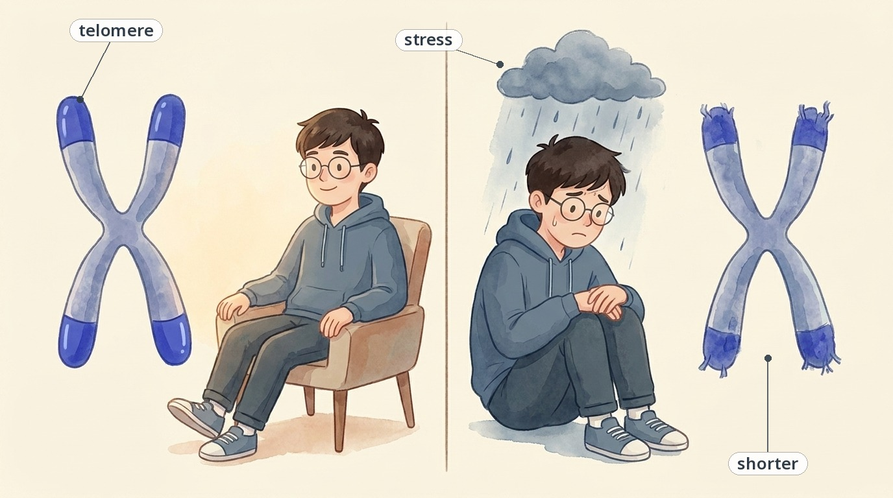

<sub>▲ 情绪与基因组：长期压力下，染色体末端的端粒更短</sub>

<details><summary>🔬 深一层：压力怎么“磨”端粒</summary>

目前的主流解释有几条：压力激素皮质醇长期偏高、氧化应激增加、慢性低度炎症。端粒富含 G 碱基，对氧化损伤格外敏感；端粒酶活性被压低后，磨损又补不回来。小鼠研究提示，慢性压力还会通过 p16 这条通路让衰老细胞积累。这些机制在人体里还没有完全坐实。

</details>

**证据有多硬（B）**：
- 人群研究方向一致：压力、抑郁和端粒偏短相关（Epel 2004；Mathur 2016；Ridout 2016）。
- 但效应量小：放到个人身上，压力只是影响端粒的众多因素之一。
- **为什么不是 A**：这些主要是关联研究，因果方向（是压力导致端粒短，还是有别的共同原因）还在研究；“管理情绪能让端粒变长”的干预证据也在积累中。

**程序员场景**：连续高压冲刺之后，安排一周“低负载迭代”：不排新需求、按时下班、补觉，像给系统做一次冷却。

**边界**：关联不等于因果；抑郁症是疾病，治疗优先，端粒长度不是 KPI，也不建议为此去测端粒。

> **笔者按**：情绪是有分子后果的，这不是鸡汤；但后来的大样本也提醒我们，这个后果在单个人身上没有最初那篇论文看起来那么大。我想让程序员记住的不是“端粒”这个词，而是一个工程直觉：长期过载的系统一定会有损耗，只是日志写在你看不见的地方。

<details><summary>📚 参考文献（4 篇，已核对 PubMed）</summary>

1. Epel ES, et al. Accelerated telomere shortening in response to life stress. *Proc Natl Acad Sci U S A*. 2004;101(49):17312-5. (PMID: 15574496)
2. Mathur MB, et al. Perceived stress and telomere length: A systematic review, meta-analysis, and methodologic considerations for advancing the field. *Brain Behav Immun*. 2016;54:158-169. (PMID: 26853993)
3. Ridout KK, et al. Depression and telomere length: A meta-analysis. *J Affect Disord*. 2016;191:237-47. (PMID: 26688493)
4. Lyons CE, et al. Chronic social stress induces p16-mediated senescent cell accumulation in mice. *Nat Aging*. 2025;5(1):48-64. (PMID: 39528642)

</details>

---

## 第四章 · 古方新解

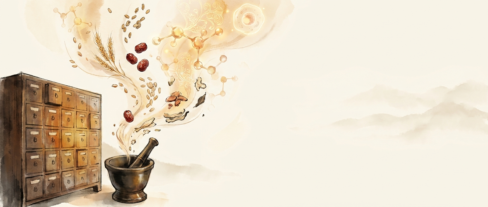

> 两千年的经验，放到同一把证据尺子上：哪些已经拿到证据，哪些还在路上，哪些只是映射。

### 甘麦大枣汤与小麦胚芽 ⭐

> **证据 C ｜ 📖 了解即可** ｜ 痛点：情绪低落、心神不宁 ｜ 十二柱：H5 自噬 · H11 炎症

**一句话**：一张 1800 年前的经方，君药是小麦；今天，小麦胚芽成了自噬研究里的明星食材。经方找中医，胚芽放进早餐。

**你可能也这样**：压力大的那几周，莫名想哭、心慌、睡不踏实。听长辈说过“甘麦大枣汤安神”，又不知道靠不靠谱。

**做法**：
- **甘麦大枣汤**是处方，不是食谱：要用，找中医师辨证。
- **平民版**：把小麦胚芽放进主食，比如早餐燕麦里加一两勺胚芽，或者选带胚芽的全麦面包。
- 情绪问题持续两周以上、影响工作生活，先看医生。

**为什么**：

这一节有两条线，在同一颗麦粒上相遇。

**经方线**：东汉张仲景《金匮要略》里，甘麦大枣汤只有三味药：小麦、甘草、大枣，用来治“脏躁”，也就是情绪不稳、悲伤欲哭、坐立不安。2014 年的一项 meta 分析汇总了 10 项治疗抑郁的随机试验，结果偏正面，但这 10 项全部以中文发表，方法学质量普遍偏低；2025 年的小鼠研究提示，它可能通过“肠道菌群–代谢–炎症”这条轴起作用。

**现代线**：小麦胚芽是麦粒里将来发芽的那一小块，营养密度最高，也是膳食**亚精胺**含量最高的食物之一。亚精胺能激活**自噬**，也就是细胞的“垃圾回收”（详见「亚精胺与小麦胚芽」）。

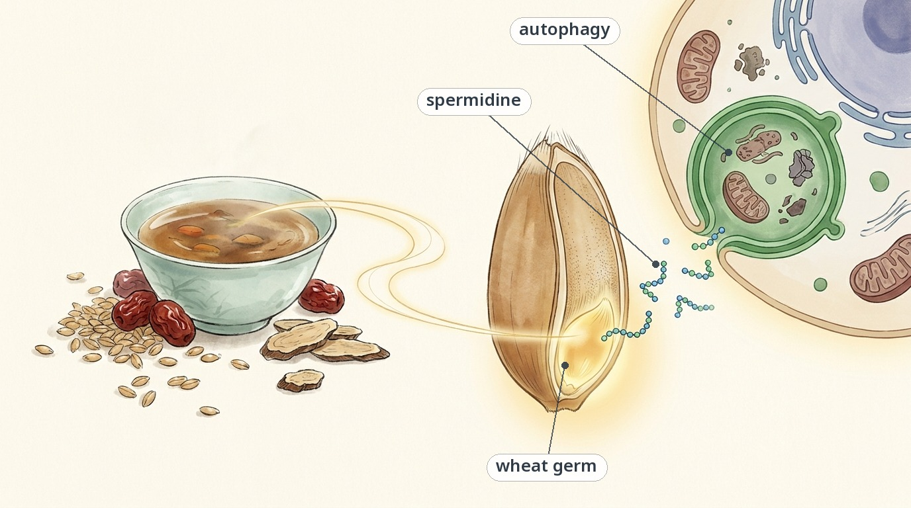

<sub>▲ 一碗经方，一颗麦粒：两条线在小麦上相遇，但彼此不能当证据</sub>

<details><summary>🔬 深一层：为什么不能说“古人早就知道自噬”</summary>

经方里的“小麦”是整粒小麦（多用浮小麦或淮小麦），不是提纯的胚芽；它的作用机制目前只有动物研究，跟亚精胺有没有关系，还没有人验证过。两条线各自成立，交汇只是一个有意思的巧合，不能互相当证据。

</details>

**证据有多硬（C）**：
- 经方：有 meta 分析，但纳入的试验少、质量偏低，作者自己也呼吁做更严格的研究；机制来自动物实验。
- 胚芽与亚精胺：食物含量明确；亚精胺补剂的人体试验结果并不亮眼（见「亚精胺与小麦胚芽」）。
- **为什么不是 B**：缺少高质量、大样本的人体随机对照试验。

**程序员场景**：情绪低谷期，给自己一个低成本的早餐仪式：一碗胚芽燕麦。它不是药，但比深夜外卖对身体友好。

**边界**：经方使用请找中医师；甘麦大枣汤不能替代精神科治疗，也不要自行和抗抑郁药换着吃；方中有甘草，长期大量服用可能升高血压、降低血钾，高血压和心脏病患者尤其要遵医嘱；乳糜泻或麸质过敏者避开小麦制品。

> **笔者按**：这一节是全书故事密度最高的一条。我不说“古人早就知道”，我说的是：一样好食材，经得住两套完全不同的知识体系反复检验。故事可以讲得漂亮，证据要说得老实。

<details><summary>📚 参考文献（2 篇，已核对 PubMed）</summary>

1. Yeung WF, et al. A meta-analysis of the efficacy and safety of traditional Chinese medicine formula Ganmai Dazao decoction for depression. *J Ethnopharmacol*. 2014;153(2):309-17. (PMID: 24632021)
2. Zhang B, et al. Gan-Mai-Da-Zao decoction ameliorates depressive-like behaviors in CUMS mice via the microbiota-metabolism-inflammation axis. *Phytomedicine*. 2025;145:157018. (PMID: 40580692)

</details>

### 八段锦与筋 ⭐

> **证据 B（肌少症、平衡）+ D（筋膜机制映射）｜ 🧪 可以试** ｜ 痛点：久坐僵硬、肌肉流失 ｜ 十二柱：H4 蛋白稳态

**一句话**：八段锦对老年人的肌肉和平衡有随机试验证据；“练的是筋”这层解释，只走到了一半。

**你可能也这样**：坐了一天，起身时腰背像生锈；想运动，又不想换衣服去健身房。公园里大爷大妈练的八段锦，看着慢悠悠的，真有用吗？

**做法**：
- 跟练视频每天 15–20 分钟，八个动作一套下来大约 12 分钟。
- 要领是**拉、伸、旋拧**：每个动作做到有牵拉感，但不痛。
- 想更省事，只做第一式“两手托天理三焦”：双手交叉上举、掌心向上，伸展 5 次。

**为什么**：

这一节示范了本指南的方法：证据走到哪一层，话就说到哪一层。

1. **动作层（证据最硬）**：2025 年成都的一项随机对照试验，把 90 位 60–77 岁的肌少症老人分成两组：一组练八段锦，一组做抗阻训练，都是每周 3 次、每次 60 分钟，坚持 24 周。结果八段锦组在身体功能评分、平衡、下肢力量和腿部肌肉量上，改善得比抗阻训练组还多。
2. **组织层（综述）**：“筋”在现代解剖里最接近**筋膜**，就是包在肌肉外面、把全身连成网的那层白色结缔组织。2025 年的系统综述把它重新定义为“力学信号的枢纽”和干细胞的储备库。
3. **分子层（推理）**：筋膜主要由胶原蛋白构成；蛋白质的折叠和维护（蛋白稳态）是衰老十二标志之一。这是“筋 = 蛋白结构”的科学落脚点。
4. **概念层（空白）**：“肝主筋”这类中医理论，在英文文献库里找不到可检验的对应研究，我们如实留白。

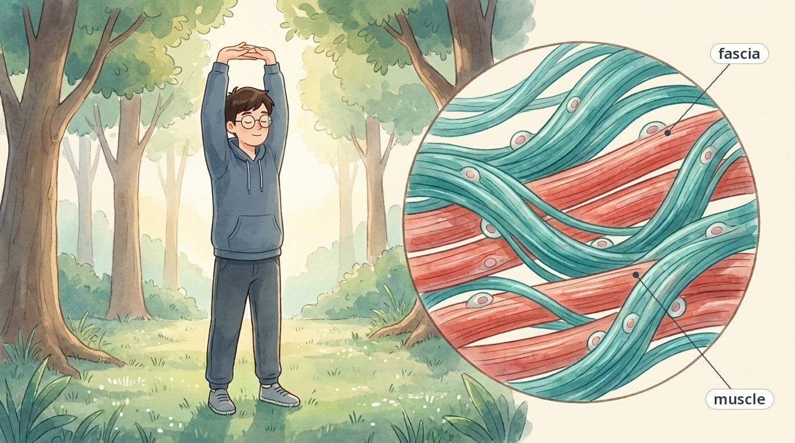

<sub>▲ 八段锦“两手托天”与筋膜：胶原纤维包裹肌肉</sub>

<details><summary>🔬 深一层：为什么慢动作也算力量刺激</summary>

八段锦的很多动作是持续的等长收缩和多关节牵拉，比如马步、旋转、上举。对平时不运动的人和老年人来说，这已经足够构成肌肉的力学刺激，所以上面那项试验里它能跑赢抗阻训练并不离奇。不过那是一项单中心试验，受试者九成是女性、都已经有肌少症；对年轻人来说，想长肌肉，「每周两次力量训练」里那种渐进加重的抗阻训练仍是主力，最好两样都做。

</details>

**证据有多硬（动作层 B，机制层 D）**：
- 动作层：有随机对照试验，但只有 90 人、单中心，研究人群是有肌少症的老年人。
- 机制层：筋膜研究是综述级；“练八段锦 → 改善筋膜 → 延缓衰老”这条链没有被直接验证。
- **为什么不是 A**：样本量和随访时间有限，年轻人群的数据少。

**程序员场景**：工位久坐的反向操作。午休前或下班后，用一套八段锦代替刷短视频；会议间隙做一式“两手托天”。

**边界**：有慢性病的人循序渐进；膝关节不适时，减小马步下蹲的幅度；动作中出现疼痛就停。

> **笔者按**：四层证据，逐层递减，最后一层诚实留白，这是全指南方法论的自证。传统功法值不值得练？动作层的证据已经足够回答“值得”，不需要靠玄学加分。

<details><summary>📚 参考文献（3 篇，已核对 PubMed）</summary>

1. Wu K, et al. Efficacy of Baduanjin Exercise for Sarcopenia in Older Adults: A 24-Week Randomized Controlled Trial. *J Cachexia Sarcopenia Muscle*. 2025;16(6):e70163. (PMID: 41371252)
2. Pirri C, et al. Redefining Fascia: A Mechanobiological Hub and Stem Cell Reservoir in Regeneration-A Systematic Review. *Int J Mol Sci*. 2025;26(20). (PMID: 41155456)
3. López-Otín C, et al. Hallmarks of aging: An expanding universe. *Cell*. 2023;186(2):243-278. (PMID: 36599349)

</details>

### 醋与乙酸

> **证据 B（餐后血糖）｜ 🧪 可以试** ｜ 痛点：饭后犯困、血糖坐过山车 ｜ 十二柱：H6 营养感知 · H12 菌群

**一句话**：随餐吃点醋，能把餐后血糖压低一点；想养菌群，靠的是膳食纤维，不是喝醋。

**你可能也这样**：中午一大碗盖浇饭，下午两点眼皮打架。听说“喝醋降血糖”“醋能排毒”，不知道哪句是真的。

**做法**：
- 凉拌菜、饺子、面条，随餐加 1–2 汤匙醋（陈醋、米醋、苹果醋都行），别空腹喝醋。
- 同时把膳食纤维吃够：燕麦、豆类、蔬菜水果，这是喂肠道菌群的饭。
- 两件事分开理解，别把“喝醋”当成“养菌”。

**为什么**：

这一节讲的是**同一个分子、两条路**。

**第一条路：吃进去的醋**。醋的主要成分是**乙酸**。随餐吃醋会让胃排空慢一点，碳水进入血液的速度也慢一点，餐后血糖的峰值就被削低了。2017 年的系统综述和 meta 分析汇总了多项临床试验，结论是醋可以削弱餐后的血糖和胰岛素峰值。

**第二条路：菌群自己产的乙酸**。膳食纤维人体消化不了，到了大肠被细菌发酵，产出**短链脂肪酸**，乙酸是其中含量最多的一种。短链脂肪酸给肠道细胞供能，也参与调节代谢和免疫（*Cell* 2016 综述）。

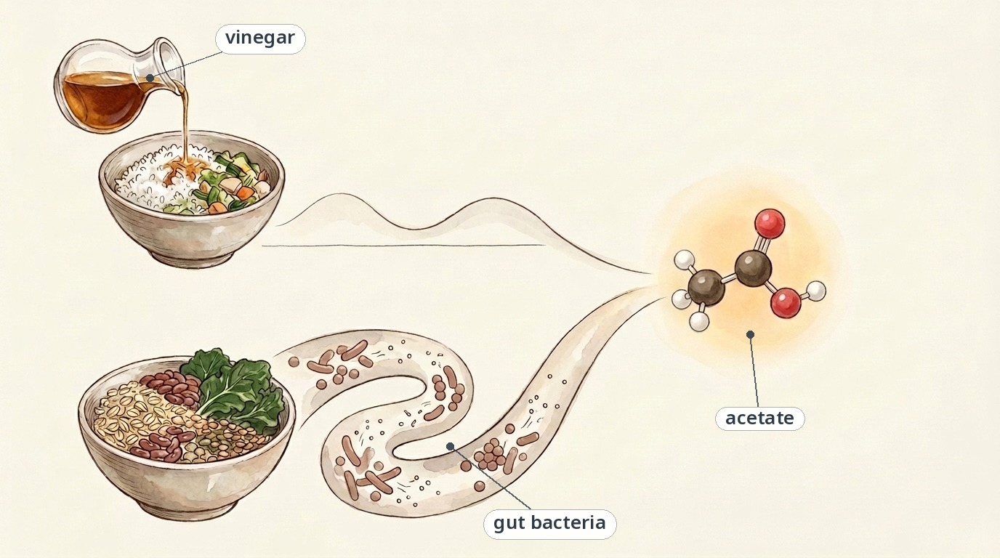

<sub>▲ 同一个乙酸，两条路：随餐吃醋，和菌群发酵膳食纤维</sub>

<details><summary>🔬 深一层：为什么不能说“喝醋 = 补短链脂肪酸”</summary>

吃进去的乙酸大部分在小肠上段就被吸收了，到不了大肠；菌群产的乙酸在大肠就地生成、就地起作用。分子相同，作用的地点和证据链完全不同。喝醋的证据在餐后血糖曲线上，菌群的好处要靠膳食纤维去换。

</details>

**证据有多硬（B）**：
- 餐后血糖：系统综述 + 多项小型随机对照试验。单个试验的结果并不完全一致，合起来看，餐后血糖和胰岛素的峰值都被削低了，幅度中等。
- **为什么不是 A**：试验规模小、观察时间短，还没有“长期吃醋 → 少得糖尿病”的硬终点证据。

**程序员场景**：外卖里碳水最重的那一餐，加一碟醋，是成本最低的餐后血糖管理。

**边界**：胃食管反流、胃溃疡的人慎用；别空腹喝醋，也别直接喝浓醋，会伤牙釉质和食道；醋不是“排毒神药”。

> **笔者按**：这一节示范了“扯得妙”和“扯得错”的分界线：食醋里的乙酸和菌群发酵出来的乙酸是同一个分子，这很妙；但如果因此说“喝醋养菌群”，就扯错了。两条证据链各自成立，交汇处留给读者惊叹就好。

<details><summary>📚 参考文献（2 篇，已核对 PubMed）</summary>

1. Shishehbor F, et al. Vinegar consumption can attenuate postprandial glucose and insulin responses; a systematic review and meta-analysis of clinical trials. *Diabetes Res Clin Pract*. 2017;127:1-9. (PMID: 28292654)
2. Koh A, et al. From Dietary Fiber to Host Physiology: Short-Chain Fatty Acids as Key Bacterial Metabolites. *Cell*. 2016;165(6):1332-1345. (PMID: 27259147)

</details>

### NAC 与化痰

> **证据 B（化痰，与长寿无关）｜ 📖 了解即可（药品）** ｜ 痛点：感冒后痰黏咳不出 ｜ 十二柱：H11 炎症

**一句话**：NAC 是药典里的老牌化痰药，本职是化痰，不是日常保健品。

**你可能也这样**：感冒好了一半，喉咙里总有一口黏痰，咳不出也咽不下，夜里被它弄醒好几次。

**做法**：
- 痰液黏稠难咳时，可以在医生或药师指导下使用 N-乙酰半胱氨酸（NAC），按说明书用。
- 多喝水、保持空气湿润，是化痰的基础。
- 不建议把 NAC 当日常补剂长期自己吃。

**为什么**：

打个比方：黏痰像一团被很多“小扣子”扣在一起的网。这些扣子是黏蛋白分子之间的**二硫键**。NAC 带着一个活泼的硫原子，能把这些扣子解开，网散了，痰就变稀，气道里的纤毛就扫得动了。

这件事证据清楚，但效果没有想象中大：
- Cochrane 系统综述（2019，38 项试验、1 万多人）：慢性支气管炎和慢阻肺患者用黏液溶解剂（包括 NAC），急性加重**小幅减少**，大约每 8 个人用药，能多 1 个人在研究期间不发作。而且越新、越长的试验，效果越小。
- 2000 年专门针对口服 NAC 的分析：连用 12–24 周，约一半人没有急性加重，安慰剂组约三成；副作用和安慰剂差不多。
- 要注意：这些证据都来自**慢性**气道病患者。感冒后一过性的黏痰，多数会自己好，NAC 能帮多少，证据少得多。

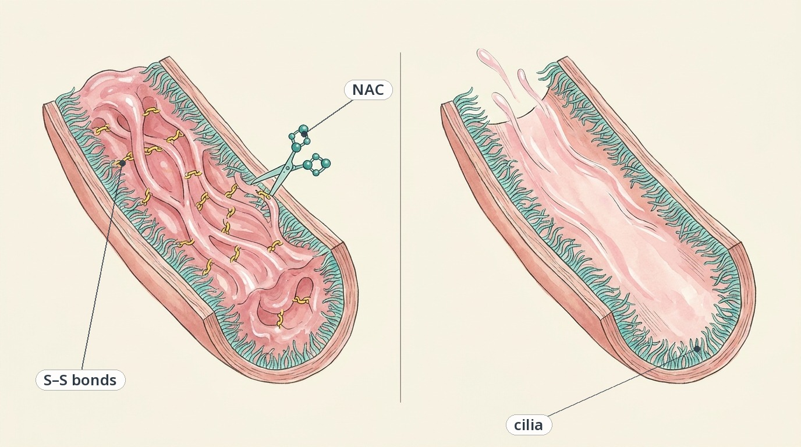

<sub>▲ NAC 剪断黏液里的二硫键：稠痰变稀，纤毛扫得动</sub>

<details><summary>🔬 深一层：NAC 的“兼职”</summary>

NAC 进入身体后能变成半胱氨酸，这是合成谷胱甘肽的原料之一。谷胱甘肽是细胞里最重要的抗氧化分子。这就是 NAC 在抗衰老领域出名的原因：甘氨酸 + NAC 的组合，见「GlyNAC」。但这是它的兼职，证据和适用人群都不一样。

</details>

**证据有多硬（B，针对化痰）**：
- 减少慢性支气管炎、慢阻肺急性加重：Cochrane 系统综述 + meta 分析，效果小但稳定。
- **注意**：这个等级只针对“化痰”。它和长寿没有关系，所以行动建议是“了解即可”。

**程序员场景**：秋冬季，药箱里值得备着的老药之一。真用之前，先问一句医生或药师。

**边界**：这是药品。吸入剂型可能诱发支气管痉挛，哮喘患者用前务必问医生；胃溃疡患者慎用；不要长期自行服用。

> **笔者按**：老药、便宜、证据清楚，NAC 是“古方新解”这一章里最不玄的一条。化痰是它的本职，抗衰是它的兼职，别搞反了。

<details><summary>📚 参考文献（2 篇，已核对 PubMed）</summary>

1. Poole P, et al. Mucolytic agents versus placebo for chronic bronchitis or chronic obstructive pulmonary disease. *Cochrane Database Syst Rev*. 2019;5(5):CD001287. (PMID: 31107966)
2. Stey C, et al. The effect of oral N-acetylcysteine in chronic bronchitis: a quantitative systematic review. *Eur Respir J*. 2000;16(2):253-62. (PMID: 10968500)

</details>

### 颂钵

> **证据 D ｜ 🧪 可以试（放松仪式）** ｜ 痛点：睡前脑子停不下来 ｜ 十二柱：—

**一句话**：颂钵的声音能让人很快放松下来，可以当睡前仪式；“频率疗愈”是营销，不是科学。

**你可能也这样**：关了电脑，脑子还在跑代码；躺下后，白天的会议在脑内自动重播。

**做法**：
- 睡前 10–15 分钟，听一段颂钵、白噪音或舒缓的低频音乐，音量调低。
- 配合「睡前 1 小时屏幕宵禁」：放下手机后，用声音给大脑一个“下班信号”。
- 不用买昂贵的“疗愈钵”，免费音频就够了。

**为什么**：

打个比方：大脑从“工作模式”切到“睡眠模式”需要一个过渡，就像服务器下线前要先停止接收新请求。持续、单调、有余韵的声音能把注意力从思绪里拉出来，呼吸和心跳跟着慢下来。这是一种**放松反应**。

研究支持这一点，但只到这一点：2020 年的系统综述只找到 4 项相关研究，报告了紧张、焦虑下降和情绪改善，但多数设计薄弱；2023 年的一项随机对照试验，让 50 位焦虑偏高的成年人听一次藏式颂钵，焦虑明显下降，心率变异性上升（身体更放松的信号）。但对照组里做“渐进式肌肉放松”（一组一组地绷紧再放松肌肉）的人，焦虑也降了。

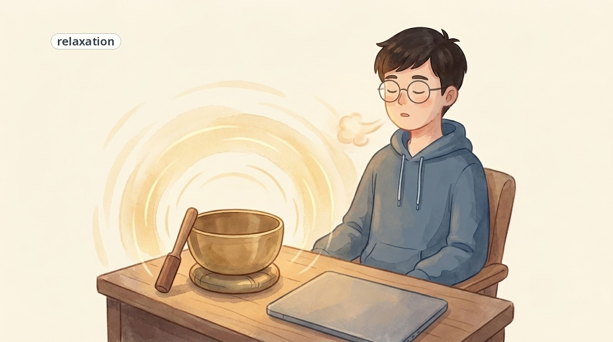

<sub>▲ 颂钵：声音形态的放松，不是频率疗愈</sub>

<details><summary>🔬 深一层：为什么证据只有 D</summary>

这些研究样本小、对照组设计弱（很难做“假颂钵”安慰剂），测的多是主观感受，而且多数只看当场效果。所谓“特定频率修复细胞”“调节脉轮”，没有任何可靠证据。

</details>

**证据有多硬（D）**：
- 有放松反应的初步证据；免费的放松方法也能做到类似效果。
- “疗愈”“治病”之类的宣称不成立。
- **为什么不是 C**：研究数量少、质量偏低，结局多为主观量表。

**程序员场景**：屏幕宵禁之后的 15 分钟声音仪式。它能帮你从信息流切到睡前状态，仅此而已，但已经足够。

**边界**：不能替代失眠的规范治疗（慢性失眠首选认知行为治疗）；声音敏感或耳鸣的人，自己选择音量和音色。

> **笔者按**：放松反应是真的，神话不是。把颂钵当“声音版的屏幕宵禁”用，物尽其用；当“频率疗愈”花大价钱买，就是智商税。

<details><summary>📚 参考文献（2 篇，已核对 PubMed）</summary>

1. Stanhope J, et al. The human health effects of singing bowls: A systematic review. *Complement Ther Med*. 2020;51:102412. (PMID: 32507429)
2. Rio-Alamos C, et al. Acute Relaxation Response Induced by Tibetan Singing Bowl Sounds: A Randomized Controlled Trial. *Eur J Investig Health Psychol Educ*. 2023;13(2):317-330. (PMID: 36826208)

</details>

---

## 第五章 · 续命十块大石头


> 往罐子里装东西，要先放大石头，再放沙子。下面十件事是“大石头”：证据大多是 A 级，效应量也普遍比本指南里的补剂条目大得多。补剂、按摩、颂钵都是沙子。石头没放好，沙子装得再多也没用。
>
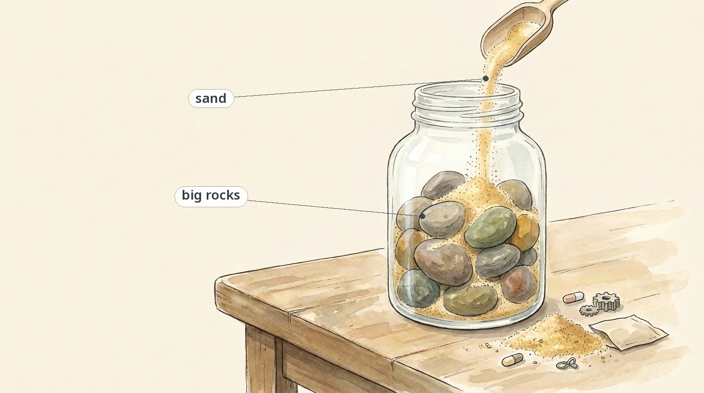

<sub>▲ 大石头与沙子：罐子里先放大石头，再倒沙子</sub>

| 大石头 | 一句话 | 证据 |
|---|---|---|
| 不吸烟 | 戒烟是一次就能续命十年的操作 | A ✅ |
| 每天动起来 | 步数和心肺体能，是最硬的“寿命指标” | A ✅ |
| 每周两次力量训练 | 肌肉是你的养老金账户 | A ✅ |
| 睡够 7 小时左右 | 睡太少、睡太多都和早死相关；打鼾要查 | A ✅ |
| 少喝酒 | 没有“有益健康”的饮酒量 | A ✅ |
| 知道自己的血压 | 程序员三十几岁就可能高血压，而且没感觉 | A ✅ |
| 看懂体检里的血脂和血糖 | 低密度脂蛋白每降 1 个单位，心血管事件少约五分之一 | A ✅ |
| 以植物为主的地中海式饮食 | 橄榄油、坚果、鱼、蔬菜豆类：吃出来的心血管保护 | A ✅ |
| 管住腰围 | 体重和腰围，是慢病风险的仪表盘 | A ✅ |
| 有人可以说话 | 社交关系对寿命的影响，和戒烟同一量级 | A ✅ |

另外两件不需要论证的事：**按年龄做癌症筛查**，**按时接种疫苗**。具体项目和频率听医生的。

### 不吸烟（含电子烟）｜A ✅

**为什么**：一项追踪二十多万美国人的研究显示，吸烟者比从不吸烟的人平均少活 10 年以上；40 岁前戒烟，可以避开约 90% 的吸烟相关超额死亡风险。

**程序员场景**：“写不出来抽一根”是最贵的思考工具。换成下楼走一圈（见「30 分钟起身闹钟」），提神效果差不多，不花寿命。

**边界**：电子烟不是“安全版香烟”，长期影响仍在研究中；戒烟困难可以去医院戒烟门诊。

<details><summary>📚 参考文献</summary>

1. Jha P, et al. 21st-century hazards of smoking and benefits of cessation in the United States. *N Engl J Med*. 2013;368(4):341-50. (PMID: 23343063)

</details>

### 每天动起来：步数与心肺体能｜A ✅

**为什么**：15 个国际队列、近 5 万人的汇总分析：每天步数越多，全因死亡风险越低，60 岁以上大约在每天 6000–8000 步趋于平台，60 岁以下大约 8000–10000 步。另一项 12 万人的跑步机测试研究发现，心肺体能越好死亡率越低，看不到上限；体能垫底带来的风险，不亚于吸烟和糖尿病。

**程序员场景**：步数是最便宜的监控指标，手机自带。心肺体能的训练方法见 Zone 2。

**边界**：有心脏病或久未运动的人，先从走路开始，循序渐进。

<details><summary>📚 参考文献</summary>

1. Paluch AE, et al. Daily steps and all-cause mortality: a meta-analysis of 15 international cohorts. *Lancet Public Health*. 2022;7(3):e219-e228. (PMID: 35247352)
2. Mandsager K, et al. Association of Cardiorespiratory Fitness With Long-term Mortality Among Adults Undergoing Exercise Treadmill Testing. *JAMA Netw Open*. 2018;1(6):e183605. (PMID: 30646252)

</details>

### 每周两次力量训练｜A ✅

**为什么**：荟萃分析显示，每周 30–60 分钟的力量训练，和全因死亡、心血管病、癌症风险降低 10%–20% 相关。肌肉不只用来搬东西，它还是全身最大的“血糖消耗池”，年纪越大越难攒回来。

**程序员场景**：不用办卡。俯卧撑、深蹲、弹力带，每次 20 分钟，每周两次。

**边界**：从自重开始，动作标准比重量重要；有关节伤病先问医生。

<details><summary>📚 参考文献</summary>

1. Momma H, et al. Muscle-strengthening activities are associated with lower risk and mortality in major non-communicable diseases: a systematic review and meta-analysis of cohort studies. *Br J Sports Med*. 2022;56(13):755-763. (PMID: 35228201)

</details>

### 睡够 7 小时左右｜A ✅

**为什么**：前瞻性研究的荟萃分析显示，睡眠太短和太长都与更高的全因死亡风险相关。睡得太长可能是身体出问题的信号，而不是原因。

**程序员场景**：睡眠怎么修，见「晨光 10 分钟」「睡眠债偿还表」「睡前 1 小时屏幕宵禁」。**打鼾响、白天总困**，可能是睡眠呼吸暂停，值得去睡眠门诊查一次。

**边界**：这是关联研究，“7 小时”是群体平均，不是每个人的 KPI。

<details><summary>📚 参考文献</summary>

1. Cappuccio FP, et al. Sleep duration and all-cause mortality: a systematic review and meta-analysis of prospective studies. *Sleep*. 2010;33(5):585-92. (PMID: 20469800)

</details>

### 少喝酒｜A ✅

**为什么**：一项汇总近 60 万饮酒者的分析发现，每周纯酒精超过约 100 克（大约五瓶 500 毫升的普通啤酒），全因死亡风险就开始上升。喝得越少越好，没有“护心”的量。

**程序员场景**：上线庆功、团建，可以举杯，但不用干杯。

<details><summary>📚 参考文献</summary>

1. Wood AM, et al. Risk thresholds for alcohol consumption: combined analysis of individual-participant data for 599 912 current drinkers in 83 prospective studies. *Lancet*. 2018;391(10129):1513-1523. (PMID: 29676281)

</details>

### 知道自己的血压｜A ✅

**为什么**：高血压没感觉，却会慢慢损伤心、脑、肾。SPRINT 试验中，心血管高风险人群把收缩压控制得更低（目标 <120 mmHg，对照组 <140），心血管事件和全因死亡都更少。

**程序员场景**：买一个家用电子血压计，每月测一次，记在笔记里，就像给生产环境加监控。

**边界**：血压目标因人而异；确诊和用药听医生的，不要自己调药。

<details><summary>📚 参考文献</summary>

1. SPRINT Research Group. A Randomized Trial of Intensive versus Standard Blood-Pressure Control. *N Engl J Med*. 2015;373(22):2103-16. (PMID: 26551272)

</details>

### 看懂体检里的血脂和血糖｜A ✅

**为什么**：汇总 17 万人随机试验数据的分析显示，低密度脂蛋白胆固醇（LDL-C，“坏胆固醇”）每降低 1 mmol/L，主要血管事件约减少 22%。血糖偏高同样是心血管和肾脏的慢性负担。

**程序员场景**：体检报告别只看有没有箭头。把 LDL-C、空腹血糖、糖化血红蛋白记进表格，看逐年趋势。

**边界**：要不要吃药，由医生结合你的整体风险判断。

<details><summary>📚 参考文献</summary>

1. Cholesterol Treatment Trialists' (CTT) Collaboration. Efficacy and safety of more intensive lowering of LDL cholesterol: a meta-analysis of data from 170,000 participants in 26 randomised trials. *Lancet*. 2010;376(9753):1670-81. (PMID: 21067804)

</details>

### 以植物为主的地中海式饮食｜A ✅

**为什么**：PREDIMED 随机试验中，补充特级初榨橄榄油或坚果的地中海式饮食组，主要心血管事件比低脂饮食对照组少约 30%。

**程序员场景**：外卖也能做：多选蔬菜和豆类，主食换粗粮，加一份鱼，零食换坚果。

<details><summary>📚 参考文献</summary>

1. Estruch R, et al. Primary Prevention of Cardiovascular Disease with a Mediterranean Diet Supplemented with Extra-Virgin Olive Oil or Nuts. *N Engl J Med*. 2018;378(25):e34. (PMID: 29897866)

</details>

### 管住腰围｜A ✅

**为什么**：涵盖四大洲 239 项研究的个体数据分析显示，从不吸烟的人里，体重指数（BMI）在 20–25 之间时死亡率最低，超重和肥胖都会让风险上升。中国成人的超重标准更严：BMI ≥24。

**程序员场景**：比体重更值得看的是腰围，它反映内脏脂肪。每月量一次，和血压一起记。

**边界**：BMI 对肌肉量大的人不准；过瘦同样不健康。

<details><summary>📚 参考文献</summary>

1. Global BMI Mortality Collaboration. Body-mass index and all-cause mortality: individual-participant-data meta-analysis of 239 prospective studies in four continents. *Lancet*. 2016;388(10046):776-86. (PMID: 27423262)

</details>

### 有人可以说话｜A ✅

**为什么**：一项汇总 148 项研究、30 多万人的荟萃分析发现，社会关系更紧密的人，研究期间的生存可能性高约 50%。效应量和戒烟同一量级。

**程序员场景**：一个人对着屏幕调试十小时，然后一个人吃外卖？每周至少约一次饭、打一个电话。

**边界**：这是关联研究；孤独、抑郁持续时，请找专业帮助。

<details><summary>📚 参考文献</summary>

1. Holt-Lunstad J, et al. Social relationships and mortality risk: a meta-analytic review. *PLoS Med*. 2010;7(7):e1000316. (PMID: 20668659)

</details>


---

## 第六章 · 续命的一天

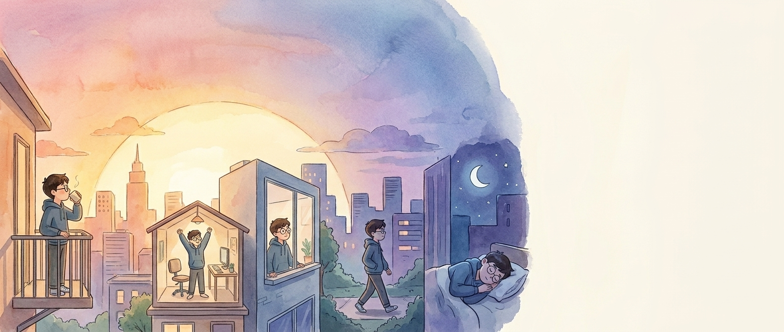

> 按一天的时间线走：早起晒光、白天起身、护住眼睛、下午断咖啡因。

### 晨光 10 分钟

> **证据 B ｜ ✅ 去做** ｜ 痛点：昼夜颠倒、晚上睡不着 ｜ 十二柱：—（节律是全书的地基）

**一句话**：想早睡，先早起晒太阳。

**你可能也这样**：周日凌晨 1 点还精神，周一早上 9 点像被拖出被窝。下决心“今晚 11 点睡”，结果躺在床上刷手机刷到 2 点。

**做法**：起床后 1 小时内，到户外（或开着窗的窗边）待 10–30 分钟。阴天也有效，只是多待一会儿。不用看太阳，周围的环境光就够了。

**为什么**：

打个比方：你身体里有一个**系统时钟**（大脑里的视交叉上核）。它不靠网络对时，靠的是**眼睛看到的光**。早晨的强光就像一次 NTP 校时，告诉时钟“现在是白天”。时钟校准后，晚上分泌“睡眠信号”褪黑素的时间也会跟着提前。

关键在亮度差：办公室灯光通常不到 500 勒克斯，户外阴天也有几千，晴天可以到十万。窗里窗外，差了几十倍。

所以，晚睡晚起的循环，破局点不在“今晚逼自己早睡”，而在“明早先把时钟拨准”。

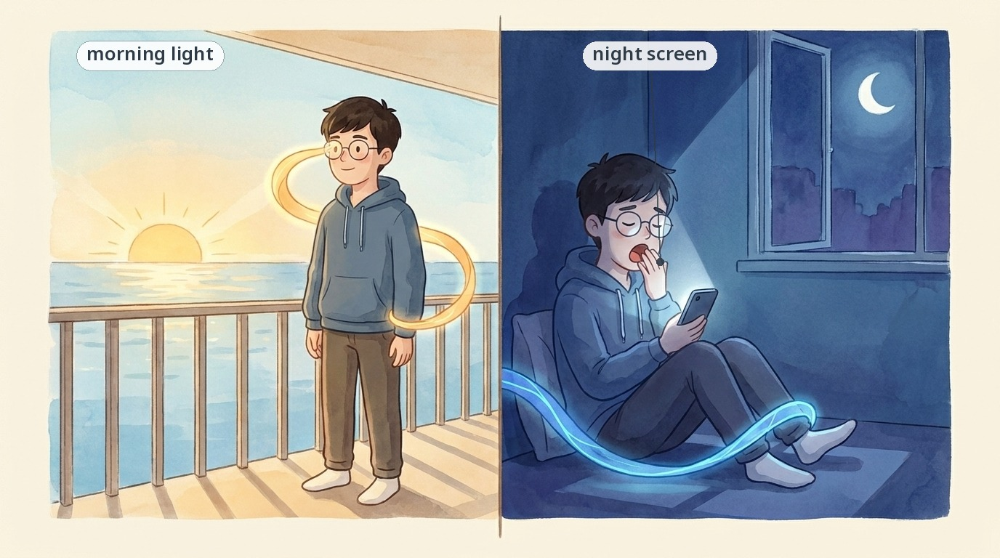

<sub>▲ 困意信号：被早晨拉住，还是被夜晚拖走</sub>

<details><summary>🔬 深一层：眼睛里的“测光表”</summary>

视网膜里除了负责看东西的视锥细胞和视杆细胞，还有一类**内在光敏神经节细胞（ipRGC）**。它们不负责成像，专门测亮度，对蓝光最敏感，并且直接连到生物钟主钟（视交叉上核）。早晨的强光通过这条线路抑制褪黑素，并锚定主钟的相位：白天更清醒，晚上褪黑素按时升起。

</details>

**证据有多硬（B）**：
- 人体对照研究：一周户外露营、只接受自然光后，参与者的褪黑素节律明显提前，和日出日落对齐（Wright 2013）。
- 实验室研究给出了光照“重置”生物钟的剂量-反应关系（Zeitzer 2000）。这项研究测的是**夜间**光照，它也解释了为什么晚上要少照强光（见「睡前 1 小时屏幕宵禁」）。
- 晨间光疗是临床上使用的非药物节律干预（用于延迟睡眠时相障碍）。
- **为什么不是 A**：结局是褪黑素节律这类替代指标，还没有“晒晨光→更长寿”的硬终点试验。

**程序员场景**：把站会前的 10 分钟改成下楼买咖啡；远程办公的，把第一个会挪到阳台上开。

**边界**：双相情感障碍患者做光疗需遵医嘱；不要直视太阳。

> **笔者按**：反直觉的一条：晚睡晚起的破局点不在晚上，在早晨。想早睡，先早起晒光；顺序搞反了，越努力越失眠。这是“续命的一天”的起点。

<details><summary>📚 参考文献（2 篇，已核对 PubMed）</summary>

1. Wright KP Jr, et al. Entrainment of the human circadian clock to the natural light-dark cycle. *Curr Biol*. 2013;23(16):1554-8. (PMID: 23910656)
2. Zeitzer JM, et al. Sensitivity of the human circadian pacemaker to nocturnal light: melatonin phase resetting and suppression. *J Physiol*. 2000;526 Pt 3:695-702. (PMID: 10922269)

</details>


### 30 分钟起身闹钟

> **证据 B ｜ ✅ 去做** ｜ 痛点：腰酸、饭后犯困 ｜ 十二柱：H6 营养感知

**一句话**：每坐 30 分钟，起来动 2 分钟。全书技术含量最低、杠杆最高的一条。

**你可能也这样**：一坐下来调一个 bug，抬头已经是三个小时后，腰僵、腿麻、脑子发木。晚上去健身房练了一小时，心想“今天的久坐抵消了吧”。

**做法**：
- 设一个 30 分钟循环的静音提醒（手机、手表、番茄钟都行）。
- 提醒一响就站起来 2–3 分钟：接杯水、上个厕所、做 5 个深蹲、走到窗边看一眼远处。
- 不需要剧烈，关键是**打断**。

**为什么**：

打个比方：肌肉是全身最大的“血糖和血脂回收站”。人一坐下不动，回收站就进入待机，血里的糖和脂肪排着队却没人处理。站起来走两步，回收站立刻重新上线。

人群数据说明，久坐的伤害有两笔账：
- **总时长**：一项汇总了一百多万人数据的分析发现，每天久坐时间越长，死亡风险越高；只有每天中高强度运动达到大约 60–75 分钟，才能抵消这部分风险。
- **连续时长**：一项用加速度计客观测量的美国队列研究发现，即使总久坐时间相同，**每次坐得越久不起身**，死亡风险也越高。

所以健身房里的一小时很好，但它补不上白天连坐三小时的那一笔账。

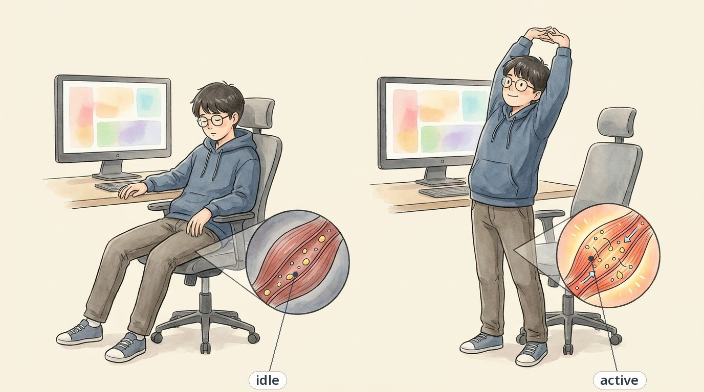

<sub>▲ 久坐是过程性伤害，起身是分钟级恢复</sub>

<details><summary>🔬 深一层：肌肉为什么会“待机”</summary>

动物研究发现，长时间不动时，骨骼肌里负责分解血脂的脂蛋白脂肪酶（LPL）活性明显下降；人体实验也发现，用每 20–30 分钟一次的短时活动打断久坐，能降低餐后的血糖和胰岛素反应。肌肉收缩本身就能把葡萄糖拉进细胞，不完全依赖胰岛素。

</details>

**证据有多硬（B）**：
- 大规模人群研究（Ekelund 2016）和客观测量的队列研究（Diaz 2017）方向一致。
- **为什么不是 A**：都是观察性研究；“每 30 分钟起身 → 更长寿”还没有长期随机试验。

**程序员场景**：编译、构建、跑测试、等 CI 的时间，就是天然的起身点。把等待时间变成站立时间。

**边界**：动作温和就行；有体位性低血压的人，起身先在床边或椅边停几秒。

> **笔者按**：全指南里技术含量最低的一条，也可能是杠杆率最高的一条。我见过太多人买了上万块的升降桌，然后把它降到最低，坐着用。

<details><summary>📚 参考文献（2 篇，已核对 PubMed）</summary>

1. Ekelund U, et al. Does physical activity attenuate, or even eliminate, the detrimental association of sitting time with mortality? A harmonised meta-analysis of data from more than 1 million men and women. *Lancet*. 2016;388(10051):1302-10. (PMID: 27475271)
2. Diaz KM, et al. Patterns of Sedentary Behavior and Mortality in U.S. Middle-Aged and Older Adults: A National Cohort Study. *Ann Intern Med*. 2017;167(7):465-475. (PMID: 28892811)

</details>

### 20-20-20 用眼法则

> **证据 C ｜ 🧪 可以试** ｜ 痛点：眼干、眼酸、看久了模糊 ｜ 十二柱：—

**一句话**：每看屏幕 20 分钟，看 6 米外的东西 20 秒，顺便用力眨几下眼。

**你可能也这样**：下午四点，眼睛又干又涩，盯着屏幕的字开始发虚；滴了眼药水，舒服十分钟，又回到原样。

**做法**：
- 每 20 分钟，看 20 英尺（约 6 米）外的东西 20 秒：窗外的树、走廊尽头的墙都行。
- 同时**慢慢地、完整地**眨 5–10 次眼。
- 和「30 分钟起身闹钟」合并：起身、远眺、眨眼，一套动作做完。

**为什么**：

打个比方：看近处时，眼睛里一圈叫**睫状肌**的小肌肉要一直收紧，像手一直握着拳。看 6 米外的东西，这只“拳头”才能松开。

另一个问题是眨眼。眨眼像雨刷，每眨一次就把**泪膜**重新刷匀一遍，泪膜是盖在眼球表面的一层薄水膜。人一专注看屏幕，眨眼次数会明显减少，还常常眨不完整；泪膜蒸发得快、补得慢，眼睛就干了（TFOS 国际专家组 2023 年综述）。

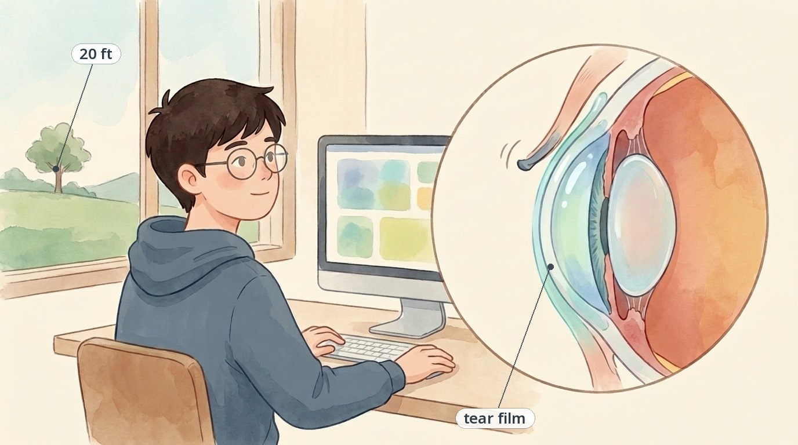

<sub>▲ 看远处，眨眨眼：给泪膜一次刷新</sub>

<details><summary>🔬 深一层：为什么“眨不完整”比“眨得少”更麻烦</summary>

不完整眨眼时，上眼睑没有落到底，眼球下半部分的泪膜得不到更新，睑板腺分泌的油脂也没被挤出来。这层油脂负责防止泪液蒸发。长期如此，可能发展为睑板腺功能障碍，这是干眼最常见的原因之一。

</details>

**证据有多硬（C）**：
- 屏幕使用和眼干、视疲劳的关联证据充分；美国眼科学会等机构推荐 20-20-20。
- **为什么不是 B**：“20 分钟、6 米、20 秒”这组数字是经验设定，没有被严格的随机试验验证过。机制是对的，数字取个好记的。

**程序员场景**：给“忘记眨眼”装一个定时器。如果你已经在用番茄钟，每个番茄结束时顺便做一次。

**边界**：持续视疲劳、视力突然下降、看东西重影，要去看眼科，这不只是屏幕的问题。

> **笔者按**：眨眼是被屏幕劫持的第一个本能：代码看得越入神，眨得越少，泪膜干了都没感觉。20-20-20 的本质，是给这个本能装一个外部提醒。

<details><summary>📚 参考文献（2 篇）</summary>

1. Wolffsohn JS, et al. TFOS Lifestyle: Impact of the digital environment on the ocular surface. *Ocul Surf*. 2023;28:213-252. (PMID: 37062428)
2. American Academy of Ophthalmology. Computers, Digital Devices and Eye Strain. [AAO 官方建议](https://www.aao.org/eye-health/tips-prevention/computer-usage)（机构建议，持续更新）

</details>

### 咖啡因下午 2 点红线

> **证据 B ｜ ✅ 去做** ｜ 痛点：明明困了却睡不着、睡了不解乏 ｜ 十二柱：—

**一句话**：下午 2 点以后的那杯咖啡，会一直“喝”到你半夜。

**你可能也这样**：下午四点来一杯美式续命，晚上十二点躺下，翻来覆去；或者“我喝完照样秒睡”，但第二天还是像没睡够。

**做法**：
- 下午 2 点以后不再摄入咖啡因。
- 咖啡因不只在咖啡里：浓茶、奶茶、可乐、能量饮料、部分止痛药和感冒药里都有。
- 下午想提神，换成起身走一圈、晒几分钟太阳，或者喝无咖啡因咖啡。

**为什么**：

打个比方：大脑醒着的时候，会不断积累一种叫**腺苷**的分子，它就是“困意信号”。腺苷积累到一定程度，你就困了。咖啡因的长相和腺苷很像，它占住腺苷的受体，但不传递信号，就像把门铃按钮用胶带粘住：困意还在，你只是听不到门铃。

关键是它走得很慢。咖啡因的半衰期大约 5 小时，个体差异很大（大约 2–10 小时）。下午 2 点喝一杯，晚上 7 点血里还剩一半左右，半夜还剩四分之一。

实验最不给面子：2013 年的一项试验让受试者在睡前 0、3、6 小时服用 400 毫克咖啡因（大约两三杯大杯美式），结果即使是**睡前 6 小时**那组，客观测得的总睡眠时间也少了一个多小时，而受试者自己的感觉没那么明显。

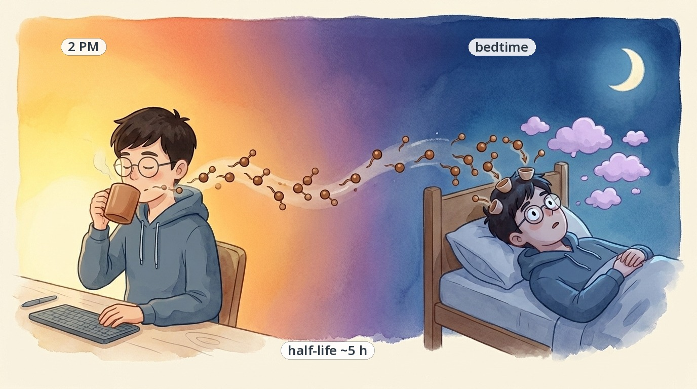

<sub>▲ 下午 2 点那杯咖啡的下半场：到了夜里，咖啡因还剩一半</sub>

<details><summary>🔬 深一层：为什么“我喝了照样睡”不可信</summary>

咖啡因不一定让你睡不着，但会改变睡眠的结构：入睡变慢、浅睡增多、夜里醒来的次数变多。这些变化本人往往察觉不到。代谢咖啡因的主要是肝脏里的 CYP1A2 酶，它的活性受基因、吸烟、口服避孕药、孕期等影响，所以有人喝了没感觉，有人一杯就失眠。

</details>

**证据有多硬（B）**：
- 随机对照试验（Drake 2013）+ 成熟的药理学研究（Fredholm 1999）。
- **为什么不是 A**：结局是睡眠指标，不是长期健康终点；试验剂量偏高，样本也不大。

**程序员场景**：想靠一杯晚咖啡赶 deadline，其实是拿明天的状态换今晚的清醒，而睡眠债是复利（见「睡眠债偿还表」）。

**边界**：孕期咖啡因的代谢明显变慢，摄入量要遵医嘱；心律失常、焦虑症的人对咖啡因更敏感。

> **笔者按**：我把它划成“红线”而不是“建议”，唯一的原因是：主观感觉在这件事上不可信。睡前 6 小时的咖啡照样偷走一个小时的睡眠，而当事人觉得“我代谢快，没事”。

<details><summary>📚 参考文献（2 篇，已核对 PubMed）</summary>

1. Drake C, et al. Caffeine effects on sleep taken 0, 3, or 6 hours before going to bed. *J Clin Sleep Med*. 2013;9(11):1195-200. (PMID: 24235903)
2. Fredholm BB, et al. Actions of caffeine in the brain with special reference to factors that contribute to its widespread use. *Pharmacol Rev*. 1999;51(1):83-133. (PMID: 10049999)

</details>

---

## 第七章 · 修复与维护

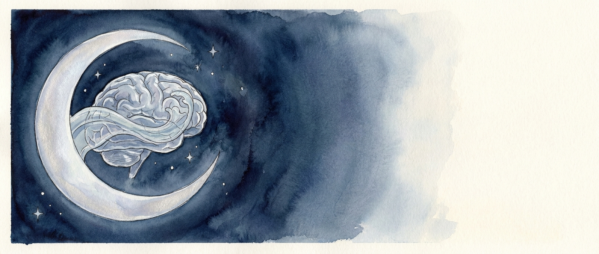

> 睡眠是身体的垃圾回收：熬了夜怎么还债，睡前怎么关机。再加上每天坐八小时的工位，怎么调才不伤颈、腰、手腕。

### 睡眠债偿还表

> **证据 B ｜ ✅ 去做** ｜ 痛点：熬夜后遗症 ｜ 十二柱：—

**一句话**：睡眠债分三晚慢慢还，不要周末一口气睡 12 个小时。

**你可能也这样**：上线那周每晚睡 5 小时，自我感觉“还行，习惯了”；到了周六一觉睡到下午 2 点，周日晚上又睡不着，周一更困。

**做法**：熬夜之后，按这三步还：
1. **当晚提前 30–60 分钟上床**，而不是第二天睡到中午。
2. **第二天午睡不超过 20 分钟**，最好在下午 3 点前。
3. **连续 3 晚正常作息**，起床时间照旧，用早晨的光把时钟拨回来（见「晨光 10 分钟」）。

**为什么**：

打个比方：睡眠不足像内存泄漏。每晚少睡一点，就漏一点，系统一时不崩，但越来越卡。更麻烦的是，**监控面板会失灵**：你觉得自己“已经适应了”，其实性能还在往下掉。

实验数据很清楚：连续两周每晚只睡 6 小时，注意力测试的成绩一路下滑，到最后相当于连续通宵两晚；可受试者自己报告的困倦感，只是略有上升（Van Dongen 2003）。

还债也比欠债慢。另一项实验让受试者连续一周限制睡眠，之后每晚给足 8 小时恢复；**3 晚之后，睡得最少的几组仍没回到原来的水平**（Belenky 2003）。

那为什么不周末一次睡够？因为睡到下午等于把生物钟往后拨了几个小时，周日晚上睡不着，周一又欠一笔。旧债没还清，又添了一笔“时差债”。

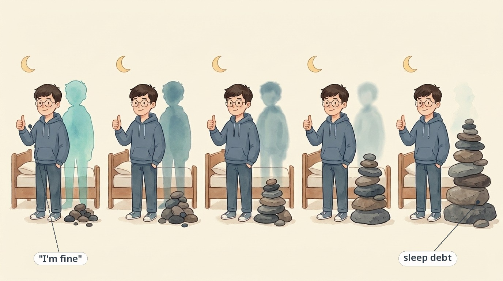

<sub>▲ 睡眠债：越欠越多，感觉越平</sub>

<details><summary>🔬 深一层：为什么“感觉还行”靠不住</summary>

困倦感和真实表现是两条不同的曲线。睡眠限制的头几天，困倦感上升明显，之后逐渐变平；而用“精神运动警觉测试”（看到信号就按键）测出的反应失误，会随欠债天数持续累积。大脑会适应“困”的感觉，却不会适应“缺觉”本身。所以判断自己睡够没有，不能问感觉，要看作息记录。

</details>

**证据有多硬（B）**：
- 两项严格控制的实验室研究给出了清晰的剂量-反应关系：睡得越少，损伤越大，而且会累积（Van Dongen 2003；Belenky 2003）。
- 分三晚还、少睡懒觉的做法，来自睡眠医学的临床共识和节律研究。
- **为什么不是 A**：“三晚偿还法”本身没有做过头对头的对照试验，实验室结局也是认知测试，不是长期健康结局。

**程序员场景**：发版夜之后，最错误的选择就是“周末睡到下午”。正确的姿势：周五晚上早点睡，周六照常起床晒太阳，下午小睡 20 分钟。

**边界**：如果躺下 30 分钟以上睡不着、每周超过 3 晚、持续 3 个月，这是慢性失眠，属于疾病，要去睡眠门诊，不是自律问题。

> **笔者按**：睡眠研究里最阴险的发现是：债越欠越多，困倦感却变平了，让人真心觉得“我还行”。在睡眠这件事上，感觉是一个失真的仪表盘，要相信记录，别相信感觉。

<details><summary>📚 参考文献（2 篇，已核对 PubMed）</summary>

1. Van Dongen HP, et al. The cumulative cost of additional wakefulness: dose-response effects on neurobehavioral functions and sleep physiology from chronic sleep restriction and total sleep deprivation. *Sleep*. 2003;26(2):117-26. (PMID: 12683469)
2. Belenky G, et al. Patterns of performance degradation and restoration during sleep restriction and subsequent recovery: a sleep dose-response study. *J Sleep Res*. 2003;12(1):1-12. (PMID: 12603781)

</details>
### 睡前 1 小时屏幕宵禁

> **证据 B ｜ ✅ 去做** ｜ 痛点：入睡困难 ｜ 十二柱：—

**一句话**：睡前 1 小时放下手机，把入睡这件事交还给大脑。

**你可能也这样**：11 点上床，“刷两分钟就睡”，抬头一看 1 点了。关了灯，脑子里还在转刚才那条热帖。

**做法**：
1. 睡前 1 小时，手机、平板、电脑都放下；手机放到够不着的地方充电。
2. 用纸质书、播客、拉伸或洗个热水澡来填这一小时。
3. 实在做不到，至少把屏幕调到最暗，打开夜间模式，并且只看“无聊”的内容。

**为什么**：

打个比方：睡觉前，大脑要做一次“优雅关机”：先降低负载，再释放褪黑素这个“该睡了”的信号。屏幕同时打断这两步。

第一，**光**。屏幕的光（尤其是蓝光）会告诉生物钟“现在还是白天”，压住褪黑素，把整个时钟往后推。第二，**内容**。信息流、消息、短视频让大脑保持兴奋，就像关机前又开了十个新进程。

一项对照实验让成年人睡前 4 小时用平板读电子书，连续 5 晚，再和读纸质书对比。结果：读平板时入睡平均晚了约 10 分钟，晚上的褪黑素被压低，生物钟往后推，第二天早上更难清醒（Chang 2015）。

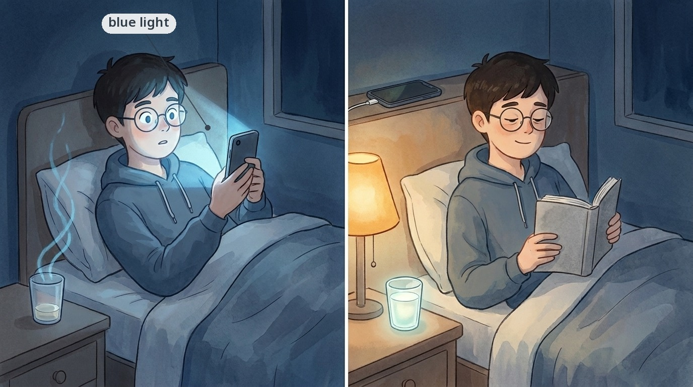

<sub>▲ 最后那小时屏幕，偷走的不止一小时</sub>

<details><summary>🔬 深一层：为什么光会“推迟”时钟</summary>

眼睛里有一类专门测亮度的细胞（ipRGC，见「晨光 10 分钟」），它们对蓝光最敏感，直接连到生物钟主钟。同一束光，早上照会把时钟往前拨，晚上照会往后拨。所以早上要多照光，晚上要少照光，这是同一个机制的两面。

</details>

**证据有多硬（B）**：
- 对照实验证明，睡前用发光屏幕会推迟入睡、压低褪黑素、推迟生物钟（Chang 2015）。
- 一项近万名挪威青少年的调查发现，睡前用电子设备越多，睡得越少、越难入睡（Hysing 2015）。
- **为什么不是 A**：实验样本小、效应温和（10 分钟量级）；大样本数据来自青少年，而且是相关性，不能直接证明因果。

**程序员场景**：“躺床上刷会儿手机”是晚睡循环的最后一块拼图。手机放客厅充电，再买个最便宜的闹钟，这是性价比最高的睡眠改造。

**边界**：夜班和经常跨时区的人需要个性化的节律方案；严重失眠的原因往往不止屏幕，要去看医生。

> **笔者按**：10 分钟的入睡延迟听起来不痛不痒，直到你意识到它每晚都在，而且“内容让人兴奋”的那笔账还没算进去。宵禁一小时，换回来的是整个入睡窗口。

<details><summary>📚 参考文献（2 篇，已核对 PubMed）</summary>

1. Chang AM, et al. Evening use of light-emitting eReaders negatively affects sleep, circadian timing, and next-morning alertness. *Proc Natl Acad Sci U S A*. 2015;112(4):1232-7. (PMID: 25535358)
2. Hysing M, et al. Sleep and use of electronic devices in adolescence: results from a large population-based study. *BMJ Open*. 2015;5(1):e006748. (PMID: 25643702)

</details>
### 熬夜与维生素 C（止损垫，不是免死金牌）

> **证据 C ｜ 🧪 可以试** ｜ 痛点：熬夜止损 ｜ 十二柱：—

**一句话**：熬了夜，用蔬果补点维生素 C 当止损垫，但它不是熬夜许可证。

**你可能也这样**：通宵修完线上故障，早上买了一瓶“维 C 泡腾片”，觉得能把昨晚的伤害抵掉一点。

**做法**：
1. 熬夜当晚或第二天，多吃富含维生素 C 的蔬果：橙子、猕猴桃、彩椒、西兰花。一个猕猴桃加一个橙子，就够一天的量。
2. 吃不到蔬果，可以用常规剂量补充剂（每天 100–200 mg）。
3. **不要大剂量“对冲”**：一天吃好几克，多出来的会被排掉，还可能伤胃。

**为什么**：

打个比方：熬夜是一场火灾，维生素 C 是一块防火毯，能盖住一角火苗，但房子还是在烧。

熬夜时，压力激素皮质醇升高，体内的“氧化损伤”（可以理解为细胞被锈蚀）也会增加。维生素 C 是体液里最主要的抗氧化剂之一。大鼠实验里，补维生素 C 能压住熬夜引起的皮质醇和氧化损伤升高（Olayaki 2015），还能减轻熬夜造成的记忆损伤（Mhaidat 2015）。

但要分清主次：维生素 C 管的只是氧化损伤这一小块。熬夜让人变笨、免疫力下降、代谢紊乱，这些主要伤害它都管不了。**睡眠债没有化学解药**，只能用睡眠还（见「睡眠债偿还表」）。

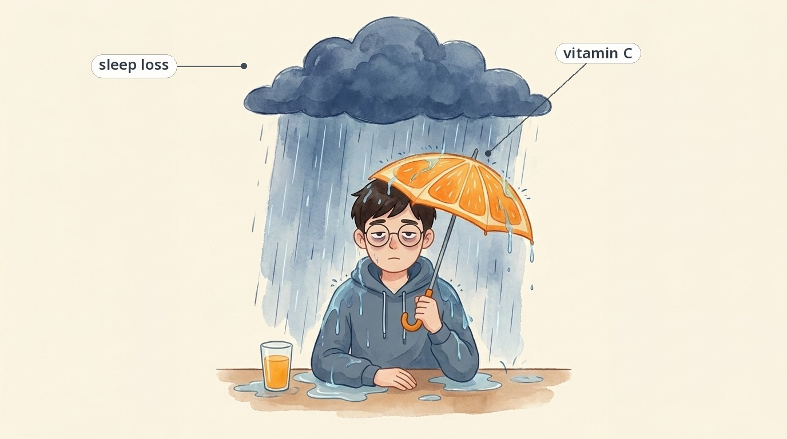

<sub>▲ VC 是止损垫，不是免死金牌</sub>

<details><summary>🔬 深一层：为什么剂量不是越大越好</summary>

人体吸收维生素 C 靠肠道里的转运蛋白，它们会饱和：每天几百毫克时，血液浓度基本到顶；剂量再高，吸收比例下降，多余的从尿里排掉。所以“一次吃 1 克、2 克”并不能让血里的维生素 C 成倍增加，反而更容易拉肚子。

</details>

**证据有多硬（C）**：
- 动物实验：维生素 C 能缓冲熬夜引起的皮质醇和氧化损伤升高，并减轻记忆损伤（两项大鼠研究）。
- 人体证据以综述和间接关联为主（Otocka-Kmiecik 2020）。
- **为什么不是 B**：没有专门针对“熬夜人群补维生素 C”的高质量人体随机试验。

**程序员场景**：发版夜的“止损三件套”：吃点蔬果补维生素 C，当晚提前睡（见「睡眠债偿还表」），第二天早上出门晒太阳（见「晨光 10 分钟」）。三件套能让你少受点罪，但债还是要还。

**边界**：每天超过 1 克可能引起腹泻、胃不适；长期大剂量与肾结石风险相关。有肾结石病史的人不要自行补大剂量。常上夜班的人，重点是节律管理（见「睡前 1 小时屏幕宵禁」），补剂只是配角。

> **笔者按**：这是本指南第一个“救火”条目。写它不是为了给熬夜发许可证：维生素 C 能缓冲的只有氧化损伤这一小块，脑力和睡眠的欠账一分都免不了。所以它排在「睡眠债偿还表」「睡前 1 小时屏幕宵禁」后面：前面两条做到了，才轮得到它。

<details><summary>📚 参考文献（3 篇，已核对 PubMed）</summary>

1. Olayaki LA, et al. Vitamin C Prevents Sleep Deprivation-induced Elevation in Cortisol and Lipid Peroxidation in the Rat Plasma. *Niger J Physiol Sci*. 2015;30(1-2):5-9. (PMID: 27507778)
2. Mhaidat NM, et al. Exploring the effect of vitamin C on sleep deprivation induced memory impairment. *Brain Res Bull*. 2015;113:41-7. (PMID: 25724146)
3. Otocka-Kmiecik A, et al. The Role of Vitamin C in Two Distinct Physiological States: Physical Activity and Sleep. *Nutrients*. 2020;12(12). (PMID: 33371359)

</details>
### 工位人体工学三件套

> **证据 B ｜ ✅ 去做** ｜ 痛点：脖子酸、腰疼、手腕麻 ｜ 十二柱：—

**一句话**：屏幕抬高、腰后垫住、手腕放平，三处调对，颈、腰、腕少受罪。

**你可能也这样**：抱着笔记本在沙发上、床上、咖啡馆里写代码，一天下来脖子像灌了铅；手腕偶尔发麻，甩一甩又好了。

**做法**：
1. **屏幕**：上沿和眼睛平齐，距离约一臂（50–70 厘米）。用笔记本办公，就加一个支架，再配外接键盘和鼠标。
2. **手腕**：手肘弯成 90–100 度，手腕保持平直，不要往上翘。
3. **腰**：臀部坐到椅子最里面，腰后垫一个靠枕或用椅子的腰托。

**为什么**：

打个比方：成年人的头大约 5 公斤，相当于一个保龄球。头摆正时，颈椎只扛这 5 公斤；头往前低，力臂变长，颈椎扛的力就像用一根杆子挑着保龄球，越往前越沉。一项力学模型估算，低头 15 度时颈椎承受的力大约是 12 公斤，低到 60 度就接近 27 公斤（Hansraj 2014）。

腰椎也一样。经典的椎间盘压力测量发现：坐着比站着压力高约四成，坐着再往前探身，压力接近站立时的两倍（Nachemson 1981；后来的复测方向一致、数值略低）。

手腕往上翘时，腕管里的压力升高，压迫正中神经，这是腕管综合征的直接机制。

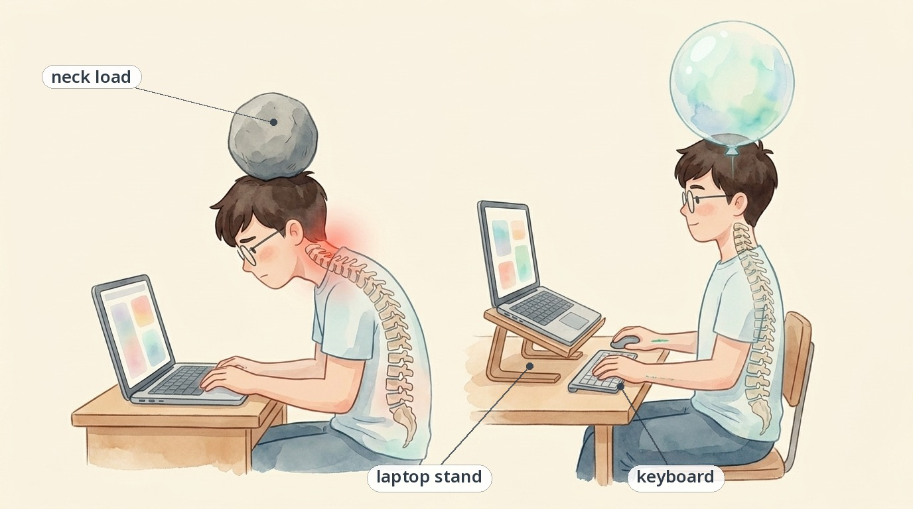

<sub>▲ 头每低一寸，脖子多扛几斤：支架 + 外接键盘</sub>

<details><summary>🔬 深一层：笔记本为什么天生不符合人体工学</summary>

笔记本的屏幕和键盘连在一起：屏幕放到眼睛高度，键盘就高得没法打字；键盘放到合适高度，屏幕就低得必须低头。两者只能顾一头，所以长期办公要把它们拆开：支架抬屏幕，外接键盘放低。

</details>

**证据有多硬（B）**：
- 生物力学证据扎实（力学测量和模型）。
- **为什么不是 A**：“工位改造能预防腕管综合征、颈椎病”的随机试验结果并不一致。

**程序员场景**：笔记本支架 + 外接键盘鼠标，几百块钱同时解决颈和腕两个问题，这是性价比最高的工位改造。

**边界**：已经出现持续手麻（尤其是夜里麻醒）、握力下降，要去医院做神经检查。工位改造救不了已经受损的神经。

> **笔者按**：笔记本是按“偶尔移动使用”设计的，每天八小时用它办公，它就是一件刑具。外接键盘加支架，是我推荐过的性价比最高的改造，没有之一。

<details><summary>📚 参考文献（2 篇，已核对 PubMed）</summary>

1. Nachemson AL. Disc pressure measurements. *Spine (Phila Pa 1976)*. 1981;6(1):93-7. (PMID: 7209680)
2. Hansraj KK. Assessment of stresses in the cervical spine caused by posture and position of the head. *Surg Technol Int*. 2014;25:277-9. (PMID: 25393825)

</details>

---

## 第八章 · 专注力工程

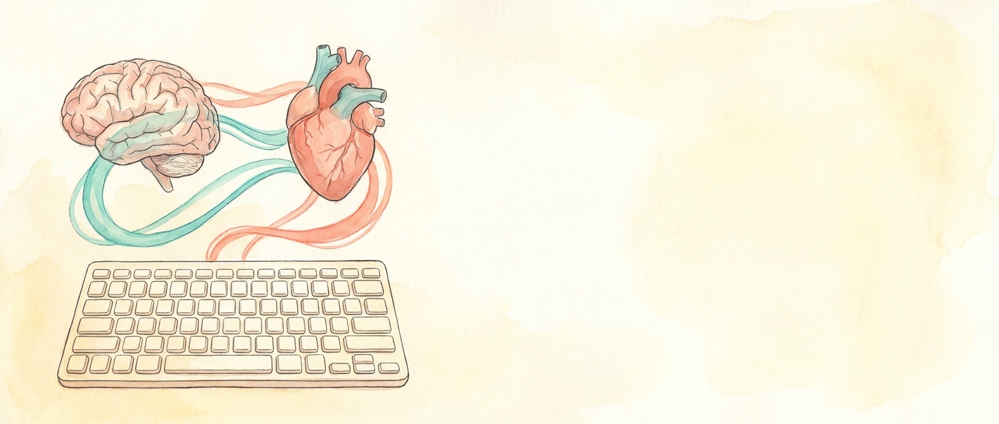

> 心流、工作记忆、节律、冥想：程序员最贵的生产资料是专注力，怎么保护它。

### 写代码与心流

> **证据 C ｜ 🧪 可以试** ｜ 痛点：被打断、切换成本 ｜ 十二柱：—

**一句话**：被打断前留一行“恢复注释”，给未来的自己留个断点。

**你可能也这样**：刚把一个复杂的 bug 理出头绪，同事拍了下肩膀：“有空吗，问个小事。”五分钟后回来，盯着屏幕想：“我刚才在干嘛来着？”

**做法**：
1. **划出免打扰时段**：在日历上占一块 2 小时的“专注时间”，把即时通讯状态改成“勿扰”。
2. **留恢复注释**：被打断前，花 10 秒写一行注释，例如 `// TODO 下一步：检查 token 过期时是否重试`。回来先读这一行。
3. 收工前也留一行，第二天早上直接从这里开始。

**为什么**：

打个比方：你脑子里正在跑的任务，就像调试器里的一个进程，变量、调用栈、下一步的计划都在内存里。被打断就像进程被杀掉，内存清空。恢复注释就是一个**断点加快照**：把最关键的上下文写到磁盘上，回来时不用从头重建。

软件工程研究证实了这个成本。一项分析了近百名程序员、上万次编程会话的研究发现：程序员的工作被切成很多短会话，被打断后，往往要花不少时间才能重新开始改代码；而留下笔记、标记的人，恢复得更快（Parnin & Rugaber 2011）。

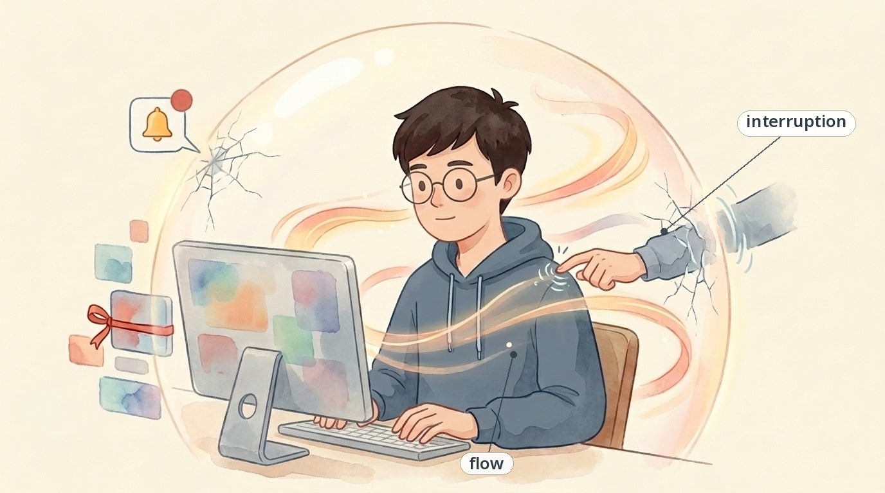

<sub>▲ 心流与中断：留一个“断点”，回来就能续上</sub>

<details><summary>🔬 深一层：大脑在“重建上下文”时做什么</summary>

认知科学把这叫“目标的停用与重新激活”。任务被打断时，大脑会把当前目标暂时搁置；回来时要重新找回目标、回忆进度、重新加载相关细节。有意思的是，**自己主动安排的短暂切换**反而有好处：一项实验发现，在长时间单调任务中偶尔短暂切换一下目标，可以防止注意力随时间下滑（Ariga 2011）。区别在于：主动切换你知道自己停在哪；被动打断你不知道。恢复注释把被动打断变成了“主动存档”。

</details>

**证据有多硬（C）**：
- 软件工程的实证研究（日志分析 + 问卷），说明中断成本真实存在，留标记有助于恢复（Parnin & Rugaber 2011）。
- 认知实验支持“短暂、主动的切换”有助于保持注意力（Ariga 2011）。
- **为什么不是 B**：没有“留恢复注释 vs 不留”的随机对照试验，结局也是工作效率，不是健康。

**程序员场景**：看到产品经理朝你走来，先 Cmd+S，再写一行恢复注释。分工也很清楚：平常的杂事用番茄钟打节奏（见「番茄钟的生理学」），深度任务就护住心流。

**边界**：心流不是所有任务的最佳状态，代码评审、排查疑难问题有时更需要发散思维。也别把“护心流”变成“谁都别找我”，团队协作也是工作。

> **笔者按**：被打断后“我在干嘛来着”的那十秒钟茫然，就是重建上下文在计费。恢复注释是全指南最便宜的一条习惯：一行注释，换回一次快速续传。

<details><summary>📚 参考文献（2 篇）</summary>

1. Parnin C, Rugaber S. Resumption strategies for interrupted programming tasks. *Software Quality Journal*. 2011;19(1):5-34. (DOI: 10.1007/s11219-010-9104-9)
2. Ariga A, et al. Brief and rare mental "breaks" keep you focused: deactivation and reactivation of task goals preempt vigilance decrements. *Cognition*. 2011;118(3):439-43. (PMID: 21211793)

</details>
### 脑内内存管理

> **证据 C ｜ 🧪 可以试** ｜ 痛点：脑子装不下、认知超载 ｜ 十二柱：—

**一句话**：别在脑子里存东西，写下来不是偷懒，是扩容。

**你可能也这样**：脑子里同时挂着三个需求、两个 bug、一个下午的会，还有“记得给妈回电话”。哪件都没忘，但哪件都做不好。

**做法**：把“记在脑子里”改成“记在外面”：
1. 写代码前，先写几行伪代码或步骤。
2. 所有待办都进一个清单（工具不重要，一个就行）。
3. 被打断前留恢复注释（见「写代码与心流」）。
4. 桌上常备一张草稿纸，想到什么先扔上去。

**为什么**：

打个比方：大脑的工作记忆像 CPU 的寄存器，很快，但很少，一次只能放几样东西。你硬塞进去十件事，它就得不停地换进换出，真正用来“算”的空间就没了。把东西写下来，就是把数据从寄存器挪到硬盘上，寄存器腾出来专心计算。

认知科学把这叫“认知卸载”。一篇综述总结了大量实验：人们把“将来要做的事”交给外部提醒（便签、日历、提醒），记得更牢，也更省力（Gilbert 2023）。

反过来，想靠“练脑”给寄存器扩容，基本没戏。一项汇总了几十项研究的分析发现，工作记忆训练只会让你在训练的那个游戏上变强，换到别的任务（比如推理、智力测试）就没有效果了（Melby-Lervåg 2016）。

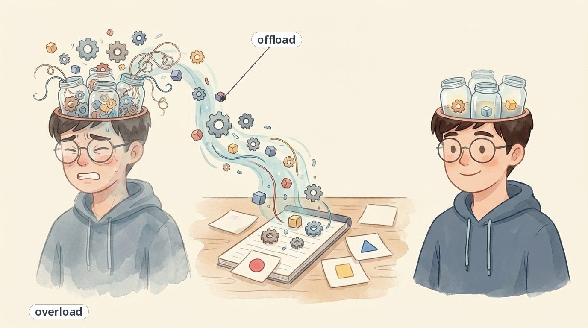

<sub>▲ 脑内内存管理：写下来，就是扩容</sub>

<details><summary>🔬 深一层：卸载会不会让人变“笨”</summary>

有研究担心，什么都交给工具，记忆力会退化。目前的证据更像是“分工”：交给工具的信息，自己记得少一些；但腾出来的资源可以用在别的事上，整体表现往往更好。前提是工具可靠，关键时刻能找回来。

</details>

**证据有多硬（C）**：
- 认知卸载有系统综述支持，但多数是实验室任务（Gilbert 2023）。
- “脑训练不能迁移”有 meta 分析支持（Melby-Lervåg 2016）。
- **为什么不是 B**：没有“写清单”对长期认知或健康影响的随机试验。

**程序员场景**：你早就在这么做了：注释、TODO、白板。这一条只是告诉你，这个直觉有认知科学撑腰，而且比买脑训练 App 靠谱（见「别花冤枉钱」）。

**边界**：卸载不等于不动脑。深入理解一段代码，仍然要把它装进脑子里想。外化的是“记住”，不是“思考”。

> **笔者按**：“写下来就是扩容”，工程师对外部存储的理解比谁都深。倒是那些卖脑训练 App 的，该读读那篇 meta 分析。省下订阅费，买一沓好草稿纸。

<details><summary>📚 参考文献（2 篇，已核对 PubMed）</summary>

1. Gilbert SJ, et al. Outsourcing Memory to External Tools: A Review of 'Intention Offloading'. *Psychon Bull Rev*. 2023;30(1):60-76. (PMID: 35789477)
2. Melby-Lervåg M, et al. Working Memory Training Does Not Improve Performance on Measures of Intelligence or Other Measures of "Far Transfer": Evidence From a Meta-Analytic Review. *Perspect Psychol Sci*. 2016;11(4):512-34. (PMID: 27474138)

</details>
### 番茄钟的生理学

> **证据 C ｜ 🧪 可以试** ｜ 痛点：注意力涣散 ｜ 十二柱：—

**一句话**：番茄钟的本质是节律：专注一阵，恢复一下。25 分钟不是魔法数字。

**你可能也这样**：一坐三小时，最后一小时其实在反复读同一段日志；或者反过来，一会儿看消息一会儿刷网页，一上午什么都没干成。

**做法**：
1. 专注 25 分钟，休息 5 分钟，算一个周期；4 个周期后休息久一点。
2. 休息时离开屏幕：看远处、眨眨眼（见「20-20-20 用眼法则」），站起来走两步（见「30 分钟起身闹钟」）。
3. 数字可以调。写复杂代码时可以改成 50 + 10，关键是有节奏地专注和恢复。

**为什么**：

打个比方：注意力像一块手机电池，持续高负载会掉电、发热。番茄钟不是让电池变大，而是定时插一下充电器。

实验发现，长时间盯着一件单调的事，注意力会随时间下滑；而中间偶尔短暂地切换一下，就能防止这种下滑（Ariga 2011）。这就是“专注—恢复”循环的科学依据。

但要诚实：**“25 分钟”这个数字没有生理学来源**。它来自 Francesco Cirillo 上世纪 80 年代读大学时用的番茄形厨房计时器，是个人习惯，不是实验推导。

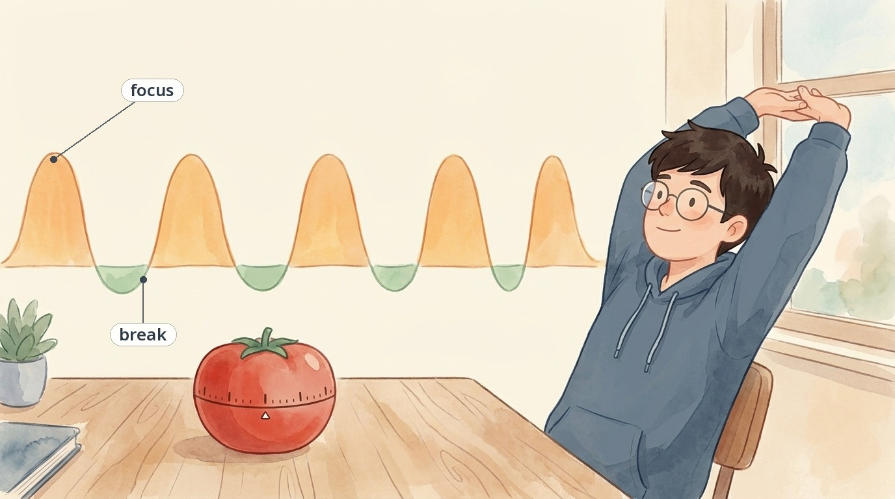

<sub>▲ 强制暂停协议：节律本身就是价值</sub>

<details><summary>🔬 深一层：90 分钟的“超日节律”是真的吗</summary>

睡眠中大约每 90 分钟经历一个周期，这一点证据充分。有学者提出，清醒时注意力也有类似的 90 分钟起伏（“基本休息—活动周期”假说），但白天的证据弱得多，个体差异也大。所以与其迷信某个数字，不如观察自己：什么时候开始反复读同一行，就是该休息的信号。

</details>

**证据有多硬（C）**：
- 短暂休息有助于保持注意力，有实验支持（Ariga 2011）。
- **为什么不是 B**：“25 分钟最优”从来没有被直接验证过，番茄钟本身也缺少高质量的对照试验。

**程序员场景**：把番茄钟当成“强制暂停协议”：铃一响，抬头、眨眼、起身，三件事一次做完。它最大的价值在节律，不在数字。

**边界**：深度编码时被铃声打断也有成本（见「写代码与心流」）。进入心流时，可以把周期拉长，不必教条。

> **笔者按**：我喜欢这一条的诚实：“25 分钟”是一个意大利大学生的个人约定，不是生理学。方法可以工程化，但把工程约定当成自然规律，正是这本指南要反复拆穿的事。

<details><summary>📚 参考文献（2 篇）</summary>

1. Cirillo F. The Pomodoro Technique.（方法源头，非科学文献）
2. Ariga A, et al. Brief and rare mental "breaks" keep you focused: deactivation and reactivation of task goals preempt vigilance decrements. *Cognition*. 2011;118(3):439-43. (PMID: 21211793)

</details>
### 冥想十分钟

> **证据 B ｜ ✅ 去做** ｜ 痛点：压力、焦虑 ｜ 十二柱：H2 端粒 · H11 炎症

**一句话**：每天 10 分钟数呼吸；走神后拉回来，这个动作本身就是训练。

**你可能也这样**：下载过冥想 App，坐了两分钟，脑子里全是需求文档和没回的消息，觉得“我不适合冥想”，就删了。

**做法**：
1. 每天 10 分钟，坐直，闭眼或者看着地面。
2. 注意力放在呼吸上：吸气数 1，呼气数 2，数到 10 再从 1 开始。
3. 走神了很正常。发现走神，就把注意力拉回呼吸。**把注意力拉回来的这个动作，就是训练本身。**

**为什么**：

打个比方：冥想不是“清空大脑”，而是在练习一个函数：`return_to_breath()`。每走神一次、拉回一次，就是调用一次。调用得越多，这个函数跑得越快。你以为“总走神”说明失败，其实那正是在练。

这个练习能实实在在地减轻焦虑。一项汇总了 47 项随机试验的分析发现，正念冥想课程对焦虑、抑郁和疼痛有小到中等程度的改善（Goyal 2014）。专门针对职场的随机试验汇总也发现，正念训练能降低工作压力（Bartlett 2019）。

在分子层面也有一些线索：一项小型汇总分析发现，冥想与端粒酶（帮助维护染色体末端“保护帽”的酶）活性升高相关（Schutte 2014）。注意力和炎症之间的联系，见「注意力能调节炎症」。

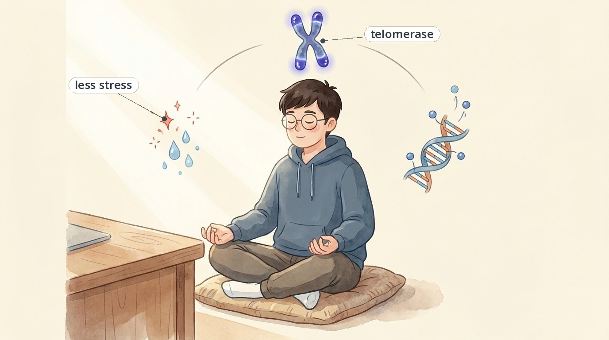

<sub>▲ 冥想十分钟：压力、端粒酶、表观调节信号</sub>

<details><summary>🔬 深一层：从“压力”到“染色体”</summary>

长期压力会让压力激素持续偏高，炎症信号增加，这和端粒变短有关（见「情绪与基因组稳定」）。冥想降低压力反应，理论上可以减轻这条链上的负担。不过，端粒酶的证据来自几项小试验的汇总，更像“方向一致的信号”，不能当成“冥想能延长端粒”的结论。

</details>

**证据有多硬（B）**：
- 改善焦虑、抑郁和压力：多项随机试验与 meta 分析（Goyal 2014；Bartlett 2019）。
- 分子层（端粒酶）：小样本汇总，信号级（Schutte 2014）。
- **为什么不是 A**：效应量中等偏小；很多试验没有可信的“假冥想”对照，难以完全排除安慰剂效应。

**程序员场景**：等编译、两个会之间、睡前，10 分钟不比一集短视频长。

**边界**：冥想不替代精神科治疗。已确诊抑郁症、焦虑症的人，以专业治疗为主，冥想是辅助。少数人在长时间、高强度冥想中会感到不适，出现这种情况就停下来。

> **笔者按**：这一条的心理证据最扎实，分子证据还在早期。哪怕只看“少焦虑一点”，每天 10 分钟也很划算；端粒酶算是附赠的线索，不是买它的理由。

<details><summary>📚 参考文献（3 篇，已核对 PubMed）</summary>

1. Goyal M, et al. Meditation programs for psychological stress and well-being: a systematic review and meta-analysis. *JAMA Intern Med*. 2014;174(3):357-68. (PMID: 24395196)
2. Bartlett L, et al. A systematic review and meta-analysis of workplace mindfulness training randomized controlled trials. *J Occup Health Psychol*. 2019;24(1):108-126. (PMID: 30714811)
3. Schutte NS, et al. A meta-analytic review of the effects of mindfulness meditation on telomerase activity. *Psychoneuroendocrinology*. 2014;42:45-8. (PMID: 24636500)

</details>
---

## 第九章 · 餐桌与补剂

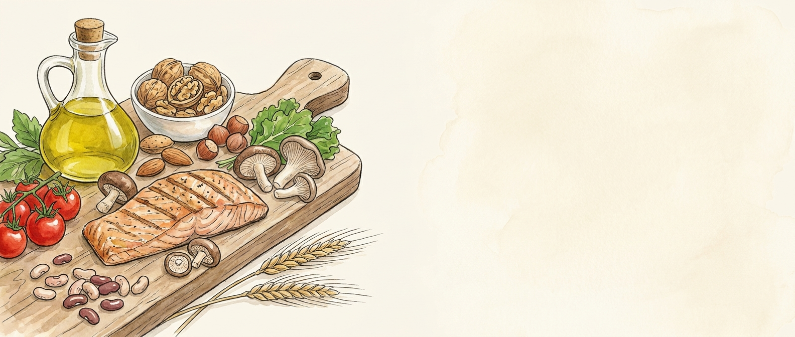

> 坚果、鱼油、DHA、亚精胺、GlyNAC：哪些值得放上餐桌，哪些补剂可以省下，哪些只是写给父母的。

### 坚果一把

> **证据 B ｜ ✅ 去做** ｜ 痛点：每天的零食 ｜ 十二柱：H6 营养感知

**一句话**：每天一小把无盐坚果，大约 28 克，是最好的零食之一。

**你可能也这样**：下午 4 点，抽屉里的薯片、饼干和辣条在召唤你。吃完更饿，还犯困。

**做法**：
1. 每天一小把，约 28 克，差不多是一个手心能托住的量。
2. 选**原味、无盐、无糖、不油炸**的。
3. 核桃、杏仁、开心果、榛子换着吃。

**为什么**：

打个比方：薯片像一次性的高电流，让血糖冲上去又掉下来；坚果像一块稳定的电池，脂肪、蛋白质和纤维让能量慢慢释放。

大规模的人群数据很一致。一项汇总了 18 项前瞻性研究的分析发现，坚果吃得最多的人，比吃得最少的人全因死亡风险低约两成，心血管病死亡风险也更低；而且吃得越多（在适量范围内），风险越低（Chen 2017）。

坚果里的好东西不止一样：不饱和脂肪酸有助于改善血脂，膳食纤维喂养肠道菌群，还有维生素 E、镁和多酚。

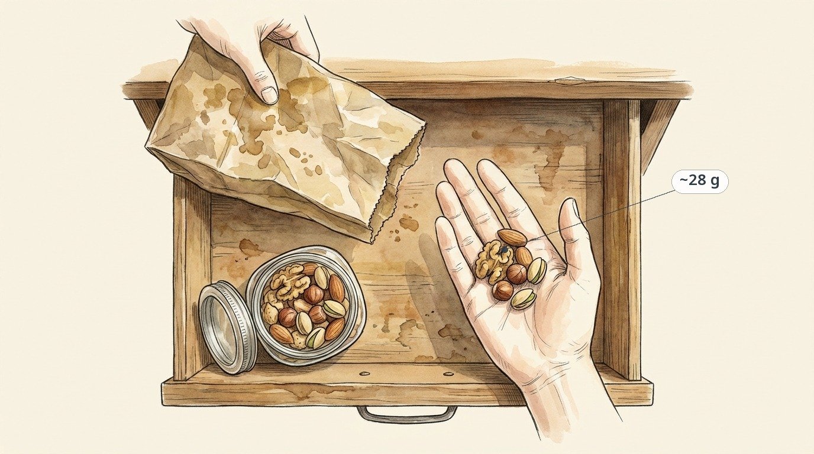

<sub>▲ 坚果一把：把薯片换成一小把无盐坚果</sub>

<details><summary>🔬 深一层：为什么是“一把”，不是“一罐”</summary>

坚果的热量很高，28 克大约 160–200 千卡。研究里的“最高摄入组”大多也就是每天一小把左右。超过这个量，额外的好处不明显，体重却可能上去。所以证据里的剂量，就是“一小把”。

</details>

**证据有多硬（B）**：
- 多项大型前瞻队列与 meta 分析，方向一致，并有剂量-反应关系（Chen 2017）。
- **为什么不是 A**：都是观察性研究，吃坚果的人可能本来就更注意健康，无法完全排除这种混杂。

**程序员场景**：把工位抽屉里的薯片换成一罐无盐混合坚果，再配一个小量勺。每天一勺，不要边写代码边抓，一抓就是半罐。

**边界**：坚果过敏者必须严格避开。盐焗、蜂蜜、琥珀、油炸的“坚果零食”不算数。小孩吃整粒坚果有呛噎风险。

> **笔者按**：全书最好执行的一条，就是把薯片换成坚果。每天一把，混着吃，别一次吃掉半罐。“一小把”不是我的保守，它就是证据里的剂量。

<details><summary>📚 参考文献（1 篇，已核对 PubMed）</summary>

1. Chen GC, et al. Nut consumption in relation to all-cause and cause-specific mortality: a meta-analysis 18 prospective studies. *Food Funct*. 2017;8(11):3893-3905. (PMID: 28875220)

</details>
### Omega-3 与干眼

> **证据 B（大型 RCT 阴性）｜ 食补 🧪；补剂 💸** ｜ 痛点：护眼补剂 ｜ 十二柱：—

**一句话**：干眼可以多吃深海鱼；但最大的鱼油试验是阴性的，别专门花钱买补剂。

**你可能也这样**：眼睛干涩，网上一搜“护眼”，买了一大瓶深海鱼油，吃了两个月，感觉好像有用，又好像没用。

**做法**：
1. 先做免费的：屏幕前多眨眼，每 20 分钟看一次远处（见「20-20-20 用眼法则」）。
2. 食补：每周吃两次深海鱼（三文鱼、鲭鱼、沙丁鱼）。
3. **不建议专门买鱼油治干眼**。已经在吃的，3 个月没感觉就停，不要加量。
4. 干眼严重，去眼科，那里有真正有效的治疗。

**为什么**：

打个比方：鱼油里的 Omega-3（EPA 和 DHA）像一种“消防员”，能平息炎症。干眼和眼表的慢性炎症有关，所以“吃鱼油护眼”听起来很合理。

但听起来合理，不等于真的有用。一些小型试验和汇总分析看到了改善（Wang 2023）。可是规模最大、设计最严格的 DREAM 试验，让 535 名中重度干眼患者每天吃 3000 毫克 EPA + DHA，连续 12 个月，结果和吃橄榄油“安慰剂”的人**改善程度一样**（DREAM 2018）。针对“电脑视觉综合征”的各种干预，系统综述也认为证据有限（Singh 2022）。

当小试验和大试验打架时，一般以大试验为准。

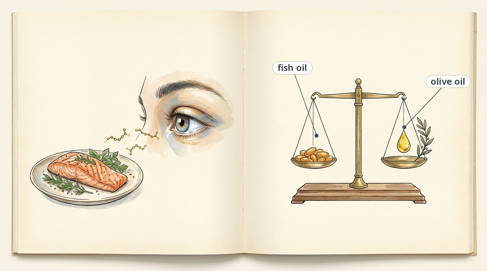

<sub>▲ Omega-3 与干眼：吃鱼可以；大型试验里，鱼油和橄榄油安慰剂打平</sub>

<details><summary>🔬 深一层：为什么小试验容易“有效”</summary>

干眼的主要结局是症状评分，很主观，安慰剂效应很强（DREAM 里两组都改善了不少）。小试验人数少，偶然性大，阳性结果又更容易发表，汇总起来就容易偏向“有效”。DREAM 用了足够大的样本和可信的安慰剂，这些偏差就被压下去了。

</details>

**证据有多硬（B，阴性）**：
- 最大、最严格的随机试验是阴性（DREAM 2018）。
- 小样本试验和 meta 分析偏阳性，证据分裂（Wang 2023；Singh 2022）。
- 结论：吃鱼可以试；为了干眼专门买鱼油，别花这个钱。

**程序员场景**：很多人的顺序是：眼药水 → 鱼油 → 眨眼提醒。应该反过来：先眨眼和看远处，再吃鱼，最后才考虑别的。

**边界**：高剂量鱼油会增加出血倾向，正在吃抗凝药的人要先问医生；做手术前要告诉医生。

> **笔者按**：这是全指南证据最“打架”的一条，我故意留着它。证据分裂时怎么诚实地呈现，本身就是这套分级体系存在的意义。

<details><summary>📚 参考文献（3 篇，已核对 PubMed）</summary>

1. Wang WX, et al. Efficacy of Omega-3 Intake in Managing Dry Eye Disease: A Systematic Review and Meta-Analysis of Randomized Controlled Trials. *J Clin Med*. 2023;12(22). (PMID: 38002640)
2. Singh S, et al. Interventions for the Management of Computer Vision Syndrome: A Systematic Review and Meta-analysis. *Ophthalmology*. 2022;129(10):1192-1215. (PMID: 35597519)
3. Dry Eye Assessment and Management Study Research Group, et al. n-3 Fatty Acid Supplementation for the Treatment of Dry Eye Disease. *N Engl J Med*. 2018;378(18):1681-1690. (PMID: 29652551)

</details>
### APOE4 与长链脂肪酸

> **证据 C ｜ 📖 了解即可（吃鱼可以；为护脑专门买补剂 💸）** ｜ 痛点：基因 × 营养 ｜ 十二柱：H1 基因组

**一句话**：APOE4 携带者的大脑“烧”DHA 更快，但多补 DHA 没换来更好的认知，吃鱼就够了。

**你可能也这样**：做了个基因检测，报告上写着“APOE4 携带者，阿尔茨海默病风险升高”，当晚就在网上下单了三瓶高剂量 DHA。

**做法**：
1. 不用为这个基因焦虑，也不用专门去测。
2. 不管是不是携带者，都把本指南的基本功做扎实：运动（见「Zone 2 快走」）、睡眠（见「睡够 7 小时左右」）、管住血压（见「知道自己的血压」）。
3. 每周吃两次深海鱼。
4. **为了护脑专门买高剂量 DHA 补剂，目前没有证据支持。**

**为什么**：

先说 APOE。它是一种帮身体搬运脂肪的蛋白，有几种“型号”，其中 APOE4 是阿尔茨海默病最常见的遗传风险因素：带的份数越多，风险越高、发病越早（Corder 1993）。

DHA 是大脑里含量最高的 Omega-3 脂肪酸。一项 PET 研究用带标记的 DHA 追踪它进入大脑的过程，发现：**APOE4 携带者的大脑并不是“吃不进”DHA，反而在部分脑区摄取得更多**（约高 16%），研究者认为这说明他们的大脑消耗 DHA 更快（Yassine 2017）。

打个比方：两台电脑都能正常装油，但 APOE4 那台“油耗”更高。

那多补一点，能不能把消耗补回来？2026 年发表的一项随机对照试验给出了答案：365 名有痴呆风险的老人，每天吃 2 克 DHA，持续 24 个月。脑脊液里的 DHA 确实升高了，而且携带者和非携带者升得一样多；**但认知和脑体积都没有比安慰剂组更好**（Yassine 2026）。

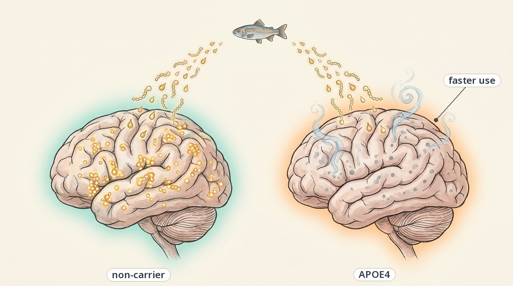

<sub>▲ APOE4 与长链脂肪酸：两个大脑都能吸收 DHA，APOE4 携带者的大脑消耗得更快</sub>

<details><summary>🔬 深一层：“补进去了”不等于“有用了”</summary>

这项试验是营养研究的一个好教材。它先证明了“靶点达到”：补充的 DHA 真的进了中枢神经系统。但下一步“临床获益”没有出现。很多补剂广告停在第一步：“XX 能进入大脑”“XX 能提高血液浓度”，然后直接跳到“所以能护脑”。中间这一跳，恰恰是最需要证据的地方。

</details>

**证据有多硬（C）**：
- APOE4 增加阿尔茨海默病风险：经典遗传学研究，结论稳固（Corder 1993）。
- APOE4 大脑消耗 DHA 更快：一项 22 人的 PET 研究，属于探索性证据（Yassine 2017）。
- 高剂量 DHA 补 2 年：随机对照试验，认知和脑体积无获益（Yassine 2026）。
- **为什么只是“了解即可”**：机制有意思，但目前唯一的干预试验是阴性的。

**程序员场景**：这一条最大的用处是给你装一个“补剂广告检测器”：看到“XX 能进入大脑”，先问一句“然后呢，认知变好了吗？”

**边界**：基因不等于命运，大多数 APOE4 携带者一辈子不会得阿尔茨海默病，可改变的生活方式因素很多。APOE 检测会带来心理压力，也可能涉及保险问题，想测的话，先找遗传咨询。

> **笔者按**：我原本把这一条当成“精准营养”的预告片，核对完最新试验后改了口：APOE4 的大脑确实更“耗油”，但多加油并没有让它跑得更好。这正是营养科学里最常见、也最容易被广告跳过的一步。吃鱼就好，钱留着买跑鞋。

<details><summary>📚 参考文献（3 篇，已核对 PubMed）</summary>

1. Corder EH, et al. Gene dose of apolipoprotein E type 4 allele and the risk of Alzheimer's disease in late onset families. *Science*. 1993;261(5123):921-3. (PMID: 8346443)
2. Yassine HN, et al. DHA brain uptake and APOE4 status: a PET study with [1-(11)C]-DHA. *Alzheimers Res Ther*. 2017;9(1):23. (PMID: 28335828)
3. Yassine HN, et al. CNS target engagement of high-dose DHA supplementation in older adults at risk for dementia: a randomised, double-blind, placebo-controlled trial. *EBioMedicine*. 2026;129:106316. (PMID: 42315445)

</details>
### 亚精胺与小麦胚芽

> **证据 C ｜ 🧪 食补可以试；补剂 💸** ｜ 痛点：想激活自噬 ｜ 十二柱：H5 自噬

**一句话**：亚精胺从小麦胚芽、纳豆、奶酪里吃就好；补剂的人体试验结果并不亮眼。

**你可能也这样**：在短视频里刷到“延寿神物亚精胺，激活细胞自噬，逆转衰老”，一瓶好几百，犹豫要不要买。

**做法**：
1. 食补优先：小麦胚芽（撒在燕麦、酸奶里）、纳豆、陈年奶酪、蘑菇、豆类。
2. 补剂暂时不推荐。人体试验的结果目前还不支持花这个钱。

**为什么**：

先说自噬。打个比方：细胞里也会堆积“垃圾”，比如坏掉的蛋白和老化的线粒体。自噬就是细胞的**垃圾回收机制**，把垃圾拆开、回收再利用。年纪越大，回收越慢。

亚精胺是一种天然存在于食物里的小分子，能启动这套回收机制。在酵母、线虫、果蝇和小鼠身上，补亚精胺都能延长寿命，这部分证据相当扎实。

但到了人身上，结果平淡。一项 12 个月、100 名有记忆力担忧的老人参加的随机对照试验，补充小麦胚芽来源的亚精胺，**主要结局（记忆力）没有改善**，只在一些探索性指标（言语记忆、炎症信号）上看到苗头（Schwarz 2022）。另一项试验给老年男性每天吃 40 毫克亚精胺，血液里的多胺水平几乎没变（Keohane 2024），说明“吃进去”和“到达身体”之间还隔着一段距离。

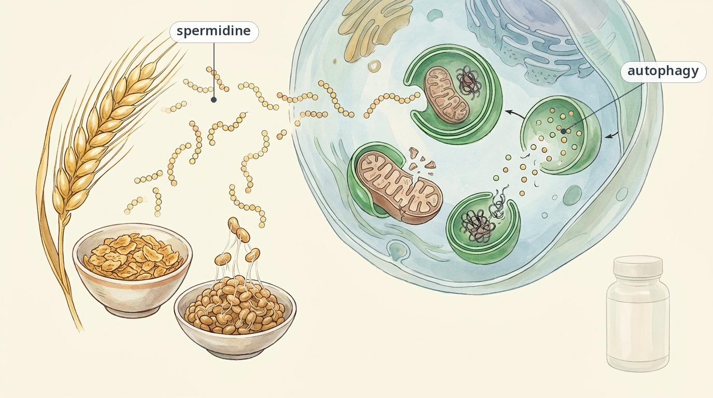

<sub>▲ 亚精胺与小麦胚芽：食物里的亚精胺与自噬</sub>

<details><summary>🔬 深一层：为什么动物有效，人身上不明显</summary>

可能的原因有几个：动物实验的剂量按体重算远高于人能吃到的量；人体肠道菌群本身也会合成多胺，额外补的那点占比不大；而且人的衰老结局要很多年才能看出来，一两年的试验很难捕捉。这些都说明，现在下结论“人吃了能延寿”还太早。

</details>

**证据有多硬（C）**：
- 机制和动物延寿证据强。
- 人体随机试验：主要结局阴性，只有探索性信号（Schwarz 2022）；40 mg 补充对血液多胺影响很小（Keohane 2024）。
- **为什么不是 B**：人体试验少、规模小、主要结局没有达到。

**程序员场景**：早餐的燕麦里加两勺小麦胚芽，成本很低，顺便多了维生素 E 和纤维。它和「甘麦大枣汤与小麦胚芽」说的是同一颗麦粒。

**边界**：补剂的剂量和长期安全性还没有定论；孕期、哺乳期和正在治疗肿瘤的人，不要自行补充。小麦胚芽含麸质，乳糜泻患者要避开。

> **笔者按**：亚精胺是“动物数据很漂亮，人体数据很平淡”的典型。食物里吃，零风险；补剂，等更大的试验。别为一个还没在人身上兑现的故事付溢价。

<details><summary>📚 参考文献（2 篇，已核对 PubMed）</summary>

1. Schwarz C, et al. Effects of Spermidine Supplementation on Cognition and Biomarkers in Older Adults With Subjective Cognitive Decline: A Randomized Clinical Trial. *JAMA Netw Open*. 2022;5(5):e2213875. (PMID: 35616942)
2. Keohane P, et al. Supplementation of spermidine at 40 mg/day has minimal effects on circulating polyamines: An exploratory double-blind randomized controlled trial in older men. *Nutr Res*. 2024;132:1-14. (PMID: 39405978)

</details>
### GlyNAC

> **证据 C ｜ 📖 了解即可（写给父母）** ｜ 痛点：老年补剂组合 ｜ 十二柱：H7 线粒体

**一句话**：GlyNAC（甘氨酸 + NAC）是写给父母看的一条，年轻人不用急。

**你可能也这样**：爸妈的微信群里转来一篇“抗衰老新组合”，问你：“这个靠谱吗？要不要给我们买？”

**做法**：
1. 这一条主要是帮你**回答父母的问题**。
2. 年轻人身体里的谷胱甘肽一般不缺，不需要补。
3. 父母想试，先让医生或药师看看他们正在吃的药，再决定。

**为什么**：

先说谷胱甘肽。打个比方：它是细胞里的“灭火器”，专门处理线粒体（细胞的发电站）产生的“火星”，也就是氧化损伤。年纪大了，灭火器里的药剂会变少。

谷胱甘肽由三种原料组成，其中甘氨酸和半胱氨酸在老年人身上常常不够。GlyNAC 就是同时补上这两种原料：甘氨酸，加上能变成半胱氨酸的 NAC（N-乙酰半胱氨酸）。

美国贝勒医学院的一个团队做了一系列研究：先在老年 HIV 感染者身上做了开放标签试验（Kumar 2020），又在普通老人中做了先导试验（Kumar 2021），最后做了一项随机对照试验（Kumar 2023）。结果方向一致：补充后，老人的谷胱甘肽水平、氧化损伤、线粒体功能、体能等多项指标都有改善。

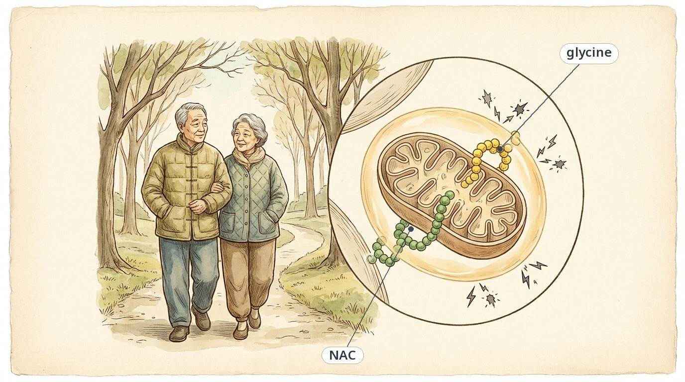

<sub>▲ GlyNAC：甘氨酸 + NAC，为线粒体补上谷胱甘肽护盾</sub>

<details><summary>🔬 深一层：为什么不直接吃谷胱甘肽</summary>

口服的谷胱甘肽大部分会在肠道里被拆开，很难原样进入细胞。细胞更习惯自己用原料现做。所以补原料（甘氨酸 + 半胱氨酸）比直接补成品更合理，这也是 GlyNAC 的思路。NAC 的另一个用途见「NAC 与化痰」。

</details>

**证据有多硬（C）**：
- 三项研究方向一致，其中有一项随机对照试验（Kumar 2023）。
- **为什么不是 B**：全部来自同一个团队、同一个中心，样本都只有几十人甚至更少；第一项研究的对象是老年 HIV 感染者；还需要其他团队独立重复。

**程序员场景**：父母的补剂清单里，GlyNAC 的证据比大多数“抗衰网红产品”扎实一些。但“扎实一些”不等于“已经证实”，帮他们先问医生。

**边界**：只有老年人的数据。NAC 可能和某些药物（例如硝酸甘油）相互作用，有哮喘的人也要谨慎，用之前请药师审核。

> **笔者按**：这一条不是为码农自己写的，是为你爸妈写的。贝勒团队的系列研究方向一致，但还缺独立复制。我的建议是：了解它，能回答父母的问题；真要吃，先过医生那一关。

<details><summary>📚 参考文献（3 篇，已核对 PubMed）</summary>

1. Kumar P, et al. Supplementing Glycine and N-acetylcysteine (GlyNAC) in Aging HIV Patients Improves Oxidative Stress, Mitochondrial Dysfunction, Inflammation, Endothelial Dysfunction, Insulin Resistance, Genotoxicity, Strength, and Cognition: Results of an Open-Label Clinical Trial. *Biomedicines*. 2020;8(10). (PMID: 33007928)（研究对象为老年 HIV 感染者）
2. Kumar P, et al. Glycine and N-acetylcysteine (GlyNAC) supplementation in older adults improves glutathione deficiency, oxidative stress, mitochondrial dysfunction, inflammation, insulin resistance, endothelial dysfunction, genotoxicity, muscle strength, and cognition: Results of a pilot clinical trial. *Clin Transl Med*. 2021;11(3):e372. (PMID: 33783984)
3. Kumar P, et al. Supplementing Glycine and N-Acetylcysteine (GlyNAC) in Older Adults Improves Glutathione Deficiency, Oxidative Stress, Mitochondrial Dysfunction, Inflammation, Physical Function, and Aging Hallmarks: A Randomized Clinical Trial. *J Gerontol A Biol Sci Med Sci*. 2023;78(1):75-89. (PMID: 35975308)

</details>
---

## 第十章 · 别花冤枉钱

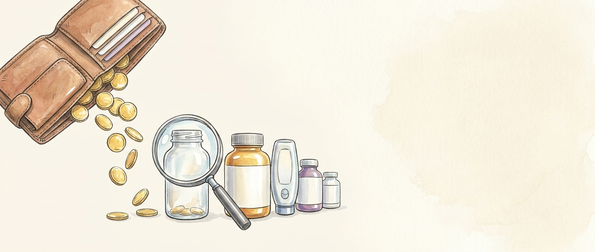

这一章专门讲“花钱买的东西”。标准只有一条：**证据撑不撑得起价格**。每一项都用全书的两把尺子打分，结论从严。

先送你一个“补剂广告检测器”，五条里中两条，就先别掏钱：

1. **只说“能进入、能升高”，不说“然后呢”**。血液里某个指标升高了，不等于人更健康、更年轻了（见「APOE4 与长链脂肪酸」）。
2. **拿动物数据当人类结论**。小鼠延寿和人延寿之间，隔着很多年和很多失败的试验。
3. **只有一两项小样本、厂家资助的人体试验**。
4. **满口“频率、能量、排毒、共振”**，却说不清测的是什么。
5. **价格和证据倒挂**：越贵的东西，证据往往越薄；最便宜的那些（走路、睡觉、晒太阳）证据最硬。

> 🖼 钱该花在哪：一双跑鞋、一个笔记本支架、一个放在卧室的老式闹钟、一罐无盐坚果、一个家用血压计。全书证据最硬的那些事，大多不花钱或花很少的钱（见「续命十块大石头」）。

### NMN 与 NR：血液里的数字升了，不等于人年轻了

> **证据 C（小样本人体，替代指标）｜ 💸 别花钱**

**广告怎么说**：补充“NAD⁺ 前体”，逆转衰老，恢复年轻时的能量。

**证据怎么说**：NAD⁺ 是细胞发电（线粒体）离不开的一种分子，年纪越大越少，这一点是真的。NMN 和 NR 吃下去，血液里的 NAD⁺ 确实能升高：一项 30 名中老年人参加的试验，每天 1000 毫克 NR，6 周后血液 NAD⁺ 升高约六成，但血压、体能等指标没有明确改善（Martens 2018）。另一项 25 名糖尿病前期女性的试验，每天 250 毫克 NMN，10 周后肌肉对胰岛素更敏感了，其他指标基本没变（Yoshino 2021）。

**结论**：没有任何试验证明它让人更长寿或“更年轻”。一个月几百上千元，换来的是一个升高的血液数字。

**钱该花在哪**：「Zone 2 快走」本身就能让线粒体变多、变强，免费。

### 大剂量抗氧化剂：吃多了可能有害

> **证据 A（Cochrane 系统综述）｜ 💸 别花钱**

**广告怎么说**：自由基导致衰老，抗氧化剂越多越好。

**证据怎么说**：这是被大型试验推翻得最彻底的一个说法。一项芬兰研究给近三万名男性吸烟者补 β-胡萝卜素，结果肺癌发病**反而增加了约 18%**（ATBC 1994）。Cochrane 汇总了 78 项随机试验、近 30 万人：抗氧化剂补充没有降低死亡率；在设计最严谨的那些试验里，β-胡萝卜素、维生素 E 和较高剂量的维生素 A 还可能**增加**死亡风险（Bjelakovic 2012）。

**结论**：从蔬果里吃抗氧化物质没问题；单独吃大剂量的补剂，别花钱，还可能有害。

**钱该花在哪**：多买蔬菜水果。

### 大剂量维生素 C：防不住感冒，也抵不掉熬夜

> **证据 A（Cochrane 系统综述）｜ 💸 别花钱**

**广告怎么说**：每天几克维生素 C，预防感冒、增强免疫、对冲熬夜。

**证据怎么说**：Cochrane 汇总的结果：普通人每天规律补充维生素 C，**感冒的次数并不会减少**，只是病程平均缩短约 8%；感冒以后才开始吃，基本没用。只有马拉松运动员、士兵这类身体压力极大的人，预防感冒的效果比较明显（Hemilä 2013）。熬夜这件事，见「熬夜与维生素 C」：它只能缓冲一小块氧化损伤。

**结论**：从蔬果里吃够就行。几克一天的大剂量，多出来的会被排掉，还可能拉肚子、增加肾结石风险。

### 防蓝光眼镜：眼睛累，不是因为蓝光

> **证据 B（Cochrane 系统综述）｜ 💸 别花钱**

**广告怎么说**：屏幕蓝光伤眼，戴防蓝光眼镜缓解眼疲劳、保护视网膜、改善睡眠。

**证据怎么说**：Cochrane 汇总了 17 项随机试验：和普通镜片相比，防蓝光镜片**可能并不能减轻**用电脑带来的眼疲劳；对睡眠和保护黄斑，也没有可靠证据（Singh 2023）。眼睛累，主要是因为盯着近处、眨眼变少（见「20-20-20 用眼法则」）。

**结论**：别为“防蓝光”多花钱。想睡得好，睡前放下屏幕比戴眼镜管用（见「睡前 1 小时屏幕宵禁」）。

### 为干眼买鱼油，为护脑买 DHA

> **证据 B（大型 RCT 阴性）｜ 💸 别花钱**

最大的干眼鱼油试验，鱼油和橄榄油安慰剂打平（见「Omega-3 与干眼」）；为 APOE4 携带者护脑的高剂量 DHA 试验，DHA 进了大脑，认知却没变好（见「APOE4 与长链脂肪酸」）。**吃鱼可以，专门买补剂别花钱。**

### 亚精胺补剂

> **证据 C ｜ 💸 别花钱**

两者都是“机制和动物数据漂亮，人体数据平淡”。亚精胺补剂的人体试验主要结局阴性（见「亚精胺与小麦胚芽」）。**食物里吃，零风险；补剂，等更大的试验。**

### 40Hz 声光设备

> **证据 C ｜ 📖 了解即可；买设备 💸**

40Hz 是近几年最有意思的脑科学发现之一，但人体证据还停留在阿尔茨海默病患者的早期试验（见「40Hz 声光节拍」）。市面上的“40Hz 健脑灯”“40Hz 健脑耳机”，参数和试验里用的不一定一样，健康人用了能不能“健脑”，没有证据。

### 脑训练 App

> **证据 A（meta 分析：不能迁移）｜ 💸 别花钱**

工作记忆训练只会让你在那个游戏上变强，换到别的任务就没有效果（见「脑内内存管理」）。2016 年，美国联邦贸易委员会（FTC）还因为“健脑”宣传缺乏证据，与知名脑训练品牌 Lumosity 达成 200 万美元的和解。想让脑子好用，把东西写下来，再睡够觉。

### 颂钵、“频率疗愈”课程

> **证据 C ｜ 🧪 当放松可以试；为“频率疗愈”付费 💸**

颂钵的声音让人放松，这是真实的体验；但“某个频率修复细胞、调频脉轮”没有任何证据（见「颂钵」）。当成一种放松方式，和听音乐、泡澡一样就好；动辄几千元的“疗愈课程”，别花这个钱。

### 反复花钱测“生物年龄”

> **证据 C ｜ 📖 了解即可 ｜ ⚠️ 利益相关**

利益声明：我做的就是生物年龄检测（见「甲基化时钟」「一张脸能读出你的生物年龄」），所以这一条写得格外小心。

生物年龄是一个“读数”，不是“诊断”：它告诉你身体大概走到了哪里，但不能代替体检，也不会告诉你具体哪里出了问题。测一次，有一个基线就够了；改了生活方式，过一两年再测一次看趋势。**一个月测一次没有意义**，读数本身有误差，短期的波动说明不了什么。

> **笔者按**：一本讲“续命”的指南，专门留一章劝你别花钱，听起来有点自砸饭碗，尤其是我自己还在做检测。但我相信，帮你省下买错东西的钱，你才会相信我推荐的那些东西。

<details><summary>📚 参考文献（6 篇，已核对 PubMed）</summary>

1. Martens CR, et al. Chronic nicotinamide riboside supplementation is well-tolerated and elevates NAD(+) in healthy middle-aged and older adults. *Nat Commun*. 2018;9(1):1286. (PMID: 29599478)
2. Yoshino M, et al. Nicotinamide mononucleotide increases muscle insulin sensitivity in prediabetic women. *Science*. 2021;372(6547):1224-1229. (PMID: 33888596)
3. Alpha-Tocopherol, Beta Carotene Cancer Prevention Study Group. The effect of vitamin E and beta carotene on the incidence of lung cancer and other cancers in male smokers. *N Engl J Med*. 1994;330(15):1029-35. (PMID: 8127329)
4. Bjelakovic G, et al. Antioxidant supplements for prevention of mortality in healthy participants and patients with various diseases. *Cochrane Database Syst Rev*. 2012;2012(3):CD007176. (PMID: 22419320)
5. Hemilä H, et al. Vitamin C for preventing and treating the common cold. *Cochrane Database Syst Rev*. 2013;2013(1):CD000980. (PMID: 23440782)
6. Singh S, et al. Blue-light filtering spectacle lenses for visual performance, sleep, and macular health in adults. *Cochrane Database Syst Rev*. 2023;8(8):CD013244. (PMID: 37593770)

</details>

---

## 第十一章 · 续命十二柱

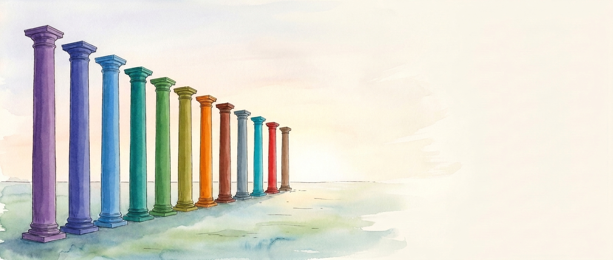

本指南的科学骨架，是 2023 年 *Cell*《Hallmarks of Aging》提出的十二大衰老标志。每一节建议，最终都对应得上某一根柱子。

> López-Otín C, Blasco MA, Partridge L, et al. Hallmarks of aging: An expanding universe. *Cell*. 2023;186(2):243-278. (PMID: 36599349)

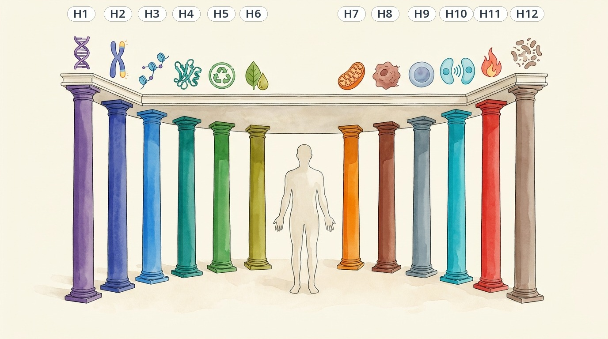

<sub>▲ 续命十二柱：十二种衰老机制，每根柱子一个固定颜色，全书沿用</sub>

| 柱 | 衰老标志 | 对应小节 |
|---|---|---|
| H1 | 基因组不稳定 | 情绪与基因组稳定 · 学新东西时大脑会剪断 DNA · APOE4 与长链脂肪酸 |
| H2 | 端粒损耗 | 冥想十分钟（端粒酶）· 情绪与基因组稳定 |
| H3 | 表观遗传改变 | 甲基化时钟 · 冥想十分钟（表观调节信号） |
| H4 | 蛋白稳态丧失 | 八段锦与筋 |
| H5 | 自噬失能 | 亚精胺与小麦胚芽 · GlyNAC · 甘麦大枣汤与小麦胚芽 |
| H6 | 营养感知失调 | 坚果一把 · 醋与乙酸 · 30 分钟起身闹钟 |
| H7 | 线粒体功能障碍 | Zone 2 快走 · 阳气与线粒体 · 麦角硫因与蘑菇 |
| H8 | 细胞衰老 | 情绪与基因组稳定（慢性压力→p16 衰老细胞） |
| H9 | 干细胞耗竭 | 暂时没有生活方式层面的证据抓手，诚实留白 |
| H10 | 细胞间通讯改变 | 注意力能调节炎症（神经—免疫对话）· 面颈部淋巴按摩（脑—淋巴引流）· 40Hz 声光节拍 |
| H11 | 慢性炎症 | 麦角硫因与蘑菇 · NAC 与化痰 · 甘麦大枣汤与小麦胚芽 · 冥想十分钟（炎症基因） |
| H12 | 菌群失调 | 醋与乙酸（短链脂肪酸路径） |

> 十二根柱子，十一根有抓手，一根诚实留白。等证据走到那一步，我们再说到那一步。
>
> 📖 延伸阅读：熊博士博客[《抗衰防病五道防线》](https://xiongjianghui.com/zh/blog/five-defense-aging-framework)：五道防线和十二柱，是同一张地图的两种画法。


---

# 附录

## 术语表

| 术语 | 一句话解释 |
|---|---|
| RCT（随机对照试验） | 随机分组，一组干预、一组对照，比较结果。判断因果最可靠的方法之一 |
| 队列研究 | 长期跟踪一大群人，看谁得了什么病。能发现关联，但不能单独证明因果 |
| 荟萃分析（meta 分析） | 把多项研究的数据合起来再算一遍，结论更稳 |
| 硬终点 / 替代指标 | 硬终点是死亡、心梗这类真实结局；替代指标是血糖、血脂这类“中间读数” |
| 全因死亡率 | 不论什么原因的死亡都算在内的死亡率，衡量寿命最直接的指标 |
| 昼夜节律 / 生物钟 | 身体内部约 24 小时的周期，管着睡眠、激素、体温 |
| 褪黑素 | 大脑在天黑后分泌的“该睡了”信号 |
| 线粒体 | 细胞里的“发电厂”，把食物变成能量 |
| 自噬 | 细胞自己回收旧零件的过程，像内存回收 |
| 端粒 | 染色体末端的“保护帽”，每分裂一次变短一点 |
| DNA 甲基化 | 给基因贴“静音/开启”标签的化学修饰，不改变 DNA 序列本身 |
| 表观遗传时钟 | 用 DNA 甲基化模式估算“生物年龄”的模型 |
| 慢性炎症 | 低强度、长期不退的炎症，被认为是衰老的推手之一 |
| 氧化应激 | 体内“生锈”的反应太多、清理不过来的状态 |
| 衰老细胞 | 停止分裂但不退场的细胞，还会释放炎症信号 |
| 肠道菌群 | 肠道里数以万亿计的微生物，参与消化、免疫和代谢 |
| 短链脂肪酸（SCFA） | 肠道菌群发酵膳食纤维的产物，滋养肠道 |
| 类淋巴系统 | 大脑清运代谢废物的通道，主要在睡眠时工作 |
| APOE4 | 一种常见的基因变体，与阿尔茨海默病风险升高相关 |
| 心流 | 全神贯注、忘记时间的工作状态 |


## 编程比喻对照表

| 身体 | 程序员的说法 | 用在 |
|---|---|---|
| 生物钟 + 晨光 | NTP 校时 | 「晨光 10 分钟」|
| 睡眠 | 垃圾回收（GC）+ 夜间批处理 | 「睡眠债偿还表」「睡前 1 小时屏幕宵禁」「睡够 7 小时左右」 |
| 睡眠债 | 技术债：利息复利，周末一次还不清 | 「睡眠债偿还表」|
| 自噬 | 内存回收 / 清理缓存 | 「亚精胺与小麦胚芽」「GlyNAC」|
| 慢性炎症 | 内存泄漏：不报错，但越跑越慢 | 「情绪与基因组稳定」「NAC 与化痰」|
| DNA 损伤与修复 | 写坏的数据块 + 自动纠错 | 「情绪与基因组稳定」「学新东西时大脑会剪断 DNA」|
| 端粒 | 写入次数有限的存储（SSD 寿命） | 「冥想十分钟」「情绪与基因组稳定」|
| DNA 甲基化 | 配置文件里的开关，代码不变，行为改变 | 「甲基化时钟」|
| 表观遗传时钟 | 监控面板上的“系统运行时长”估算 | 「甲基化时钟」「一张脸读出生物年龄」|
| 线粒体 | 电源模块 | 「Zone 2 快走」「阳气与线粒体」|
| 工作记忆 | 内存 / 寄存器；写下来是“落盘” | 「脑内内存管理」|
| 被打断 | 上下文切换开销 | 「写代码与心流」|
| 十二大衰老标志 | 系统架构图上的十二个模块 | 十二柱 |
| 血压 / 血脂 / 血糖 | 生产环境的核心监控指标 | 「知道自己的血压」「看懂体检里的血脂和血糖」 |

## 配图规范

**目标**：像生物学经典教科书的插图那样，让人看一眼就想读下去；同时一眼能看懂，经得起专家挑错。

**三类图**

| 类型 | 用途 | 风格 | 工具 |
|---|---|---|---|
| 场景图 | 痛点 / 做法（程序员在工位、在床上、在楼下） | 统一的吉祥物角色，扁平插画 | AI 生成底图 + 人工修 |
| 机制图 | 一张图讲一个机制（光→生物钟、久坐→血糖） | 参考 David Goodsell 式分子水彩：柔和、准确、有尺度感 | AI 底图 + 专家审核 + 矢量标注 |
| 证据图 | 剂量-反应曲线、风险对比 | 干净的数据图 | 脚本生成，可复现（matplotlib） |

**规则**
1. **图里只放必要的英文关键词**：每张 1–4 个，越短越好（一两个词）。AI 出图本身不带字，关键词由脚本 `figures/label_figs.py` 叠加（原图在 `figures/_raw/`），保证拼写准确、风格统一。
2. **一图一点**：每张图只讲一个能验证的科学点；出处写在正文参考文献里。
3. **统一视觉**：固定的主色、吉祥物、线宽；十二柱每根柱子一个固定颜色，全书沿用。
4. **科学审核**：机制图逐张检查结构是否正确（线粒体嵴、DNA 右手螺旋、细胞比例、器官位置），审核记录写在配图清单里。
5. **许可证**：确认所用 AI 工具的生成内容条款，与 CC BY-NC-SA 4.0 兼容，并在仓库注明“AI 辅助生成 + 人工审核”。

**提示词模板（机制图）**
```
Scientific textbook illustration, David Goodsell-inspired soft watercolor style,
[主题：例如 morning light entering the eye, signal traveling to the brain's master clock],
clean composition, one focal point, accurate anatomy, muted palette with [柱子主色] accent,
white background, no text, no labels, no letters
```
## 续命工具箱

- **30 秒症状自测**：[DeepKang 症状探索器](https://a.deepkang.com/explore)。免费、匿名、无需注册。输入一个症状（如“眼干”“腰酸”“睡不好”），30 秒看到它常和哪些症状一起出现、常见原因方向，并生成一份可以带给医生看的梳理小结。
  > ⚠️ 利益相关：DeepKang 是维护方 DeepoMe 的产品。

## 关注与更新

**GitHub 是本指南的家**：star/watch 获取每次更新，Issue 征题与纠错。

新条目在公众号首发，GitHub 同步归档。扫码关注：

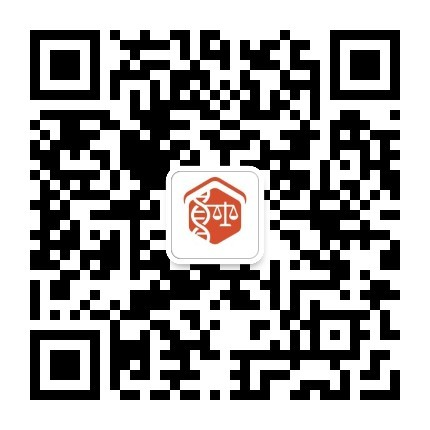

## 贡献指南

欢迎 PR 投稿新条目，格式要求：
1. **一节一事，不编号**：每个小节是独立模块，引用其他小节写「小节名」。
2. **按模板 v2**：一句话 / 你可能也这样 / 做法 / 为什么（先比喻，再机制）/ 深一层（折叠）/ 证据有多硬 / 程序员场景 / 边界 / 参考文献（折叠）。范例见「晨光 10 分钟」。
3. **文献必须可查证**：只收真实的 PMID 或 DOI，CI 会自动核对，伪造引用直接关闭。
4. **双尺子从严标注**：证据强度 A–D + 行动建议 ✅🧪📖💸；说不清就往低标。
5. 欢迎对现有条目提出等级异议，证据更新时我们会修订。
6. **行文**：从感受和场景入手，再逐步引入机制；第一屏不出现专业术语，术语链接到术语表。
7. **延伸阅读**：可以引用[深度甲基公众号](https://mp.weixin.qq.com/s/yG0bg0ht0oOEBFSQOtPGWA)科普文章和[熊博士博客](https://xiongjianghui.com)长文，仅作延伸阅读，不替代一手文献，必须是已发布文章的真实链接。
8. **配图**：遵循[配图规范](#配图规范)：场景图、机制图可以用 AI 辅助，但图内只放必要的英文关键词、机制图必须过科学审核；数据类的证据图一律用脚本生成，保证可复现。

## 关于熊博士

<details><summary>熊博士是谁（姓名 · 机构 · 论文）</summary>

**熊博士**（熊江辉），[DeepoMe 深度甲基](https://deepome.com)创始人，长寿医学智能方向研究者。做这个指南只有一个规矩：**证据走到哪一步，就说到哪一步**，这条规矩同样约束我们自己。

- ✍️ [熊博士博客 · xiongjianghui.com](https://xiongjianghui.com)：个人官网，方法论与行业观察长文
- 🌐 [DeepoMe 深度甲基](https://deepome.com)：把长寿科学工程化为可交付的体系
- 🧬 [DeepKang 健康平台](https://deepkang.com) / [症状探索器](https://a.deepkang.com/explore)
- 💻 [GitHub · DeepoMe](https://github.com/DeepoMe)：论文配套代码与数据工具
- 📄 代表论文：RootMap（[DOI: 10.32388/A1NTLL](https://doi.org/10.32388/A1NTLL)）
- 📢 公众号科普：[衰老检测不该只是一个值：从行动仪表盘到个人长寿操作系统](https://mp.weixin.qq.com/s/yG0bg0ht0oOEBFSQOtPGWA)

</details>

## 声明

**本指南是健康教育与科普内容，不是医疗服务，不构成医疗建议、诊断或治疗方案。**

1. 本指南不进行疾病诊断、不提供治疗方案、不开具处方；涉及的检查指标解读请以主治医师意见为准。
2. 任何条目（包括标 ✅ 去做的）都不能替代就医。已有疾病、正在服药、孕哺期、未成年者，采用任何干预前请咨询医师。
3. 补剂、中药（含药食同源类）条目均为证据科普，**不构成购买或服用建议**；药品类条目（如 NAC）请严格遵医嘱，不要自行购买服用。
4. 个体差异真实存在：同一干预在不同基因型、年龄、健康状况下效果可能不同，证据等级标的是人群平均，不是对你的承诺。
5. 出现急症（胸痛、呼吸困难、意识改变、突发剧烈头痛等）请立即就医，不要查阅本指南。
6. 基因相关信息（如 APOE4）仅为科学介绍，本指南不建议任何人为用药目的自行做基因检测。

维护方为 [DeepoMe 深度甲基](https://deepome.com)，利益关系见[利益冲突声明](#利益冲突声明)。

## License

文字与配图：[CC BY-NC-ND 4.0](https://creativecommons.org/licenses/by-nc-nd/4.0/)（署名-非商业-禁止演绎），全文见 [LICENSE](LICENSE)。配图为 AI 辅助生成 + 人工审核，许可同上（待确认生成工具条款，见配图规范第 5 条）。


---
